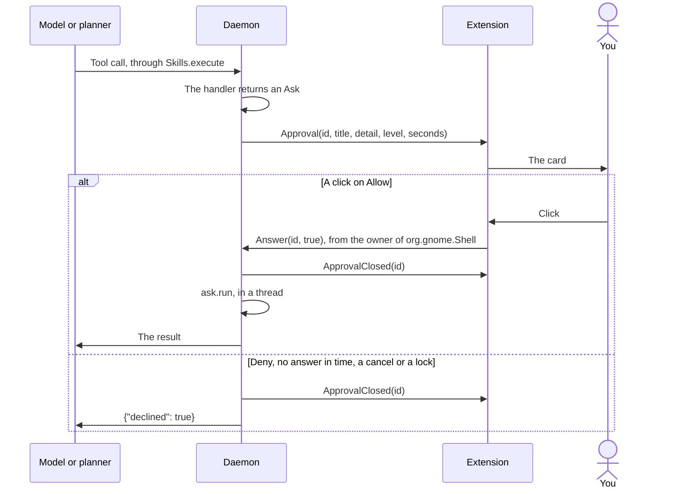

# Tuxistant component contract

The single source of truth for how the parts fit together. Change it here first.

## Layout

| Path | Owner |
|---|---|
| `tuxistant/` | Python daemon, CLI, Settings app. Runs on system `python3` (3.14), deps: dbus_fast, websockets, PyYAML, gi (Gtk 4, Adw 1) |
| `extension/tuxistant@buengenio/` | GNOME Shell 50 extension (blob, hotkey, status icon, right-click menu) |
| `themes/<id>/` | Bundled themes (`theme.json`, `shader.glsl`). User themes: `~/.local/share/tuxistant/themes/<id>/` |
| `helper/` | Fn-key helper + its systemd system unit |
| `packaging/`, `install.sh` | User units, D-Bus activation file, installer |
| `tests/` | stdlib unittest. No test may need a real mic, speaker, or the user's GNOME session. See [TESTING.md](TESTING.md) |
| `tools/` | `try-nested.sh`, `docs_images.py` for the pictures in the docs, and the live evaluations `eval_routing.py`, `eval_flows.py` and `check_voices.py` |
| `website/` | The static site. See [its README](../website/README.md) |

## D-Bus

Session bus. Name `org.tuxistant.Daemon`, path `/org/tuxistant/Daemon`, interface `org.tuxistant.Daemon`.
Structured values are JSON strings. The daemon is D-Bus activatable.

Methods:

| Method | Signature | Meaning |
|---|---|---|
| `Toggle` | `() -> ()` | idle: start a VAD turn. Active: cancel |
| `HoldStart` | `() -> ()` | Start a push-to-talk turn |
| `HoldEnd` | `() -> ()` | Stop the mic, get the words, then answer a fact or ask the voice model. See "Facts" |
| `Cancel` | `() -> ()` | Stop everything, back to idle |
| `DictateStart` | `() -> ()` | Start dictating, from the shell only. See "Dictation" |
| `DictateEnd` | `() -> ()` | Stop listening and type what was said |
| `DictateToggle` | `() -> ()` | `DictateStart`, or `DictateEnd` if already dictating |
| `GetState` | `() -> s` | Current state |
| `GetConfig` | `() -> s` | `Config.public()` as JSON; never contains the API key, the Cloud key, the TP-Link password or the Home Assistant token, only whether each is set |
| `SetConfig` | `(s key, s json_value) -> ()` | Validated by `Config.set`; emits `ConfigChanged`. A new `server` clears `api_key`: a key only goes to the server it was given for. In the same way a new `ha_server` clears `ha_token` |
| `ListVoices` | `() -> s` | `voices.catalog()` |
| `PreviewVoice` | `(s voice) -> ()` | Speak a short sample in that voice, without changing config. Replies once it has been spoken; a failure is a D-Bus error |
| `Say` | `(s text) -> ()` | Speak text in the configured voice |
| `ListThemes` | `() -> s` | `{"themes": [...], "problems": [...]}` from `themes.discover()`. Can take seconds: allow 30 |
| `PreviewTheme` | `(s id) -> ()` | Emit `ThemePreview` |
| `ListSkills` | `() -> s` | `Skills.listing()` of the skills loaded now. Each entry has `source`: `built-in`, `bundled` (a code skill that ships with Tuxistant) or `yours` |
| `ReloadSkills` | `() -> s` | Read the skills again now, as the folder watcher does on its own. Returns `{path: problem}` as JSON, `{}` if all loaded. A skill that fails keeps its last version that worked. Emits `SkillsChanged` |
| `ListPhones` | `() -> s` | `phone.devices()`: `[{"id", "name", "type", "connected", "paired"}]`, empty without GSConnect |
| `ListCalendars` | `() -> s` | `calendars.writable()`: `[{"id", "name", "account"}]` for each calendar an event can be added to. Without Evolution Data Server or its Python bindings it sends `{"problem": text}` instead, the same sentence the voice says (`calendars.NO_EDS`), and Settings shows that text in place of the advice to add an account. It connects to each calendar, so allow 30 seconds |
| `Hello` | `(i level) -> ()` | From the extension when the daemon comes online: `level` is 1 if it can draw approval cards, 2 if it can also type dictated text. 0 on the way out, which also stops dictation |
| `CanAsk` | `() -> b` | Whether an extension has said level 1. Without one, `Controller.ask` refuses at once and the user hears why |
| `CanType` | `() -> b` | Whether an extension has said level 2. Without one, dictation says why and never opens the microphone |
| `Answer` | `(s id, b allow) -> ()` | The click on an approval card. An unknown id does nothing. `Hello`, `Answer`, `SelectionText`, `Typed` and the three `Dictate` methods are refused from anyone but the current owner of `org.gnome.Shell`, checked before dispatch by `Daemon.guard` |
| `SelectionText` | `(s id, s text) -> ()` | Reply to `SelectionWanted` |
| `Typed` | `(s id, s how) -> ()` | Reply to `TypeText`: `typed`, `pasted`, `copied` or `refused` |
| `GetHistory` | `(i limit) -> s` | `History.recent()` |
| `ClearHistory` | `() -> ()` | Emits `HistoryChanged` |
| `OpenSettings` | `() -> ()` | Launch `tuxistant settings` |

Signals:

| Signal | Signature | Meaning |
|---|---|---|
| `StateChanged` | `s` | `idle`, `connecting`, `listening`, `thinking`, `speaking`, `error` |
| `Presence` | `b` | Whether the blob should be visible. False after Fn release when `hide_on_release` is on, even while the reply is still being processed and spoken |
| `Level` | `d` | 0..1 audio level, 25 to 30 Hz while listening or speaking |
| `Transcript` | `s text, b final` | What the user said |
| `Reply` | `s` | What Tux is saying |
| `Error` | `s` | Human-readable problem to show |
| `ConfigChanged` | `s key` | A setting changed |
| `ThemePreview` | `s id` | Show this theme for about 4 s, cycling through states |
| `HistoryChanged` | none | History was added to or cleared |
| `SkillsChanged` | none | A reload swapped in new skills. The next turn uses them; a turn already going keeps the ones it started with |
| `Approval` | `s id, s title, s detail, s level, i seconds` | Show the approval card. `level` is `click` or `admin` (runs as root). No answer within `seconds` is a no |
| `ApprovalClosed` | `s id` | Take the card down: answered, timed out or cancelled |
| `SelectionWanted` | `s id` | Send the selected text, or else the clipboard text, to `SelectionText` |
| `DictationStarted` | `s id` | Note the focused window: the words are for that one |
| `TypeText` | `s id, s text, b only_copy` | Put the words where the cursor is, then reply with `Typed`. Sent to the shell alone, not broadcast. `only_copy` is true after the time limit |

## Locked screen

GNOME Shell disables the extension at lock, so the daemon follows `ActiveChanged` and `GetActive` of `org.gnome.ScreenSaver` on `org.gnome.Shell.ScreenShield`, `/org/gnome/ScreenSaver`. While the shield is up it cancels any job and ignores `Toggle`, `HoldStart`, `Say` and `PreviewVoice`, in the controller, so that holding Fn is covered too. The timer scheduler waits for the initial lock check to finish. A failed or timed-out check keeps speech locked; an absent screen-shield service is treated as unlocked. A timer or reminder that comes due while the shield is up leaves its notification, and its words wait for the unlock, up to an hour for a timer or a day for a reminder: `Controller.say_when_free` refuses while the shield is up, as `say` does. With `timer_chime` on, which it isn't as installed, a chime with no words is played then through `Controller.sound`, the one thing that makes a sound on a locked screen.

## Approvals

`tuxistant/gate.py`. A handler in `HANDLERS` takes `(args, config, session)` and returns a dict, or an `Ask(title, detail, run, level, timeout_s)`. `Skills.execute` is the only way an action runs, for the model and the planner alike:

1. If the conversation has read something private (`session.tainted`) and the action's `network` permission names anything but `home`, it asks first. `home` means the server this install already talks to.
2. The handler runs: in a thread, or on the event loop if it is `async def`. Only async handlers may use `session.confirm`, `busy`, `selection` and `execute`.
3. An `Ask` goes to `session.confirm`, which puts up the card. Yes runs `ask.run` in a thread. Anything else returns `{"declined": true, ...}` to the model.
4. Success with `files_read`, `shell` or `clipboard` sets `session.tainted`.



Title and detail are written by daemon code from what will really happen, never from a manifest or from model text, and `printable()` turns control and bidi characters into visible escapes. A click is required: no voice "yes", as audio playing nearby could say it. `ask.run` must act on what the card showed, not on a fresh look at the world. What was asked and the answer are kept in the action's history record under `asked`.

A handler that wants its result spoken in another language appends a `Speak(text, voice, model)` to `session.after`. The app says it after the model's reply, and the model never sees the text, because Kokoro would read it as English. An empty `voice` shows the text without speaking it. `media.control` and `media.playing` use it for every reply, including errors, so a browser media title never reaches the model with tools. `research.run` and `knowledge.answer` use it too, so that sources and caveats are said as written and text from the web never reaches a model with tools.

`session.notice(Speak)` is the same, said at once with the action still running. `research.run` uses it, as it can be ten seconds before there's anything else to say, and so does `knowledge.answer` if 2 s go by. It gets 3 s to be turned into speech, and a notice that can't be said or played changes nothing.

## Facts

`tuxistant/knowledge.py`, and `Turn._ask` in `tuxistant/controller.py`. The 4B model makes up what it doesn't know, in the same voice as what it does, and no wording makes it reach for a tool. So on a hold turn the daemon decides, before the voice model hears anything:

1. It gets the words. None at all ends the turn quietly.
2. `knowledge.is_fact`: a request that is entirely a sum is a fact. Words about the music playing, timers or the home (`about_here`), words that only hold now, such as today, tomorrow, latest or currently, and questions about Tux itself, such as "What can you do?", are not, with no call (`never_a_fact`). Otherwise, with `fact_lookup` on, one small call to the model with no tools says FACT or OTHER. Anything but exactly FACT is a no, and so is a failure or 2 s without an answer, because the normal route can do everything.
3. A fact goes through `session.execute("knowledge.answer", ...)`, so it has a history record and meets the same gates. The voice model isn't asked, and the session may not even be open yet. Anything else goes to the voice model.

`knowledge.answer` first refuses words about the music playing, timers or the home, whether or not `fact_lookup` is on, with an error that says so and tells the voice model to use another tool or say it can't. A turn from the shortcut is never sorted, and the voice model picks this tool for those questions too. Otherwise it tries these in order, stopping at the first that answers:

1. `calculate()`, for a sum. It turns the words into an expression and walks the parsed tree, which holds only numbers and arithmetic. Nothing is evaluated.
2. Wikipedia's API, on the words that matter: five pages, 1200 characters of each.
3. Web search through SearXNG. Wikipedia's search matches words, so "the rarest element" never reaches Astatine.
4. "I couldn't find that, so I don't know."

Steps 2 and 3 hand the results to a model with no tools, told to answer only from them or say "I don't know". Nothing is answered from memory. With `fact_lookup` off, the only call is the model with no tools, and nothing leaves your server.

The sorter's prompt matters more than it looks. Asked plainly, the model answers the question instead of sorting it, so the words go in as `Message: "..."` after fifteen worked examples. An empty thinking block takes four tokens before the first word, so a limit of 5 leaves room for one.

A VAD turn can't be sorted, as the server replies by itself when it hears you stop. The same action is on its tool list, and the model picks it now and then.

## Mail

`tuxistant/mail.py`. `mail.search` answers a question from Thunderbird's own search index, the file `global-messages-db.sqlite` in its profile, wherever a packaged, snap or flatpak Thunderbird keeps that. It is opened read-only and without a lock, as Thunderbird holds its own while it runs. Three tables are read: `messages`, `folderLocations` and `messagesText_content`, the plain table under a full-text index whose tokenizer only Thunderbird has. With several profiles, the newest index that opens and holds any mail is the one read.

1. With `mail_search` off, which is how it starts, the tool isn't on the model's list, and the handler refuses if it's called anyway. Only the value true counts as on.
2. A question that asks outright for a password, a passcode, a PIN or a sign-in or verification code is refused before anything is opened. That is a kindness, not the protection: step 5 is.
3. The question's words are looked for in the subject, the sender and the text, without the small words and the ones a request is made of, and cut to their stems, so that "apply" finds "application" but not "Apple". A small word written with a capital in the middle of the question is kept, as Will, May and Don are then people. Of more than eight, the longest are kept. The newest 40 mails holding all of them are taken, and the newest 400 holding enough of them to be about it: two of the words, or one in the subject or the sender. A word counts only where it starts a word: SQLite finds "rent" inside "current" too, and a mail that only matched that way takes no place among the 40 or the 400. The end of an address, such as `.com`, is not searched, and neither is "no-reply".
4. Some mail is never taken. Folders Thunderbird marks as Junk or Trash are left out, and so are folders named for one, whether that name is in the folder's address or the one Thunderbird shows. Junk, Spam, Trash, Deleted and Quarantine count wherever they start a word, so `Junk_Mail`, `JunkMail` and "Spam reports" are skipped. Drafts, Templates, Bin, Outbox and their names in a couple of dozen languages count only as the whole name, give or take "my" before or "mail" after, so "Draft contracts" is read. One mail is one sender, subject and text: filed in two folders or sent twice, it counts once, and it is the user's own if a copy is in Sent. Its Message-ID is not looked at, as that is whatever a sender writes, and anyone the user once wrote to knows the ID of that mail.
5. Sign-in codes and passwords are hidden, and the mail around them is read like any other. Each is replaced with `[hidden]` in the subject and the text before the question's words are looked for, so a code can't be searched for, and before any model sees the mail, so it can't be said. Three things are hidden. After a word for a secret (password, code, PIN, key, token, in about twenty languages), within 160 characters: anything shaped like one, and after a word for a password whatever follows "is" or a colon, even a plain word. A number of four to eight digits up to 60 characters before such a word, as in "482913 is your code". In a mail that talks of signing in, verifying or expiring, every number of that length that isn't a year or a price, and in any mail a code that has a line to itself. A year, a time or a weight after such a word stays, unless it comes straight after "is" or a colon. Too much is hidden rather than too little: a promo code and a booking reference go too.
6. They are ranked by how many of the words they hold. Among mails holding as many, one whose sender first wrote at least a week ago comes first. Then come where the words are, whether it is the very word asked about or only one that starts like it, and how new the mail is. A sender is looked up for the best six, and for up to thirty when more hold as many words, by their exact address: a domain is shared by a company's customers or a provider's users. When their first mail came is not taken from its date, which its sender wrote. It is the middle date of the 21 mails from other people that Thunderbird indexed just after it, none counted as later than now, and with fewer than 21 after it, it came just now. Only an index of fewer than 100 mails is too small for that, and there the mail's own date is used. The lookups have 2 seconds of their own, and a sender not looked up in time counts as new.
7. The best three are shown one at a time to a model call with no tools: fenced, with links and angle brackets removed, and at most 4,000 characters of each. The first that answers is the answer. The model is told to say only NOTHING when a mail doesn't answer, and a reply that describes the mail and says what it doesn't mention counts as that too, or a stranger's mail about something else would be read out. If none answers, the best one is named as the closest only if it holds more than half the words.
8. The app says it, then "That's from an email from" a domain, or the whole address at a mailbox provider such as Gmail, "on" a day, and a warning if that sender hadn't written before. Only the address in the one pair of angle brackets at the end of the sender line counts, or the whole line if it is nothing but an address. The name beside it is never used, even when it holds an address, and a line that could be read two ways is "an unknown sender". The voice model is told what it's told after research: that it's done. Nothing from the mail reaches it, and it isn't asked to speak.

The search has 4 seconds, the sender lookups 2 more and the whole action 20, and it says "Let me check your mail." after 2. An answer that isn't in English is shown and not spoken, as the voice would read it as nonsense, and its source is said instead.

## Live skills

`tuxistant/skillhost.py`. `SkillHost` reads the skills in this order: `tuxistant/skills_builtin/*.yaml` (Python handlers in `HANDLERS`), `tuxistant/skills_code/<name>/skill.yaml` (bundled code skills), then `$XDG_DATA_HOME/tuxistant/skills/<name>/skill.yaml` (yours). It watches those folders and, after each change, builds a new `Skills` from what passed its checks and swaps it in. `Skills` objects are never changed, and each `Turn` takes `host.current()` once, so the tools a turn offered are the tools it can run.

- Each skill is checked on its own. One that fails is reported under its path (`ReloadSkills`) and keeps its last version that worked, if there is one. A folder that goes away unloads its skill.
- The first to claim an id, an action or a tool name keeps it. A code skill can't use a built-in id or action, and only bundled skills may use ids starting `org.tuxistant.`.
- Code skills may ask only for `network`, and get all of it or none, since the sandbox can't tell hosts apart. A list of hosts is shown as `network: true`. They get only the settings in `SKILL_CONFIG_KEYS` that their manifest names, never the API keys, and hear new values when those change.
- A code action is an async handler in that `Skills`' own handler table. It goes through `Skills.execute` like any other, taint rule included, and the card is written from the skill id, action name and arguments.
- Changed code (any file in the folder but byte code) means a new process for that skill. The old one finishes the calls it has and stops; a turn still holding the old `Skills` is told to ask again. Changing a built-in manifest reloads live, but a new built-in handler needs a daemon restart.

## Dictation

`tuxistant/dictation.py` and `extension/tuxistant@buengenio/typist.js`. Tap Fn, then press it again within 0.4 s and hold it. `dictate-shortcut`, `<Control><Super>d` by default, starts and stops it instead, for long passages and keyboards without Fn.

No model is involved and no tool can start it, so what is said can't become an instruction and nothing here needs a card. The words are not kept: no `Transcript`, no history row, no log.

1. `DictationStarted`. The extension notes the focused window.
2. The microphone fills a buffer, up to 300 s. Release, `DictateEnd` or `DictateToggle` keeps 0.2 s more, so the last word isn't cut off. Another key pressed with Fn, `Cancel`, a lock, or losing the shell or the extension drops the lot. A hold too short or quiet to be speech ends quietly. If the microphone dies, what it heard still goes on.
3. The audio goes to `/v1/audio/transcriptions` as a WAV, with `transcribe_model`. From here the words travel apart from the job, so a new go or a talk hold can start at once. They reach the window in the order they were said, and only `Cancel`, a lock or losing the shell stops them.
4. `clean()` turns line breaks and control characters into spaces, so the text can't press Enter in a terminal or a chat box. The extension does the same again, as it can't know who sent it. A trailing space keeps the next go from running on.
5. `TypeText`. The extension decides in this order:
   - An id it wasn't told about: nothing.
   - A field that says it's a password, at the start or now: nothing is typed or kept, and it says so. `refused`
   - The time limit ran out, no window at the start, the focus has moved, or a shell dialog is up: copied to the clipboard, and it says so. `copied`
   - A text field with an input method, and words that fit in one Wayland message: `Main.inputMethod.commit`. Any language, no key presses, the clipboard untouched. `typed`
   - Anything else, which is XWayland, most Electron apps and long passages: clipboard and primary selection, Shift+Insert, then both put back after 2 s. `pasted`
6. `Typed`. With no reply in 3 s the daemon reports an error.

Why a paste and not keystrokes: where no field has focus, keystrokes would fire single-letter shortcuts, and a paste does nothing. Why Shift+Insert and not Ctrl+V: a layout with no `v`, such as Cyrillic, can't send Ctrl+V. Terminals paste the primary selection with that key, which is why both are set.

The paste rules, all learned the hard way: a single commit over 4096 bytes kills the app, so anything over 3500 is pasted. Saving the clipboard waits 300 ms at most, as its owner may be hung, then the focus is checked again. What goes back is one type of content: text if there was any, else the first type offered. If the clipboard couldn't be saved, or held a password manager's copy, it is cleared rather than left holding the words. Anything copied in those 2 s is left alone.

## Realtime protocol (LocalAI v4.12.1, verified live)

`ws://<server>/v1/realtime?model=<pipeline>`, header `Authorization: Bearer <api_key>`. PCM s16 mono 24 kHz, base64. `server` is `host[:port]`, or `https://host[:port]` for TLS, which uses `wss://`. Both clients ignore proxies and refuse redirects, so the key goes to that host only.

1. Wait for `session.created` before sending anything. Audio sent earlier is lost (cold start takes about 6 s).
2. Send `session.update`: `{"type":"realtime","instructions":...,"tools":[...],"audio":{"output":{"voice":...}}}`. `audio.output.voice` is honoured. Wait for `session.updated`.
3. VAD turn: stream `input_audio_buffer.append`; the server detects the turn.
4. Hold turn: also send `audio.input.turn_detection: null` in session.update, and send no audio. `input_audio_buffer.commit` makes the server reply by itself, with or without `response.create`, and `turn_detection.create_response: false` is ignored, so nothing can look at the words first. So the daemon keeps the audio, gets the words from `POST /v1/audio/transcriptions`, which is the same Whisper in the same time, and decides. Anything but a fact goes in as `conversation.item.create` with `{"type":"message","role":"user","content":[{"type":"input_text","text":...}]}`, then `response.create`. The reply is the same as a reply to audio. See "Facts".
   If a response has no user item to answer, the server sends `response.done` status `failed` (`input_not_committed` in `status_details.error`), sometimes after an `error` event with that code: go quietly back to idle.
5. Events: `input_audio_buffer.speech_started`, `input_audio_buffer.committed`, `conversation.item.input_audio_transcription.completed` (`transcript`), `response.function_call_arguments.done` (`name`, `arguments`, `call_id`), `response.output_audio.delta` (`delta`), `response.output_audio_transcript.done` (`transcript`), `response.done`, `error`. Also accept the beta names `response.audio.delta` and `response.audio_transcript.done`.
6. Tool call: reply with `conversation.item.create` `{"type":"function_call_output","call_id":...,"output":"<json>"}`, then `response.create`. A response that only called a tool has no audio; its `response.done` must not end the turn. De-duplicate by `call_id`. The exception is a result that carries `the_app_reads_the_answer_aloud_next`, as research, facts and mail answers do: the app says the answer itself. If nothing else has come back since the model last spoke, no `response.create` is sent and the turn ends there. Asked to speak with the question in front of it and no answer, the model made one up. An ordinary result is still owed its `response.create`, even when the model's next reply is such a tool, until the model has spoken, and words in the same reply as such a tool count as that. If a reply fails while the app has an answer waiting, the answer is read out before the error. In a `task.run`, every call of a reply runs, and the same call twice is answered once. A step with that marker then ends the task. If such answers are all the task did, its own result carries the marker too. Otherwise it answers "The other steps are done." or "Some of the other steps didn't work.", in the app's words and not a model's.
7. Speech synthesis outside a session: `POST /v1/audio/speech` `{"model": tts_model, "voice": ..., "input": ...}` returns a WAV. Split long text by sentence: long passages can run the 8 GB GPU out of memory.
8. Speech to text outside a session: `POST /v1/audio/transcriptions`, multipart with `model` and `file`, returns `{"text": ...}`. 23 s of speech took 0.9 s with Whisper turbo on the RTX 4060, with punctuation.

## Fn helper

`helper/tuxistant-fn` runs as a sandboxed system service (`DynamicUser`, group `input`, no network). It finds input devices that report `KEY_FN` (0x1d0) by scanning `/sys/class/input/event*/device/capabilities/key`, and reads raw `struct input_event` records with no extra libraries and no `EVIOCGRAB`, so Fn keeps working normally.

It serves `/run/tuxistant-fn/events.sock` (Unix stream, broadcast to all clients), one word per line:

- `down`: Fn pressed
- `up`: Fn released
- `other`: another key was pressed while Fn is held. Never says which key, and is never sent when Fn is not held

Nothing else may ever leave this helper. The daemon owns timing: `down` starts a `fn_hold_ms` timer; `other` or `up` cancels it; if it fires, `HoldStart`; `up` after that means `HoldEnd`. A `down` within 0.4 s of a tap, meaning a press under 0.3 s with no other key, is `DictateStart` straight away, `up` then means `DictateEnd`, and `other` cancels it, because that was a Fn shortcut. A missing socket must not stop the daemon: retry quietly every 5 s. `TUXISTANT_FN_SOCKET` overrides the path, for tests.

## Themes

`theme.json`:

```json
{ "id": "orb", "name": "Orb", "author": "...", "version": "1.0.0",
  "layout": { "kind": "orb", "size": 220, "anchor": "bottom-right", "margin": 32 } }
```

`layout.kind` is `orb` (`size` px wide, optional `height` px, `anchor`, `margin`) or `band` (`height` as a fraction of the monitor, full width, anchored to the bottom edge, click-through, so its right-click menu is the panel icon's). `id` must equal the folder name. Validation is in `tuxistant/themes.py`.

`shader.glsl` defines `vec4 tux_theme(vec2 uv)`: `uv` is 0..1 with (0,0) at the top-left of the actor; returns premultiplied RGBA. The extension prepends these uniforms and wraps the function in a Cogl fragment snippet:

```glsl
uniform float u_time;    // seconds
uniform float u_level;   // smoothed 0..1 audio level
uniform float u_appear;  // 0..1 show/hide animation (the host also multiplies output by it)
uniform float u_listen;  // 0..1 blend: listening
uniform float u_think;   // 0..1 blend: thinking or connecting
uniform float u_speak;   // 0..1 blend: speaking
uniform vec2  u_size;    // actor size in logical pixels
```

Rules: only `#if`-family directives, no backslashes, no textures, no `while` or `do`, loops of the form `for (int i = 0; i < 8; i++) {` that run at most 1024 times per pixel, under 64 KB. Themes are data only and never contain code that runs outside the GPU. A user theme is listed only after `tuxistant/shader_trial.py` has compiled, linked and drawn it in a throwaway process, as a shader can crash or hang the shell it runs in.

## GNOME specifics (verified on Shell 50.1, this machine)

- Keybinding: `Main.wm.addKeybinding(name, settings, Meta.KeyBindingFlags.IGNORE_AUTOREPEAT, Shell.ActionMode.ALL, handler)`; a held key must not toggle on and off. The key is `toggle-shortcut` in the schema `org.gnome.shell.extensions.tuxistant`. Default `<Control><Super>space` is unused here.
- Shader host: subclass `Shell.GLSLEffect`, implement `vfunc_build_pipeline()` with `this.add_glsl_snippet(Cogl.SnippetHook.FRAGMENT, declarations, code, false)`, set values with `this.set_uniform_float(location, 1, [value])`; see `ui/lightbox.js` in the shell's gresource. `Shell.GLSLEffect` caches its pipeline per GType, so each theme needs its own dynamically registered class with a unique GTypeName.
- Wayland: the running shell cannot load a new extension without a logout. Test in a headless shell only.
- GJS doesn't keep a boxed value it hands to a callback, such as the `GLib.Bytes` from `St.Clipboard.get_content`. Copy it inside the callback. Keeping it and using it later crashes the shell, and on Wayland that ends the user's whole session.
- One `Main.inputMethod.commit` must stay under the 4096 bytes of a Wayland message, or the client dies with "Argument list too long". Only the last commit in a tick survives, so a long text can't be split into several in a row.
