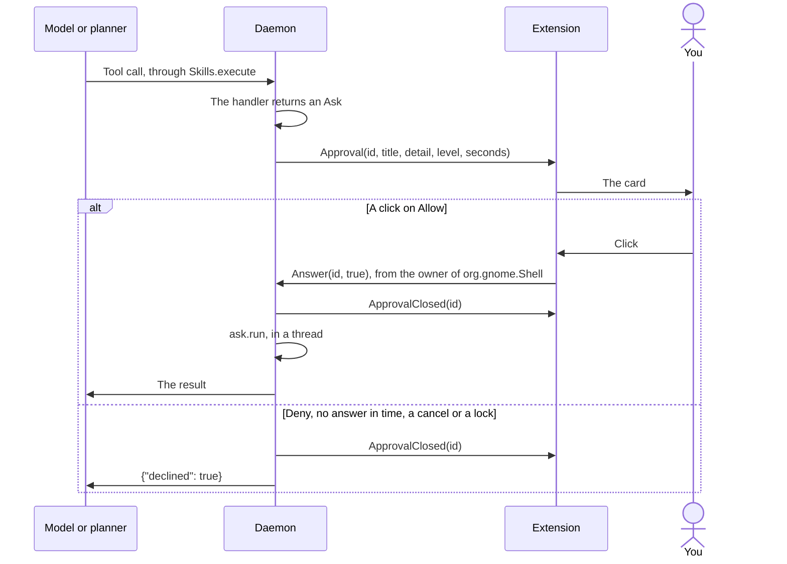

# Tuxistant component contract

The single source of truth for how the parts fit together. Change it here first.

## Layout

| Path | Owner |
|---|---|
| `tuxistant/` | Python daemon, CLI, Settings app. Runs on system `python3` (3.14), deps: dbus_fast, websockets, PyYAML, gi (Gtk 4, Adw 1) |
| `extension/tuxistant@buengenio/` | GNOME Shell 50 extension (blob, hotkey, status icon, right-click menu) |
| `themes/<id>/` | Bundled themes (`theme.json`, `shader.glsl`). User themes: `~/.local/share/tuxistant/themes/<id>/` |
| `helper/` | Fn-key helper + its systemd system unit |
| `packaging/`, `install.sh` | User units, D-Bus activation file, installer |
| `tests/` | stdlib unittest. No test may need a real mic, speaker, or the user's GNOME session. See [TESTING.md](TESTING.md) |
| `tools/` | `try-nested.sh`, `docs_images.py` for the pictures in the docs, and the live evaluations `eval_routing.py`, `eval_flows.py` and `check_voices.py` |
| `website/` | The static site. See [its README](../website/README.md) |

## D-Bus

Session bus. Name `org.tuxistant.Daemon`, path `/org/tuxistant/Daemon`, interface `org.tuxistant.Daemon`.
Structured values are JSON strings. The daemon is D-Bus activatable.

Methods:

| Method | Signature | Meaning |
|---|---|---|
| `Toggle` | `() -> ()` | idle: start a VAD turn, in a new conversation. Dictating: end the go as `DictateEnd` does, with no turn, and leave a kept conversation alone. Otherwise active: cancel. Idle or active, it ends a kept conversation, except when it only ends a go (see "Follow-ups", items 5 and 8) |
| `HoldStart` | `() -> ()` | Start a push-to-talk turn. A go that is dictating ends first, as `DictateEnd` ends it. Within 2 minutes of the last hold turn it carries on that conversation: see "Follow-ups" |
| `HoldEnd` | `() -> ()` | Stop the mic, get the words, then answer a fact or ask the voice model. See "Facts" |
| `Cancel` | `() -> ()` | Stop everything, back to idle, and end the conversation |
| `DictateStart` | `() -> ()` | Start dictating, from the shell only. See "Dictation" |
| `DictateEnd` | `() -> ()` | Stop listening and type what was said |
| `DictateToggle` | `() -> ()` | `DictateStart`, or `DictateEnd` if already dictating |
| `GetState` | `() -> s` | Current state |
| `GetConfig` | `() -> s` | `Config.public()` as JSON; never contains the API key, the Cloud key, the TP-Link password or the Home Assistant token, only whether each is set |
| `SetConfig` | `(s key, s json_value) -> ()` | Validated by `Config.set`; emits `ConfigChanged`. A new `server` clears `api_key`: a key only goes to the server it was given for. In the same way a new `ha_server` clears `ha_token`. A kept conversation's next hold connects afresh after a change to anything its session was opened with (see "Follow-ups", item 6). `cloud_consent` takes `{"version", "provider", "model"}` or `{}`: see "Cloud agreement" below |
| `ListVoices` | `() -> s` | `voices.catalog()` |
| `PreviewVoice` | `(s voice) -> ()` | Speak a short sample in that voice, without changing config. Replies once it has been spoken; a failure is a D-Bus error |
| `Say` | `(s text) -> ()` | Speak text in the configured voice |
| `ListThemes` | `() -> s` | `{"themes": [...], "problems": [...]}` from `themes.discover()`. Can take seconds: allow 30 |
| `PreviewTheme` | `(s id) -> ()` | Emit `ThemePreview` |
| `ListSkills` | `() -> s` | `Skills.listing()` of the skills loaded now. Each entry has `source`: `built-in`, `bundled` (a code skill that ships with Tuxistant) or `yours`, and `recipe`: true for a recipe |
| `SkillDetails` | `(s id) -> s` | `Skills.details(id)` of the skill loaded now, or `null` if none has that id. The fields of its `ListSkills` entry, with `actions` a list instead, plus `version`, `risk_because` (the permissions that set its risk, empty for low), `file` (the manifest's path), `manifest` (its text, as loaded: a skill still on its last version that worked shows that version), and for a code skill `folder` and `files` (relative paths, as its fingerprint counts them). Each action is `{name, tool, offered, held_back}`, and `module` for a built-in or a recipe: `tool` is made by `Skills.tool()`, the code that builds the model's list, so it is what the model is sent, and `held_back` is `switched_off`, `not_set_up` or empty. Settings asks for it when a skill is opened. A daemon older than this method answers with an unknown-method error, and Settings then shows what `ListSkills` gave |
| `ReloadSkills` | `() -> s` | Read the skills again now, as the folder watcher does on its own. Returns `{path: problem}` as JSON, `{}` if all loaded. A skill that fails keeps its last version that worked. Emits `SkillsChanged` |
| `SkillProblems` | `() -> s` | The `{path: problem}` of the last reload, without reloading. Settings lists them under "Skills with problems" |
| `ListPhones` | `() -> s` | `phone.devices()`: `[{"id", "name", "type", "connected", "paired"}]`, empty without GSConnect |
| `ListCalendars` | `() -> s` | `calendars.writable()`: `[{"id", "name", "account"}]` for each calendar an event can be added to. Without Evolution Data Server or its Python bindings it sends `{"problem": text}` instead, the same sentence the voice says (`calendars.NO_EDS`), and Settings shows that text in place of the advice to add an account. It connects to each calendar, so allow 30 seconds |
| `Hello` | `(i level) -> ()` | From the extension when the daemon comes online: `level` is 1 if it can draw approval cards, 2 if it can also type dictated text. 0 on the way out, which also stops dictation |
| `CanAsk` | `() -> b` | Whether an extension has said level 1. Without one, `Controller.ask` refuses at once and the user hears why |
| `CanType` | `() -> b` | Whether an extension has said level 2. Without one, dictation says why and never opens the microphone |
| `Answer` | `(s id, b allow) -> ()` | The click on an approval card. An unknown id does nothing. `Hello`, `Answer`, `SelectionText`, `Typed` and the three `Dictate` methods are refused from anyone but the current owner of `org.gnome.Shell`, checked before dispatch by `Daemon.guard` |
| `SelectionText` | `(s id, s text) -> ()` | Reply to `SelectionWanted` |
| `Typed` | `(s id, s how) -> ()` | Reply to `TypeText`: `typed`, `pasted`, `copied` or `refused` |
| `GetHistory` | `(i limit) -> s` | `History.recent()` |
| `ClearHistory` | `() -> ()` | Emits `HistoryChanged` |
| `OpenSettings` | `() -> ()` | Launch `tuxistant settings` |
| `BrowseSkills`, `BrowseSkill`, `FetchSkill`, `InstallSkill`, `UpdateSkill`, `RemoveSkill`, `CheckRegistry` | See "Skills registry: Browse" | Browse in Settings. The daemon's side is in `tuxistant/browse.py`, Settings' in `tuxistant/settings_app.py` |

Signals:

| Signal | Signature | Meaning |
|---|---|---|
| `StateChanged` | `s` | `idle`, `connecting`, `listening`, `thinking`, `speaking`, `error` |
| `Presence` | `b` | Whether the blob should be visible. False after Fn release when `hide_on_release` is on, even while the reply is still being processed and spoken |
| `Level` | `d` | 0..1 audio level, 25 to 30 Hz while listening or speaking |
| `Transcript` | `s text, b final` | What the user said |
| `Reply` | `s` | What Tux is saying |
| `Error` | `s` | Human-readable problem to show |
| `ConfigChanged` | `s key` | A setting changed |
| `ThemePreview` | `s id` | Show this theme for about 4 s, cycling through states |
| `HistoryChanged` | none | History was added to or cleared |
| `SkillsChanged` | none | A reload swapped in new skills. The next turn uses them; a turn already going keeps the ones it started with |
| `Approval` | `s id, s title, s detail, s level, i seconds` | Show the approval card. `level` is `click` or `admin` (runs as root). No answer within `seconds` is a no |
| `ApprovalClosed` | `s id` | Take the card down: answered, timed out or cancelled |
| `SelectionWanted` | `s id` | Send the selected text, or else the clipboard text, to `SelectionText` |
| `DictationStarted` | `s id` | Note the focused window: the words are for that one |
| `DictationMode` | `s id, s mode` | How this go stops: `hold` (let go of Fn), `tap` (tap Fn) or `shortcut` (the dictate shortcut again). Sent once known, never before `DictationStarted` for that id, and again only if it changes. Holds no words |
| `TypeText` | `s id, s text, b only_copy` | Put the words where the cursor is, then reply with `Typed`. Sent to the shell alone, not broadcast. `only_copy` is true after the time limit |
| `FollowUp` | `s question, s hint, i seconds` | The hold turn that just ended asked the user something. Sent after `StateChanged` `idle` and `Presence` false: show the blob, and the question with the hint under it, for `seconds`, whatever `Presence` says. A turn starting takes them down, and so does `FollowUp` with `seconds` 0. Plain text, like `Reply` |
| `RegistryChanged` | none | See "Skills registry: Browse". The daemon sends it |

### Cloud agreement

Multi-step requests go to the cloud only when `config.cloud_in_use` holds: `cloud_enabled` is `true`, `cloud_api_key` is set, and `cloud_consent` covers what would be sent now, which means its `version` is `config.CLOUD_CONSENT_VERSION`, its `provider` is `config.CLOUD_PROVIDER` and its `model` is the `cloud_model` in use. `planner.run` checks it before a task, and `planner._same` right before every request to the cloud, after each reply, and before each tool a Cloud task runs. The Claude library is built with `max_retries=0`: the planner tries again itself, once, after a lost connection or a server error, and checks before that attempt too. So turning it off, withdrawing or changing the model stops a task in the middle, even while a request is out, with "Cloud was turned off, so I stopped.", and a Cloud task waiting for an answer is dropped (see "Follow-ups", item 4). Without a kept agreement, `cloud_enabled` alone, from `SetConfig` or a config file written by hand or before there was an agreement, does nothing. Setting `cloud_enabled` to `false` keeps the agreement, so while one is kept, `SetConfig("cloud_enabled", true)` alone turns the cloud on again; only withdrawing clears it.

- `SetConfig("cloud_consent", {"version": V, "provider": P, "model": M})` is how Settings records that the user ticked "I understand and agree" and pressed Turn On. `V` and `P` must be the current ones, with no other keys, or it is refused with "That is not what Tuxistant asks you to agree to now". `M` must be a model name: up to 100 printable characters, with no space at either end, or it is refused with "That is not a model name". `SetConfig("cloud_model", ...)` refuses the same with the same words, apart from `""`, which stands for the default, so a model that is saved can always be agreed to. The daemon adds `"date"` from its own clock as `YYYY-MM-DD`, sets `cloud_model` to `M` and `cloud_enabled` to `true`, all in one call.
- `SetConfig("cloud_consent", {})` withdraws: it clears the record and sets `cloud_enabled` to `false`.
- `GetConfig` includes `cloud_consent` as stored, so Settings can say when the user agreed and to what.

Bump `CLOUD_CONSENT_VERSION` whenever what leaves the computer changes, and change the words in Settings (`CLOUD_BODY`, `CLOUD_DETAILS`) to match: everyone who agreed before is asked again.

## Locked screen

GNOME Shell disables the extension at lock, so the daemon follows `ActiveChanged` and `GetActive` of `org.gnome.ScreenSaver` on `org.gnome.Shell.ScreenShield`, `/org/gnome/ScreenSaver`. While the shield is up it cancels any job, ends the conversation (see "Follow-ups") and ignores `Toggle`, `HoldStart`, `Say` and `PreviewVoice`, in the controller, so that holding Fn is covered too. The timer scheduler waits for the initial lock check to finish. A failed or timed-out check keeps speech locked; an absent screen-shield service is treated as unlocked. A timer or reminder that comes due while the shield is up leaves its notification, and its words wait for the unlock, up to an hour for a timer or a day for a reminder: `Controller.say_when_free` refuses while the shield is up, as `say` does. With `timer_chime` on, which it isn't as installed, a chime with no words is played then through `Controller.sound`, the one thing that makes a sound on a locked screen.

## Approvals

`tuxistant/gate.py`. A handler in `HANDLERS` takes `(args, config, session)` and returns a dict, or an `Ask(title, detail, run, level, timeout_s)`. `Skills.execute` is the only way an action runs, for the model and the planner alike:

1. If the conversation has read something private (`session.tainted`) and the action's `network` permission names anything but `home`, it asks first. `home` means the server this install already talks to.
2. The handler runs: in a thread, or on the event loop if it is `async def`. Only async handlers may use `session.confirm`, `busy`, `selection` and `execute`.
3. An `Ask` goes to `session.confirm`, which puts up the card. Yes runs `ask.run` in a thread. Anything else returns `{"declined": true, ...}` to the model. A click on Deny also ends the conversation once that turn is over, so the next hold starts afresh (see "Follow-ups"); a card that runs out of time doesn't.
4. Success with `files_read`, `shell` or `clipboard` sets `session.tainted`.



Title and detail are written by daemon code from what will really happen, never from a manifest or from model text, and `printable()` turns control and bidi characters into visible escapes. A click is required: no voice "yes", as audio playing nearby could say it. `ask.run` must act on what the card showed, not on a fresh look at the world. What was asked and the answer are kept in the action's history record under `asked`.

A handler that wants its result spoken in another language appends a `Speak(text, voice, model)` to `session.after`. The app says it after the model's reply, and the model never sees the text, because Kokoro would read it as English. An empty `voice` shows the text without speaking it. `media.control` and `media.playing` use it for every reply, including errors, so a browser media title never reaches the model with tools. `research.run` and `knowledge.answer` use it too, so that sources and caveats are said as written and text from the web never reaches a model with tools.

A recipe's request is one of these. Its handler returns an `Ask` written by `tuxistant/recipes.py` from the request it will send, for a post, a request carrying a `text` value or one to a device on the local network. `ask.run` sends that request to the addresses the card named, with nothing looked up again. In a conversation that has read something private, step 1's card comes first, and the recipe's own card after it if its rule asks for one: two cards. Whatever the answer, the app says it through `session.after`, and the model gets `{APP_SAYS: true}` or an error about its arguments that daemon code wrote. A recipe's handler carries `.sends(args, config)`, which `_first_card` asks as it asks `SENDS`: a copy of a request answered in the last 4 seconds, arguments the handler refuses, and an `open` or `say` send nothing, so they get no reach card. The handler treats a copy within 5 seconds as one, so what the card skipped never sends: it says the remembered answer again, unless that is already in `session.after`.

`session.notice(Speak)` is the same, said at once with the action still running. `research.run` uses it, as it can be ten seconds before there's anything else to say, and so does `knowledge.answer` if 2 s go by. It gets 3 s to be turned into speech, and a notice that can't be said or played changes nothing.

## Facts

`tuxistant/knowledge.py`, and `Turn._ask` in `tuxistant/controller.py`. The 4B model makes up what it doesn't know, in the same voice as what it does, and no wording makes it reach for a tool. So on a hold turn the daemon decides, before the voice model hears anything:

1. It gets the words. None at all ends the turn quietly.
2. `knowledge.is_fact`: a request that is entirely a sum is a fact. These are not, with no call (`never_a_fact`): words about the music playing, timers or the home that `maybe_here` holds, which are every word and shape 0.3.0 kept from the sorter and everything `about_here` catches; words that only hold now, such as today, tomorrow, latest or currently; and questions about Tux itself, such as "What can you do?". In a question that starts "who sang", "who sings", "who recorded" or "who performed", the title right after it is left out before the last two are looked for, as Whisper often writes a title in lower case: one word that ends the question, or the words before one that says where or when, such as at, in or tonight. A word people start with, such as "Okay." or "Hey Tux", is looked past for all of these. Otherwise, with `fact_lookup` on, one small call to the model with no tools says FACT or OTHER. Anything but exactly FACT is a no, and so is a failure or 2 s without an answer, because the normal route can do everything.
3. A fact goes through `session.execute("knowledge.answer", ...)`, so it has a history record and meets the same gates. The voice model isn't asked, and the session may not even be open yet. Anything else goes to the voice model.

`knowledge.answer` first refuses what `about_here` catches, whether or not `fact_lookup` is on, with an error that says so and tells the voice model to use another tool or say it can't. Any turn the voice model answers can reach this tool, and it picks it for those questions too. Before the handler runs, `Skills.execute` asks `ASKS_FIRST`, where `knowledge.lookup_card` returns a card when `maybe_here` catches the question and `about_here` doesn't, `fact_lookup` is on and it isn't a sum. The card names the words that would be sent, Wikipedia's host and the search server's, and a decline returns `declined()` with nothing sent. In a conversation that has read something private, the reach card is shown instead of it, so there is one card, unless `SENDS`, where `knowledge.sends` answers, says the call sends nothing: a question `about_here` catches, a sum, or any question while `fact_lookup` is off. The handler refuses those or answers them on your own server, on the same test, so they get no card. Otherwise it tries these in order, stopping at the first that answers:

1. `calculate()`, for a sum. It turns the words into an expression and walks the parsed tree, which holds only numbers and arithmetic. Nothing is evaluated.
2. Wikipedia's API, on the words that matter: five pages, 1200 characters of each.
3. Web search through SearXNG. Wikipedia's search matches words, so "the rarest element" never reaches Astatine.
4. "I couldn't find that, so I don't know."

Steps 2 and 3 hand the results to a model with no tools, told to answer only from them or say "I don't know". Nothing is answered from memory. With `fact_lookup` off, the only call is the model with no tools, and nothing leaves your server.

The sorter's prompt matters more than it looks. Asked plainly, the model answers the question instead of sorting it, so the words go in as `Message: "..."` after fifteen worked examples. An empty thinking block takes four tokens before the first word, so the limit, `SORT_TOKENS`, is 12, which leaves room for the one word after it.

A VAD turn can't be sorted, as the server replies by itself when it hears you stop. The same action is on its tool list, and the model picks it now and then.

## Follow-ups

`Talk` in `tuxistant/controller.py`. A hold turn doesn't end the conversation. Its connection to the server stays open, with the microphone shut, and the next hold within 2 minutes (`FOLLOW_ON_S`) carries on in it. The microphone still opens only while Fn is held.

The times here, the 2 minutes, the question's 10 seconds and the answer's 12, and the 5 minutes that found files are kept, are counted on the boot clock (`controller.clock()`, `CLOCK_BOOTTIME`), which runs on while the computer is suspended. The monotonic clock, asyncio's and the shell's timers stop in a suspend, so with screen lock on suspend turned off, nothing else would end a conversation overnight.

1. The new words go into the same session, so the model remembers what was said before. Between holds the client is parked: whatever the server sends is dropped, so no tool can run with no turn on screen.
2. What the conversation has touched carries over in the same `Session`: `session.tainted`, so a card the last turn would have needed is needed now, and `session.found`.
3. If Tux's own last words in a turn end in a question mark, the daemon sends `FollowUp(question, "Hold Fn to answer", 10)` once the turn has gone idle. Tux's own words are the voice model's last reply, or what a task answered when it is waiting for the user (item 4). Text the app reads out through `session.after`, such as an answer from mail, research or facts, never counts, as a stranger's mail or a web page can end in a question mark too. The extension shows the blob, the question and the hint for those 10 seconds, even with `hide_on_release` on.
4. If `task.run` ended on a question, the planner keeps its model and what it has said so far in `session.waiting`. While that question is on screen, meaning a hold whose Fn press came within 12 seconds of the `FollowUp` (`QUESTION_HINT_S` plus `ANSWER_GRACE_S`, for a press just as the hint fades), the words of that hold go to the planner as the answer, through `session.execute("task.run", ...)` with `session.replying` set, and the app says what it answers in the usual voice. Neither the fact sorter nor the voice model sees those words, and the voice model doesn't learn how the task went. A cloud task carried on this way shows no "Send this request to Claude?" card, as the answer is the words Whisper heard, not text the voice model wrote. A task is dropped instead if `server`, `api_key`, `cloud_enabled`, `cloud_api_key` or `cloud_model` changed after it started, or Cloud is no longer in use, agreement and all (`config.cloud_in_use`, see "Cloud agreement"), for a Cloud task (`SENT_TO` and `planner.resumable`): its model holds the goal, its own replies and everything its tools returned, and all of that goes with each request, so carrying on would send it to a server or account the task never used. The words of that hold then go the usual way. The 12 seconds count to the press, not to the `HoldStart` that comes `fn_hold_ms` later, up to 5 s as Settings allows: the Fn helper's client tells `hold_start` how long ago Fn went down (`held`), and a `HoldStart` over D-Bus counts from when it arrives. The same change while a task runs, as it thinks, runs a tool or shows a card, stops it before its next request and before any more of its tools run, the first tool of a reply included (`planner._same`, checked again in the request's own thread): the app says "The settings changed, so I stopped that.", with "Part of it may already be done." if something ran, and the task doesn't wait for an answer. That covers a Cloud task's key replaced in the middle of it. A Cloud task that Cloud no longer covers, as it was switched off, withdrawn or pointed at another model, stops at the same points with "Cloud was turned off, so I stopped." instead. A later hold in the conversation drops the waiting task and goes the usual way, through the fact sorter and the voice model, which remembers its question while the connection lasts. So does a last reply that isn't a question. A hold that hears nothing, or is let go too soon, says nothing and leaves the question as it was: the extension took it down as the hold began, so the daemon sends `FollowUp` again with the question, the hint and the whole seconds it has left, if any.
5. It ends, and the next hold starts a new conversation, after 2 minutes with no hold, on `Cancel`, on `Toggle` idle or active, except when it only ends a dictation go (item 8), on a lock, and at the end of a turn in which a card was answered with Deny. A new conversation has read nothing, waits on no task and has no model memory. One thing outlives a conversation, as it did before follow-ups: the paths of `file.find`'s latest results, for 5 minutes after they were found (`FOUND_MEMORY_S`), so "open the second one" still works after 2 quiet minutes or a `Toggle`. `Cancel`, a lock and Deny forget those too. The kept conversation looks at the boot clock every second (`WAKE_CHECK_S`), so on waking it ends at once if its 2 minutes are up, and a hold checks too, before it carries on. If they aren't, the question, if one was up, is put right on screen, as the shell timed it on a clock that stopped: `FollowUp("", "", 0)` and the waiting task dropped if its 10 seconds went by in the sleep, or `FollowUp` again with the whole seconds it has left.
6. The conversation goes on with a new connection, which keeps what it touched but not what the model remembers, if the server closed the connection meanwhile, a hold cut the last reply short, the last turn failed, the skills were reloaded since, the tools the model would be offered changed since it connected, as when mail search is switched on or Home Assistant set up, or `server`, `api_key`, `pipeline`, `voice` or `instructions` changed since it connected (`SESSION_SETTINGS` in `tuxistant/realtime.py`), so the next words go to the server the settings name, never to the old one. Before the words of a hold go into a kept connection it is sent a ping, and one with no answer in 2 s (`PING_TIMEOUT_S`) is let go there and then: a link that died with no word, on a new network, in a suspend or at a router that forgets quiet links, still looks open, and words sent into it would wait a minute for a reply. The new connection never carries on a task that started before a new server or key (item 4). The old connection is closed. `transcribe_model` needs no new connection: each hold's words are fetched with it afresh.
7. A VAD turn (`Toggle`) is a conversation of its own, with follow-ups only through `conversation_mode`, and is never carried on by a hold.
8. Dictation is not part of the conversation and doesn't end it. A go that starts while a question is up takes the question down once it is known to be dictation: the daemon sends `FollowUp("", "", 0)` and drops the waiting task, so the hold after the go goes the usual way, in the same conversation. That is at once for `DictateStart` and `DictateToggle`, and for Fn when `DictationMode` says `tap` or `hold`, or when the go ends and keeps its words before that. A second Fn press that turns out to be a Fn shortcut (another key with it, see "Fn helper") was never dictation: the go that press started is dropped (`Controller.drop_go`), and only it, while the conversation, the waiting task and the words of earlier gos are left alone, and since the extension hid the question when the go started listening, the daemon sends `FollowUp` again with the question, the hint and the whole seconds it had left, if any. A hold pressed within the 12 seconds of the first `FollowUp` still answers it. `Toggle` or `HoldStart` during a go ends the go first, as `DictateEnd` does: `Toggle` then leaves the conversation alone, taint included, and `HoldStart` carries it on. A Fn shortcut that cancels a go leaves it alone too; `Cancel` ends both.
9. Words the app speaks over a kept question, `Say`, `PreviewVoice` or a timer or reminder coming due, replace it on screen, so they take it down as a go does: `FollowUp("", "", 0)`, the waiting task is dropped, and the conversation carries on. The extension shows their `Reply` in the question's place, with no hint left under it, and lets it go as it does any reply.

## Mail

`tuxistant/mail.py`. `mail.search` answers a question from Thunderbird's own search index, the file `global-messages-db.sqlite` in its profile, wherever a packaged, snap or flatpak Thunderbird keeps that. It is opened read-only and without a lock, as Thunderbird holds its own while it runs. Three tables are read: `messages`, `folderLocations` and `messagesText_content`, the plain table under a full-text index whose tokenizer only Thunderbird has. With several profiles, the newest index that opens and holds any mail is the one read.

1. With `mail_search` off, which is how it starts, the tool isn't on the model's list, and the handler refuses if it's called anyway. Only the value true counts as on.
2. A question that asks outright for a password, a passcode, a PIN or a sign-in or verification code is refused before anything is opened. That is a kindness, not the protection: step 5 is.
3. The question's words are looked for in the subject, the sender and the text, without the small words and the ones a request is made of, and cut to their stems, so that "apply" finds "application" but not "Apple". A small word written with a capital in the middle of the question is kept, as Will, May and Don are then people. Of more than eight, the longest are kept. The newest 40 mails holding all of them are taken, and the newest 400 holding enough of them to be about it: two of the words, or one in the subject or the sender. A word counts only where it starts a word: SQLite finds "rent" inside "current" too, and a mail that only matched that way takes no place among the 40 or the 400. The end of an address, such as `.com`, is not searched, and neither is "no-reply".
4. Some mail is never taken. Folders Thunderbird marks as Junk or Trash are left out, and so are folders named for one, whether that name is in the folder's address or the one Thunderbird shows. Junk, Spam, Trash, Deleted and Quarantine count wherever they start a word, so `Junk_Mail`, `JunkMail` and "Spam reports" are skipped. Drafts, Templates, Bin, Outbox and their names in a couple of dozen languages count only as the whole name, give or take "my" before or "mail" after, so "Draft contracts" is read. One mail is one sender, subject and text: filed in two folders or sent twice, it counts once, and it is the user's own if a copy is in Sent. Its Message-ID is not looked at, as that is whatever a sender writes, and anyone the user once wrote to knows the ID of that mail.
5. Sign-in codes and passwords are hidden, and the mail around them is read like any other. Each is replaced with `[hidden]` in the subject and the text before the question's words are looked for, so a code can't be searched for, and before any model sees the mail, so it can't be said. 0.5.0's rules for this run too, unchanged (`tuxistant/mail_floor.py`), on the subject and the text as 0.5.0 read them, from Thunderbird's index or, through Online Accounts, as decoded from MIME, quoted-printable and HTML, and what they hide is hidden whatever the rest of this step says: so every code or password 0.5.0 hid is hidden, on both paths. Of a text cut shorter than the 20,000 characters 0.5.0 read of it, as a mail fetched through Online Accounts can be, or of a subject cut at all, they take it that it talks of signing in where the rest of it does (see step 7), so through Online Accounts that rests on the server's own search finding that talk past the cut. Where one of their pieces stands is found in the text as the rules below read it, once for each piece however often they hide it, with any mark after it, as NFKC makes "482913e" and an accent after it "482913é"; a mail whose pieces stand at more places in all than it has characters has them hidden in the text as it came instead. The rules below read the mail whole as well and hide more, as well as they can: the forms and languages they name, and nothing else is promised; docs/ROADMAP.md lists what they are known to miss or take. A text with a word of more than 100 accented letters or more than 500 words for a secret is hidden whole by 0.5.0's rules, as they would take seconds over it. The second pass of step 7 runs then too, on the text as the model will read it, and the words are looked for and the mail ranked in what that leaves, so a code only the joined lines hide can't be found by its digits either. Every dash and minus sign but the hyphen-minus is an en dash to the model and a space to the hiding, but between two numbers where no code is written that way, where it is a range and the hiding reads a slash: two of one or two digits each, as in `12–15 March` or `14:00–18:00`, one or two digits and three, `Ages 6–120`, a year and a later one, whole or its last two digits, `2025–2026`, `2024–25` or `1999–00`, but for a year that comes straight after a colon or a word for "is" on its line after a word for a code (see below), which only the first pass, reading the lines, looks for, and two times, `2pm–4pm`; a dot or an ellipsis between such numbers is a slash too, as in `£12·50`. Not where either number is part of a longer one, of letters and digits or of a chain: `482 91–10`, `A7K2Q9—10` and `48–29–13` are codes. A middle dot, a dot operator or a bullet such as `•`, `●`, `■` or `◦` is a middle dot to the model and a space to the hiding. Before NFKC sees it, a mark NFKC would make a comma, a full stop or a slash of, such as the wide comma of "验证码：482913，5分钟", is made `、`, `。` or `∕`, which ends a code and joins nothing to it; one it would make a hyphen of is an en dash, one it would make an ellipsis of a midline ellipsis, `⋯`, which the hiding reads as a space, a wide bracket `〔` or `〕`, and one it would make a low line of a space. A character no one sees is a space, and a run of them one, as clean() made it for 0.5.0, but for those that stand inside a word, such as a soft hyphen, the zero-width characters, the word joiner and the byte order mark, which are taken out, and a variation selector or another default ignorable before a mark, as in a keycap, which is taken out too. So a code glued by any of these to a word, a number or capitals, as in "482913—Verification", "482913—10 minutes left", "482 913—DO NOT SHARE" or "482913⁩Verification", is hidden as it would be before a space. A hyphen-minus joins a number to the rest of a reference when a digit, a slash or up to six capitals and digits follow it, as in `48213-2` or `10482913-ABCDEF`, or when a digit stands before it, as in `1-800-555-0199`; after a word, as in `code-482913`, it joins nothing. A letter of Chinese, Japanese, Korean, Thai, Lao, Myanmar or Khmer glues no code to a word, as those write one with no space round it: "認証コードは482913です" or "您的验证码是KQ7X9B，". A unit, counter or currency they write straight after a number is part of it, so `12800円`, `2026年3月12日`, `1500ポイント`, `1205号室`, `1200개`, `1250美元`, `1500만원` and `1500บาท` are no code: the common ones of money, dates and times, counts, points, people, rooms, floors and nights (`UNIT` in `tuxistant/mail.py`), and only after a number, as 号 and 호 also end 認証番号 and 인증번호 before one; a word of more than one letter, such as 美元, ポイント or 유로, counts only whole, as its first letter can start an ordinary word written straight after a code, as 유 starts 유효. Three things are hidden. After a word for a secret (password, code, PIN, key, token, in 26 languages: English, French, German, Spanish, Portuguese, Italian, Dutch, Polish, Czech, Hungarian, Turkish, Swedish, Norwegian, Danish, Russian, Ukrainian, Greek, Vietnamese, Indonesian, Hindi, Hebrew, Arabic, Thai, Chinese, Japanese and Korean, but not as part of a word for a postcode, a barcode or points, as `postcode` and `barcode` are not, such as מיקוד, ברקוד, נקודות, รหัสไปรษณีย์ or streckkod, and Arabic كود, or كودك ("your code"), only where it names a code being given, before التحقق, التفعيل, الدخول, تسجيل, التأكيد, الأمان, لمرة, المؤقت or السري, a colon, هو, الخاص or the code itself, so "كود الخصم موجود في التطبيق" names none), within 160 characters: anything shaped like one, and after a word for a password whatever follows the first colon in its sentence, or "is" in English or one of the languages that write a space round it (ist, lautet, est, es, é, è, är, er, je, jest, là, adalah, είναι, هي, هو, היא or הוא, as written, where the English ones count in capitals too), where a Chinese or Japanese full stop `。` ends a sentence too, and where that is another language's "is", what follows 0.5.0's first colon or English "is" as well, so "Votre mot de passe est temporaire : soleil" hides both words; even a plain word, past a quote and a space too, as French writes `« soleil »`, as the model reads it, so a dash, a dot or an ellipsis in it, as in `Sunny—Day—7`, `Blume·42` or `Sunny…Day`, is part of it; one written in ASCII, after any opening bracket or any quote before it, such as `「`, `【`, `“`, `‘`, `„`, `«` or `”`, ends where Chinese, Japanese, Korean or Thai letters or one of their brackets start again, as in "パスワード：Abc12345です。", "パスワード：「Abc12345」" or "初始密码：“abc12345”，有效期至2026年3月12日", and what starts with their letters, as in "パスワード：ご登録時に設定したもの。", or is a number glued to a counter in `UNIT`, as in "有効期限：24時間" or "有效期：30分钟", is no password. A number of four to eight digits up to 60 characters before such a word, as in "482913 is your code". In a subject or a text that talks of signing in, verifying or expiring, every number of that length in it that isn't a year, a price with £, $ or € before it or after it on its line a currency's code in capitals, pounds, dollars, euros or Euro, or any currency's sign that NFKC leaves as it is, as in `125 EUR`, `1500 Euro`, `1500 €` or `1500 ฿`, looked for as the model reads it, so a dash or a dot between, as in `482913 – EUR 49.99`, makes no price, or part of a longer number joined by hyphens, or right after a hyphen or glued to a letter of Chinese, Japanese, Korean or Thai, as in `AB-123456` or `请致电95588`, which 0.5.0's talk didn't take either, whole, in two groups of three or with a space between each digit, and on a line that talks of it, letters and digits together but for a time such as `2pm-4pm`, `14h35` or `14h35min`, or a span of time such as `24-hour`, `24hrs`, `10-min` or `2-night`, whole, in two groups of three, as in `KQ7 X9B` or `KQW 9XB`, or with a space between each, in both. Other groupings, digit pairs or letters and digits in groups of four such as `KQ7X 9B2M`, are not hidden by that talk alone. Three capitals beside three digits, as in `GBP 125`, `450 CHF` or `BAW 123`, are an amount or a flight and never a code, wherever they stand. A currency after a number counts only as a whole word, and of the codes only GBP, EUR and USD in small letters, as 0.5.0 had them: `482913 Audible`, `482913 Ron` and `482913 Rubén` are no amount, but `482913 CAD` is, to these rules: 0.5.0's still hide it where they did. That talk counts only for the part it is in, as in 0.5.0: "Log in to your account" in the text leaves the subject's order number. A word that names a sign-in code, a PIN or a password in the subject (`CROSS_WORD` in `tuxistant/mail.py`: a verification, security, sign-in, log-in, one-time or authentication code, a passcode, password, PIN or OTP, a código de verificación or de seguridad, a código de verificação or de segurança, رمز or كود التحقق, التفعيل or الدخول, a clave de seguridad or de verificación, the words for a password above where they start a word, and senha only where nothing but punctuation follows it or before temporária, provisória or de acesso, but for كلمة السر, 验证码, 密码 but before 锁, 箱 or 学, 动态口令, 인증번호, รหัสยืนยัน and the like, or a bare "code" in small letters after "your", "the" or "this", "new" and at most a name, where nothing but punctuation or a line end follows it, "for" and a name do, or "you asked for", as in "Your Acme code", "Here is your code.", "That is your code for Acme." or "This is the code you asked for.") counts for the text as a word for a secret before its first 160 characters, and one in the first 300 characters of the text counts for the subject the same way, for all of it; never as talk of signing in. A word for an everyday code doesn't, a QR, gift card, promo, pickup, referral, ticket, tracking, access or confirmation code, "código de recogida" or "رمز الاستلام", and nor does a bare "code" the sentence goes on from, as in "Your Acme code for 20% off", "Scan the code at the gate" or "our code of conduct", nor a bare pass, key, token, pins, código, clave, كود, رمز or كلمة السر, or 码, 번호, コード or รหัส alone, which also name an order number, a QR code, a barcode, a postcode or a key date ("Your Acme pass" is a boarding pass, "Fechas clave de tu viaje" key dates and "New Pins for you" Pinterest's), nor a word that only holds one for a password, as "resenha" ("review") and "desenhado" ("designed") hold senha, nor 密码锁 ("combination lock") or 口令 but in 动态口令 or 登录口令, as 淘口令 is a shop's link, nor one that gives its own code or password in its part, "Use code SAVE20" or "Wi-Fi password: acme-guest". In any mail, a code that has a line to itself, give or take the dressing plain text puts round it, such as `*482913*`, `- 482913`, `# 482913`, `` `482913` ``, `| 482913 |` or `● KQW 9XB`, two groups of three capitals and digits among them, but not in brackets, before a full stop or with a `#` glued to it, as an order's `(5928374)`, `5928374.` or `#5928374` is. A code spelt out one character to a line, as an HTML mail with one character to a block reads, is put back on one line first, and one with a space between each character, as one to a table cell reads, counts as the code it is: alone on its line, after a word for a secret, or with a letter and a digit on a line that talks of signing in. A year, a time or a weight after such a word stays, alone, or a few together but for years, as in `9am 5pm` or `1st 2nd`, unless it comes straight after a colon or one of the words for "is" above in the sentence of the word for a code, or, by 0.5.0's rules, straight after a colon or the English "is" in reach of one of their words for a code: `2019 2031` is a code, and so is `2047` in "Dein Code ist 2047", but "Ihr Buchungscode ist HMX4K2. Die Saison ist 2026." keeps its year. Too much is hidden rather than too little: a promo code and a booking reference go too, and so does a postcode such as `AB1 2CD` on a line of its own, or on a line that talks of signing in, and a range joined by a dash that a code could be, such as `0900–1730` on a line of its own, or after a word for a secret one from three digits, such as `101–104` or `120–30`, or one with an ellipsis or a middle dot after three digits, `100…200` or `£123·45`, a price with a currency's local abbreviation or a sign written after letters, such as `1500 kr` or `1500 R$`, and a number glued to a rarer counter than `UNIT` has, in a mail that talks of signing in. The other way round, a code a range could be is read out: `12–34`, or `2025–26` where no colon or "is" after a word for a code stands right before it on its line.
6. They are ranked by how many of the words they hold. Among mails holding as many, one whose sender first wrote at least a week ago comes first. Then come where the words are, whether it is the very word asked about or only one that starts like it, and how new the mail is. A sender is looked up for the best six, and for up to thirty when more hold as many words, by their exact address: a domain is shared by a company's customers or a provider's users. When their first mail came is not taken from its date, which its sender wrote. It is the middle date of the 21 mails from other people that Thunderbird indexed just after it, none counted as later than now, and with fewer than 21 after it, it came just now. Only an index of fewer than 100 mails is too small for that, and there the mail's own date is used. The lookups have 2 seconds of their own, and a sender not looked up in time counts as new. An address that mail in a Sent folder is from is the user's own, and a mail from it that isn't in Sent itself is never known.
7. The best three are shown one at a time to a model call with no tools: fenced, with links and angle brackets removed, and at most 4,000 characters of each. Step 5's hiding runs again on exactly that text, in a thread, off the event loop, as joining a mail's lines can put a code back together, and on all of it. That second pass, and the one before the search (step 5), hide near a word for a secret only what the joining made: a piece with a space in it that the text before the joining didn't hold, as a line end, a link, a tag or a run of spaces stood there, as in `482\n913`, and so near talk of signing in that only joining the lines made, as in `log\nin`, which 0.5.0 didn't read as talk; measured in the joined text, links and blank lines taken out brought an order or phone number 200 characters past "Use code SPRING10" within its reach. It runs before it is cut to the 4,000 (200 for the subject): cut first, a code only the joining puts together could lose its end and be too short to hide, and "[hidden]" is longer than most of what it stands for. Past the 20,000 characters 0.5.0 read of a mail, nothing counts, as 0.5.0 read nothing there: Thunderbird's index gives all of them, and talk of signing in further on, as a long e-ticket's conditions have, is not looked for. Through Online Accounts a text can be cut shorter, where the fetch stops (only in the part it stopped in, not a whole plain part before an attachment): such a mail is fetched on, 24,000 bytes at a time in one `UID FETCH` for all of them, until its text holds those 20,000 characters, counted with nothing where an inline tag stood, as Thunderbird's index counts them, or its part ends, up to 160,000 bytes, and with a mailbox's mails taking no more than half of what a search may take, and read again, so its talk is that text's own, made plain and joined as the rest is. One still cut short of those 20,000 characters is taken to talk of signing in when the rest of it does, as those words may have been past the cut, so every number of the right length is hidden, as 0.5.0's talk hid them, and no letters with digits, as no line of it is known to talk; the server's own search decides that: it is asked once per mailbox, for all the mails it cut, with a `BODY` search for the same words, with the forms of "verify" and "authentic" written in English, Spanish and Portuguese (`TALK_TERMS` in `tuxistant/goamail.py`), those that aren't ASCII in a search of their own as a UTF-8 literal. Words split by markup past the cut can be missed, and words in a link that Thunderbird's index doesn't hold can be found, depending on how that server searches. A refusal, or no time left to ask, counts as sign-in talk. A subject is cut short only by a hostile header, as where a subject in Thunderbird's index runs past those 20,000 characters, and is taken to talk of signing in whatever the rest says. So is a subject or text that NFKC, which makes a ligature such as U+FDFA up to 18 characters, grew past the 40,000 characters that are read of it, where it is cut. An HTML part cut inside a tag loses that tag. It also loses what that cut may have split: its last 60 characters, as a word for a code there may have stood after the code and been cut off, then its last word and up to 14 numbers and single characters before it. Secrets are still looked for in what goes, so a code before that point that a word in it hides is shown as `[hidden]`. The first that answers is the answer. The model is told to say only NOTHING when a mail doesn't answer, and a reply that describes the mail and says what it doesn't mention counts as that too, or a stranger's mail about something else would be read out. If none answers, the best one is named as the closest only if it holds more than half the words.
8. The app says it, then "That's from an email from" a domain, or the whole address at a mailbox provider such as Gmail, "on" a day, and a warning if that sender hadn't written before. Only the address in the one pair of angle brackets at the end of the sender line counts, or the whole line if it is nothing but an address. The name beside it is never used, even when it holds an address, and a line that could be read two ways is "an unknown sender". The voice model is told what it's told after research: that it's done. Nothing from the mail reaches it, and it isn't asked to speak.

The search has 4 seconds, the sender lookups 2 more and the whole action 20, and it says "Let me check your mail." after 2. An answer that isn't in English is shown and not spoken, as the voice would read it as nonsense, and its source is said instead.

### Without Thunderbird: Online Accounts

`tuxistant/goamail.py`. When no Thunderbird index holds any mail, steps 3 to 6 run against the mail accounts in GNOME Online Accounts instead, and steps 1, 2, 7 and 8 are unchanged. Thunderbird and Online Accounts are never both searched.

1. On the session bus, `GetManagedObjects` on `org.gnome.OnlineAccounts` at `/org/gnome/OnlineAccounts` lists the accounts. One is used when it has the `org.gnome.OnlineAccounts.Mail` interface with `MailDisabled` false and IMAP set, and the `OAuth2Based` interface. With `PasswordBased` alone it is left alone and `GetPassword` is never called; with `ImapAcceptSslErrors` true, or neither `ImapUseSsl` nor `ImapUseTls`, it is left alone too; with `AttentionNeeded` the user is told to sign in again. At most three accounts.
2. `GetAccessToken` on `OAuth2Based` gives a token, asked for once per search and dropped with it. The accounts' tokens are asked for all at once, as one past its hour is fetched again from the provider, and Online Accounts has 5 seconds in all. An account whose token doesn't come in that time is skipped. If none is left to search, Tux says why rather than that there is no mail, and a problem with an account whose token was asked for, such as Online Accounts not answering in time, is said before one with an account it left alone. Online Accounts that doesn't list its accounts in that time, or a session bus slow to let Tux in or that refuses it, is not answering in time too: only no session bus, nothing listening where it should be, or no Online Accounts on it, is no mail. `tuxistant.goamail._connect` is the one place the bus is reached, and the evaluations block it.
3. `imaplib` reaches `ImapHost`, with TLS from the start (`ImapUseSsl`, port 993 unless the host names one) or STARTTLS (`ImapUseTls`, port 143), the system's certificates and the host name checked, by TLS from the start and after STARTTLS alike, and a certificate refused either way is said as one. A server that doesn't offer STARTTLS, or sends any line but its yes in answer to it, or anything between the yes and the TLS handshake, is refused before anything is sent, and nothing it said in the clear is kept. A yes with a code in brackets, such as `OK [ALERT] Begin TLS`, is still a yes. Sign-in is `AUTHENTICATE XOAUTH2`, and only if the server offers it.
4. `LIST` picks the mailboxes: the one marked `\All` (Gmail's All Mail) or else `INBOX`, and the one marked `\Sent` or named Sent, Sent Items or Sent Mail. Anything marked `\Junk`, `\Trash`, `\Drafts` or `\Noselect`, or named as in step 4 above, is never opened. `INBOX`, in any case, is never taken for All Mail or Sent, whatever it is marked. Each is opened with `EXAMINE`, read-only.
5. For each word, `UID SEARCH TEXT` asks for its stem and for the word itself, as some servers, Gmail's among them as far as is known, match whole words only; a word that isn't ASCII goes as a UTF-8 literal. The newest 20 holding every word and the newest holding most of them, 40 in all, are fetched with one `UID FETCH` of `INTERNALDATE`, `BODY.PEEK[HEADER.FIELDS (FROM SUBJECT MIME-VERSION CONTENT-TYPE CONTENT-TRANSFER-ENCODING)]<0.4096>` and `BODY.PEEK[TEXT]<0.16000>`, so nothing is marked read. A mail whose last part read is cut there before 0.5.0's 20,000 characters is fetched on with `BODY.PEEK[TEXT]<16000.24000>`, then `<40000.24000>` and on, in one `UID FETCH` each time for all such mails of the mailbox (see step 7 above), so no more than the first 160,000 bytes of a mail's body come down, which can hold the start of an attachment that is never decoded or read. The text is the first plain part, its line ends made line feeds, or the first HTML part as text, as Thunderbird's index holds them, so that 0.5.0's rules read what they read there: a comment is nothing; a block element (`BLOCKS` in `tuxistant/goamail.py`: a paragraph, a div, a list and its items, a heading, a table and its rows, a center, a pre, a section and the like) ends a line at its opener and at its closer, as `<br>` does; a table's cell and a quote are a space; a "<" before anything but a letter, `/`, `!` or `?` starts no tag and is text, as in `orders < 100 €`; and every other tag, whatever its name, is inline: between two digits, as in `<span>48</span><span>29</span>`, or beside a letter of Chinese, Japanese, Korean or Thai it joins them as a browser and Thunderbird's index do, and anywhere else it is a space to this version's rules and nothing to 0.5.0's (see step 5), so `<span>KQ</span><span>7X</span><span>9B</span>` or the same in `<kbd>` is KQ7X9B to them. A NUL written in the mail is a space. A part's charset label is read as Thunderbird reads it, which is as the WHATWG Encoding Standard has it: ISO-8859-1 and ASCII as Windows-1252, ISO-8859-9 as Windows-1254, TIS-620 and ISO-8859-11 as Windows-874, GB2312 and GBK as GB18030, EUC-KR as Windows-949 (`CODECS`), and so are the encoded words of a subject, those side by side in one charset read as one, as Thunderbird reads them, as a sender may split a character between two. An HTML part whose Content-Type names no charset is read in the one a `<meta>` in its first 1,024 bytes names, as Thunderbird and browsers read it. A part that names none at all, as an older sender's script sends one, is read in the charset Thunderbird would guess (`_guessed`): UTF-8 if it is that, but for a character the fetch cut at its end, as with each guess; else Windows-1252 where most of its bytes past ASCII stand one at a time, as Spanish and Portuguese accents do; Windows-1256 or GB18030 where nearly all its letters past ASCII are Arabic or Chinese read in it, seldom between two Latin letters, and for Windows-1256 seldom beside a Latin accent or sign, as GBK read in it is; and Windows-1252 otherwise. A whole mail fetched on is read again as one, so the guess is that of all of it. A subject or a sender line written in 8-bit bytes with no encoded word is read as UTF-8 when it is that, or else in the mail's charset, or Windows-1252. A part whose filename can't be read counts as an attachment. From there it is step 3 above: secrets hidden, then the words looked for again. A mail that can't be read is skipped, never the mailbox it is in.
6. A sender is known if `UID SEARCH BEFORE <a week ago> FROM "<address>"` finds a mail whose own sender line has exactly that address, among the first ten it finds. `BEFORE` goes by `INTERNALDATE`, the day the server took the mail in. A mail from the account's own address outside Sent is never known, and nor is one from an address that Sent holds mail from: for each sender found known, `UID SEARCH FROM "<address>"` in Sent, read the same way, takes that away, and a sender there was no time to look for there is not known either.

Signing in and searching have 7 seconds, the sender lookups 3 more, and each connection is cut at the end of those whatever the server does. The server's name is looked up within that time, in a thread given up on when it runs out, and reading the fetched mails stops at the search's time too. Nothing an error says is passed on: whatever goes wrong, what was found so far is the answer, or one of Tux's own sentences is said. Whatever Online Accounts took comes off those 10 seconds, so the whole search ends 8 seconds before the action's 20, leaving one mail's reading time for the answer. A literal bigger than 64,000 bytes, or more than 4 MB from one server in one search, ends the connection. Nothing in this path logs anything.

## Live skills

`tuxistant/skillhost.py`. `SkillHost` reads the skills in this order: `tuxistant/skills_builtin/*.yaml` (Python handlers in `HANDLERS`), `tuxistant/skills_code/<name>/skill.yaml` (bundled code skills), then what is in `$XDG_DATA_HOME/tuxistant/skills/` (yours), sorted by name: a folder `<name>/skill.yaml` is a code skill, and a file `<name>.yaml` is a recipe. Each is a `_Found` of `kind` `builtin`, `code` or `recipe`. It watches those folders and, after each change, builds a new `Skills` from what passed its checks and swaps it in. `Skills` objects are never changed, and each `Turn` takes `host.current()` once, so the tools a turn offered are the tools it can run.

- Each skill is checked on its own. One that fails is reported under its path (`ReloadSkills`) and keeps its last version that worked, if there is one. A folder that goes away unloads its skill.
- The first to claim an id, an action or a tool name keeps it, and two actions of one skill with the same tool name refuse it (`distinct_tools()`). A code skill can't use a built-in id or action, and only bundled skills may use ids starting `org.tuxistant.`.
- Code skills may ask only for `network`, and get all of it or none, since the sandbox can't tell hosts apart. A list of hosts is shown as `network: true`. They get only the settings in `SKILL_CONFIG_KEYS` that their manifest names, never the API keys, and hear new values when those change.
- A code action is an async handler in that `Skills`' own handler table. It goes through `Skills.execute` like any other, taint rule included, and the card is written from the skill id, action name and arguments.
- An action of yours may not start like a built-in or bundled action: `_namespace()`, the first word of its tool name up to a `.` or `_`, less a trailing `s`, may not be one of theirs, so `file.delete`, `files.delete` and `file_trash.now` are refused. Yours bring at most `USER_TOOLS`, 6, actions in all. `offered` maps each skill the last reload loaded, built-in and bundled ones included, and each of yours it kept a place for, or at start each of yours in `skills-loaded.json`, to a `_Place`: the count it was offered with, the SHA-256 of the text of the manifest offered, its id and its actions; only yours are saved. Yours in it are counted first, of them the ones whose text has that digest before those edited (`_order()`, `_edited()`), then those of them with more actions than they were offered with, then new ones in load order, and a code skill that can't run for want of a sandbox isn't counted. Without that file, as after 0.4.0, all are new. `_save_loaded()` writes it when it changes, but not from `offline()`, and a reload where your folder couldn't be listed keeps `offered` as it was; counts that add up past `USER_TOOLS` make `_read_loaded()` ignore the file, and `_unshared()` drops an id, action or tool name that two entries claim. `_read_json()` reads it, and `skill-grants.json`, only as a regular file, or a link to one, of at most `MAX_STATE_BYTES`, 1 MB, opened without blocking so a pipe can't stop start. A `skills-loaded.json` that isn't one, can't be parsed or is nested too deep is treated as missing. A `skill-grants.json` like that, a link to one that leads nowhere, or one that isn't a mapping of skill ids to mappings (`_grant_records()`), such as another app's settings behind a link, sets `_Grants.broken`: it is never written over. `refresh()` reads the file again at a reload when it is broken or its device, inode, size or time changed (`_identity()`), so a fix, a hand edit or damage counts at the next reload. While it is broken `problem()` refuses any skill of yours that asks for the network or a setting, allowed before or not, with `BROKEN_GRANTS`, and `denies()` refuses a kept `_Found` the same way, or one that asks for what its record no longer allows. `save()` doesn't write when the file changed since it was read, which is read again instead, and through a link it writes, by a temporary file and a rename, only the file the link led to when read, resolved once, beside the link; a link into another folder counts as broken. When the file changed between the read and the save, `save()` keeps nothing and `_reload_once()` makes the reload again from the file as it is now; when the write fails with an `OSError`, such as a full disk or a folder that can't be written, it isn't made again. Either way, if what the reload allowed still isn't saved, `hold()` reads the records from the file again and holds one more pass in which a skill of yours with no record that allows it gets nothing it asks for (`UNSAVED_GRANTS`), while those recorded carry on; the save is tried again at the next reload, and state is cleared only after a save. An edit in the moment between `_target()`'s check and the rename is written over; one after the rename is seen, as the identity of what was written is compared with the file's. The watcher watches the file too (`files=`), so an edit to it reloads at once, but not a change that leaves it as Tux last read or wrote it (`as_seen()`), as after its own save. A record of the wrong shape becomes one that allowed nothing (`_grant_record()`), and a `removed_at` that isn't a finite float or an int whose abs is below 2**53 is dropped (`_a_time()`). A folder name with a NUL, a lone surrogate or a `/` is no plain name (`_plain_name()`), and `_there()` says it can't be told for any other error, so no name from either file stops a reload. `gone()` runs only when your folder could be listed, and marks a record removed only when no skill found in that reload has its id and `lstat` finds nothing at its folder, or its folder name is empty or not a plain name (`_there()`); it dates a removed record with no date as now. `problem()`, and `grant()` for a skill that loads, point a record at another folder only when the one it names is surely gone, not when that can't be told, so a rename or the copy left of two keeps what was allowed. `gone()` also counts as there the id each file of yours was last read with while the daemon runs, refused ones included (`seen_ids`, with the digest of that text), and that of each `_Place`, but only while the file's text still has that digest (`_known_id()`). It doesn't mark removed a record while a file of yours that won't read and has no known id began failing, as it is now and as the same entry (its text digest and its device and inode, so a folder renamed onto an empty one starts a clock of its own), no earlier than the record's folder went missing (`_held_back()`, `unknown_since`, `missing_since`), and `problem()` then names that file, as it stood at the last reload. A record's `missing_since` is kept while a copy with its id stands in, so taking that copy out later still holds it back. An exception in a reload also drops a broken grants file's state, so a file fixed meanwhile counts at the next read. In memory those clocks start again at a restart, so after one a draft that was already failing holds a skill taken out while Tux was off until it reads or is taken out. A code skill with no record is new, so its state is cleared after the save that notes it, and while a save is held it doesn't load at all (`_asks()`). A reload that raises drops the records in memory, so nothing half noted is saved later. `prune()` keeps the `MAX_REMOVED`, 1000, records of skills taken out last, dates in the future counted as now, and clears the state of those it drops, but never drops one marked or dated in the same reload, one whose id a skill found in that reload or a `_Place` in `offered` has, one whose folder is there, or one starting with `org.tuxistant.`. Counts alone, as an earlier 0.5 build kept, give no digest or names, so all count as edited; a list of names gives no counts either, so one of those keeps no place until it has loaded once. A skill that would go past it is refused whole, by `over_budget()`, which says how many are taken, and for one with more than `USER_TOOLS` how many it may keep beside them; one that grew past it, to `USER_TOOLS` or fewer, is refused with `GREW`. Each of yours in `offered` whose file or folder is still there reserves the id and actions of its `_Place`, whatever an edit to it says, unless it is a code skill without a sandbox, and a new or edited one of yours that would take another key's is refused (`_holders()`, `_held_reason()`, which names the holder), whatever the order. `_settle()` then runs `_resolve()` again, up to `MAX_PASSES`, 16, times, with the reservation of every edited holder that blocked another (`_holders()`, `_owners()`), by a reservation or by the version of it that loads, cut to what its edit still has (`_still_held()`), when that edit loaded or was refused for a name another of yours has, widening the set each pass and dropping from it those that fail when there is none left to add. A pass counts only if every holder cut so loads its edit, and the last that counted stands, so swaps and rings load at once and a name never leaves a skill that ends up on its kept version or its place. If one still waits for a name whose holder's edit loaded in the pass that counted, its reason says the name is free from the next reload. `reload()` runs again at once, up to twice, whenever that happens or what `offered` holds of yours changed while some of yours were refused, so a reload with nothing changed changes nothing, and tells `on_change` once, after the last. Reloads run on the event loop: with 1500 recipes in the folder a first reload took 0.84 s, in two passes, and one that changed nothing 0.41 s, on an aarch64 laptop; with the grants file changing under every save, the worst case, it took four passes, 1.64 s. A hand edit marking a skill of yours that is there `removed` gets it allowed afresh, as if taken out and put back; that is the person who can edit the file allowing it, not a way past what was allowed. Each refused for a name or the budget gets its reason from the reload's end state (`_name_reasons()`, `_over()`), not from the order things were counted in, and a name another of yours has is said with that skill's file, so a reload that changes nothing changes no reason. One refused keeps its whole `_Place`. One in `offered` whose path is there but no longer a recipe or a skill folder gets `NOT_A_SKILL`. One of yours refused for any reason keeps the `_Found` the last reload offered while the daemon runs, if that is still allowed, with `KEPT` after the reason; one whose file can't be loaded falls back to that `_Found` too, and if that is refused the reason is why the file failed (`failed`). A reload that couldn't list your folder keeps those `_Found` as well. Room for the count it was offered with of each one that grew and is counted later is held, so one's growth never takes the place of another's last version. One in `offered` that is refused with no `_Found` to keep, as after a restart, or whose file or folder is still there but failed to load (`_unloaded()`), keeps its `_Place` in `offered` and `skills-loaded.json`, and the count is used up, so neither a new skill nor another's growth takes its place. Only taking the file or folder out frees it, and a code skill refused for want of a sandbox keeps none. `offline()`, which `tuxistant doctor` uses, reads the same file, so it refuses the same skills, without the `_Found` the daemon keeps, except that it doesn't check the sandbox, which the doctor reports on its own. A `.yml` or `.json` file in your folder is a problem, not skipped.
- A recipe's actions are async handlers from `recipes.handlers(manifest)`, in the same handler table. It runs no process and keeps no state. Its grant is its list of hosts, and one host more is refused until the file is taken out and put back. `skillhost.offline()` gives recipes `recipes.offline_handlers`, which only answer that they aren't running, so `tuxistant doctor` and the evaluations send nothing.
- Changed code (any file in the folder but byte code) means a new process for that skill. The old one finishes the calls it has and stops; a turn still holding the old `Skills` is told to ask again. Changing a built-in manifest reloads live, but a new built-in handler needs a daemon restart.

## Skills registry: Browse

Browse in Settings, to [REGISTRY.md](REGISTRY.md) and [REGISTRY-FORMAT.md](REGISTRY-FORMAT.md). This is what the daemon and Settings build to. The daemon's side is built, in `tuxistant/browse.py`, and tested offline in `tests/test_browse.py` and `tests/test_daemon_dbus.py`. Settings' side is built too: see "Settings" below. `tuxistant/registry.py` does every check. The daemon fetches, checks, installs, updates, removes and switches off. Settings only shows what the daemon sends and calls the methods below. It never fetches anything itself: no index, recipe, logo or link.

### The address

`registry_url` in `config.json`: a string, `""` by default. While it is empty Tux fetches nothing from any registry. It isn't in `EDITABLE`, so `SetConfig` refuses it: until the registry repo exists and its address ships as the default, it is set by hand, and the daemon reads it at start. While there is no usable address Settings has no Browse page ("Settings" below). A usable address is `https://`, a host, an optional port and a path ending in `/`, at most 200 characters, with no user, password, query or fragment. Anything else counts as empty, and `problems.address` says "The skills registry address in config.json isn't one Tux can use, so Tux fetches nothing." The address is never trusted: everything from it is checked against the registry key that ships with Tux. Until a release ships the real key, the placeholder in `tuxistant/registry_allowed_signers` verifies nothing, so every index is refused there; tests use a signers file of their own.

### Fetching

The daemon gives `Registry` its own `fetch(path, limit)`. It fetches the address followed by `index.json`, `index.json.sig`, `revocations.json`, `revocations.json.sig` or `recipes/<64 small hex digits>.yaml`, and refuses any other path. Each is one HTTPS GET with the system's certificates, at most 30 seconds for the whole file, through `webfetch.get_file`. A redirect, any status but 200, a compressed answer, or more than `limit` bytes is a failure, and so is a host whose name doesn't resolve. The address isn't held to the open internet, as only a hand edit of `config.json` sets it. It sends `Host`, `User-Agent: Tuxistant` with no version, and `Accept-Encoding: identity`, and nothing else: no cookie, `Referer`, `Accept-Language`, `If-None-Match` or `If-Modified-Since`, as an ETag can serve as an identifier. Tests pass a fake fetch, or a loopback server inside the test. None reaches the network.

### The daily check

The check is `Registry.refresh()`: `index.json` and its signature, then `revocations.json` and its signature. Those four requests are the same for every Tux. Step 2 below adds one for each skill you installed from the registry that has a newer version in the index: the check downloads that version's `recipes/<sha256>.yaml`, so the registry's host can tell which skills are installed at your address. `tests/test_browse.py` pins that list of requests. Whether the check should give that away is for the owner to decide (see "Not decided" below). A file Tux can't save, as on a full disk or with a state folder it can't make, is a sentence in `problems` (`registry.UNSAVED`), and the check carries on to the revocations. An index Tux couldn't save isn't used, as an index can lift revocations. A `revocations.json` it checked but couldn't save is used all the same while the daemon runs, as it can only add revocations, until a later check saves it; what it switches off is written to `registry-installed.json` as any switch-off is, and once that is written it is still off after a restart. When that can't be written either, the switch-off is in memory alone, and a restart loses it (step 1 below). A check that fails some other way is logged, and the next check is an hour later, not at once. When the daemon starts, `Browse.start()` runs `apply()` on the revocations Tux holds, fetching nothing, and does step 1 below for what that changed, so a switch-off or a lift saved in `state.json` but never written to `registry-installed.json` before a restart is made then and told, even a switch-off told before the restart. The daemon checks 5 minutes after it starts, unless its copy of the index (`$XDG_STATE_HOME/tuxistant/registry/index.json`) was written less than 24 hours ago: then once it is 24 hours old. That copy is written just before `state.json`, which names it, so a new one written when `state.json` couldn't be isn't used after a restart, and still sets that time (a known limit in ROADMAP.md). When that `apply()` couldn't write `registry-installed.json`, it checks 5 minutes after it starts whatever the index's age. With no usable address there is no check, so it runs that `apply()` again instead, fetching nothing: 5 minutes after the start, then an hour after each try that couldn't write the file, and whenever `CheckRegistry` is called, until one writes it. It checks again 24 hours after each check while it runs, an hour later after a check that couldn't reach the registry or couldn't save all it took (`Registry.unsaved`: `UNSAVED`, or `NOT_RECORDED` below), as what it couldn't save may revoke a skill, and whenever `CheckRegistry` is called. After each check:

1. If `apply()` changed anything, a reload, which switches the skill off at once and shows the same sentence as the file's problem. A record whose file is no longer there changes with no reload and nothing said, as nothing is there to switch. When `registry-installed.json` can't be written, `problems.state` is `registry.NOT_RECORDED`, and each switch-off holds all the same while the daemon runs: `apply()` keeps it in memory (`registry._UNWRITTEN`), `registry.installed()` reads it as if written, so the reload switches the skill off and the change is told, and a later `apply()` writes it, telling nothing more. A lift waits for that write, so the skill stays off until then and is told as back on then. An install or a removal in Browse, or an update the check installs (step 2), that writes the record while `problems.state` is `NOT_RECORDED` is followed by `apply()` (`Browse._held_written()`), which writes what was held, makes and tells a lift that waited, and clears the problem. After a restart `Browse.start()`, above, makes both again from `state.json`, but a switch-off whose revocation `state.json` doesn't have either, as Tux couldn't save it, is lost then: the recipe runs again, shown as on with no problem, until a check takes the revocation again (a known limit in ROADMAP.md). `NOT_RECORDED` says so in one sentence, the same whatever `state.json` holds (below). Then each change is a desktop notification, sent as `timers.notify` sends one (`timers.send_notice`: `org.freedesktop.Notifications`, no autostart). A switch-off has the title "Tuxistant switched off <id>" and the body `switched_off_because(kind, reason)`: `SUSPENDED` or `BANNED` with the reason from the revocation entry. A switch-off `apply()` couldn't write, `"written": false` in its change, has a second line, `browse.NOT_RECORDED_YET`: "Tux couldn't record this yet, so if Tux restarts before it can, it may run again until a check gets the registry's list of revoked skills again." A lift has "Tuxistant switched <id> back on" and "The skills registry lifted what switched it off." The reason is text(300) with no `<` or `>`, and its `&` is escaped, as GNOME reads markup in a body.
2. Updates, as below, each downloaded and checked with no click. One that asks for nothing new is installed, and Browse shows the new version. One that asks for more waits in Browse. No card ever comes up unasked.
3. `RegistryChanged` is emitted.

### One at a time

`Registry`'s calls block on the network and on `ssh-keygen`, so they run in `asyncio.to_thread`, one at a time, under one `asyncio.Lock`. The lock isn't held while a card waits. What touches the skills folder and the grants runs on the event loop, under the lock, with no `await` between the steps: `SkillHost.allow()`, `Registry.install()` or `Registry.remove()` (new: the file first, then its record), then `SkillHost.reload()`. So no reload sees a grant without its file, or a file without its grant. `Registry.install()` writes the record first, so a crash before the file is written leaves no file revocations can't reach. Over a file it installed before, the record names that version too, as `was`, until the new file is there, and `registry.installed()` reads whichever of the two is on disk, its switch-off included. `BrowseSkills` and `BrowseSkill` read a copy the daemon makes under the lock after each change, so they never wait for a fetch.

### The card

An install, and an update that asks for more, are approved on the shell's approval card, the path every risky action takes (see "Approvals"). The D-Bus method puts the card up itself, with no model turn behind it, through `Controller.card(ask, alone=True)`, which `Controller.ask()` uses too and which says how the card was answered: allowed, denied, unanswered, or locked when the screen locked while it was up, which answers a card no turn is behind. The extension shows every `Approval` it gets, and `Answer` is taken only from the owner of `org.gnome.Shell` (`Daemon.guard`), so no other program, Settings included, can click Allow. A Deny on this card doesn't end a conversation, as it belongs to none. Before asking, the daemon refuses with a sentence when the screen is locked, another card is open, or no extension has said level 1. Any program on the bus can call `InstallSkill` and so put up a card, as a model can; only a click installs.

Daemon code writes the card from the `Checked` that `Registry.check()` returned: the exact bytes that will be written, after their size, SHA-256, publisher signature and Tux's own loader all passed. It never uses `meta.yaml`, the summary, the recipe's `name` or `description`, or an action's description, which are the publisher's words.

- Title: "Install a skill from the skills registry?" or "Update a skill from the skills registry?"
- Detail, a line each:
  - "io.github.ada.tides, version 1.1.0, from the GitHub account ada."
  - "It reaches tides.example.org." or "It reaches nothing on the network."
  - "Risk: medium, because it reaches the network." or "Risk: low.", from `risk_of()` and `risk_because()`.
  - "Its actions: tides.next.", then "It can open <app id or Settings page>." and "Its desktop actions: <entries>." when it has any. A page is named from Tux's own table of pages, as "Bluetooth in Settings".
  - For an update, "New in this version:" and the phrases below. For a skill that is switched off, "It is switched off now, and this switches it back on."

Each line goes through `printable()`, as on every card, and the detail is never cut, as Allow grants everything in it: one that wouldn't fit whole in the 4000 characters a card shows is refused with "That skill asks for more than an approval card can show whole, so nothing was installed." Four hosts of 253 characters, the format's most, fit whole. Allow installs that same `Checked`, never a fresh download, and `install()` still refuses it if a revocation landed while the card was up, or if the index Tux holds by then no longer lists that version with that SHA-256. `InstallSkill` looks again after the card at whether the skill is listed and not one of yours under another file, and `UpdateSkill` at whether it is still installed from the registry.

### Grants

Apart from taking a file out and putting it back, as now, only an allowed card widens what a skill is allowed. `SkillHost.allow(manifest, file) -> str` is new. It sets the `_Grants` record of `manifest["id"]` to what the checked manifest asks for, `{"permissions": manifest["permissions"], "config": [], "folder": file.name}`, saves it, and returns "" or the sentence why it couldn't: `BROKEN_GRANTS` while the grants file is broken, or why it couldn't be saved. The daemon calls it after Allow and before `Registry.install()` writes the file. If the install then fails, the record is put back as it was and saved: the daemon takes a copy with `SkillHost.granted(id)` before `allow()` and hands it to `SkillHost.put_back(id, record)`, which removes the record when there was none. A write of the file that fails also puts `registry-installed.json` back as it was. The reload that follows loads the new version, because its record now allows it.

Nothing else in `_Grants` changes. A hand edit to that file, or to any recipe, that asks for more than its record allows is refused as before, until the file is taken out and put back. `install()` won't update a file whose SHA-256 is no longer the one it recorded. An update that asks for nothing new is installed without `allow()`, as its record already covers it. Install and update are never tools: only these D-Bus methods start them, so no model, planner or skill can.

### What an update asks for

Browse offers the newest version in the index's list that no revocation in effect covers; versions are listed in the order they were merged. For an installed skill that version is an update when it comes after the installed one in the list. Daemon code compares it, checked, with the grant record and with the installed version, loaded from its file once its SHA-256 matched the record. It asks for more when it has any of these, each said as a phrase:

- a host its grant record doesn't allow: "to reach api.example.org";
- an action name the installed version doesn't have: "the action tides.later";
- a desktop entry (`manifest["desktop"]`) it doesn't have: "the desktop action night_light";
- an app or Settings page to open that it doesn't open: "to open org.gnome.Calendar".

An installed file that no longer loads counts as having none of these. An installed version the index doesn't list can't be placed in its order, so no update is offered over it. An update that asks for nothing new installs without a card, at the daily check or from `UpdateSkill`. One that asks for more waits until the person presses Update. A file the person edited is never updated, and one that is switched off is never updated without a card.

### D-Bus

Every value is a JSON string. Every error is `org.tuxistant.Daemon.Error.Failed` with a sentence that Settings shows as it is. None of these is in `SHELL_ONLY`, since Settings calls them. A daemon older than them answers with an unknown-method error, and Settings then leaves the Browse page out ("Settings" below).

| Method | Signature | Meaning |
|---|---|---|
| `BrowseSkills` | `() -> s` | What the daemon holds, without fetching. See below |
| `BrowseSkill` | `(s id) -> s` | One skill's page from the index, without fetching. Refused when the index doesn't list it |
| `FetchSkill` | `(s id) -> s` | Fetch and check the version Browse offers, for "Show the recipe". Allow 60 s |
| `InstallSkill` | `(s id) -> s` | Check, card, `allow()`, `install()`, reload. Allow 150 s |
| `UpdateSkill` | `(s id) -> s` | The same for a skill installed from the registry, with the card only when the update asks for more or the skill is switched off. Allow 150 s |
| `RemoveSkill` | `(s id) -> s` | Take out the file Tux installed, then its record, then reload. No card: taking a skill away is the safe direction. A switch-off Tux can't tell has ended, after a lost state or a retired moderation key, keeps its record with no file, so `InstallSkill` refuses it before any card until the registry lifts it. Allow 150 s, as it may wait behind a check |
| `CheckRegistry` | `() -> s` | The daily check now. Returns what `BrowseSkills` returns, with any failure in `problems`, and never fails itself. Allow 120 s |

| Signal | Signature | Meaning |
|---|---|---|
| `RegistryChanged` | none | After a check, an install, an update, a removal, or a switch-off or back on, and once the daemon has read what it holds after it starts, as `BrowseSkills` answers with nothing held until then. Settings calls `BrowseSkills` again |

`BrowseSkills` returns:

```json
{"address": "https://example.org/registry/",
 "index": {"seq": 4, "date": "2026-11-20T09:00:00Z", "accepted": "2026-11-20T10:02:11Z"},
 "problems": {"revocations": "Tux couldn't reach the skills registry."},
 "categories": [{"id": "information", "name": "Information", "tags": ["weather", "prices"]}],
 "skills": [
   {"id": "io.github.ada.tides", "author": "ada", "name": "Tides",
    "summary": "Says when the next high tide is at a seaside town", "tags": ["weather"],
    "licence": "MIT", "links": [{"title": "Source", "url": "https://github.com/ada/tides"}],
    "version": "1.1.0", "date": "2026-11-20T08:41:00Z", "hosts": ["tides.example.org"],
    "risk": "medium", "risk_because": ["network"],
    "installed": {"version": "1.0.0", "file": "<skills folder>/io.github.ada.tides.yaml",
                  "edited": false, "off": null},
    "update": {"version": "1.1.0", "new": ["to reach tides.example.org"], "problem": ""}}]}
```

- `address` is `""` when none is usable. `index` is null until one was accepted, and `accepted` is when Tux last accepted it, from the held copy's time. `problems` has `address`, `index`, `revocations` or `state`, each a sentence, only while there is one (`Registry.problems`). A file that couldn't be saved is one too: `registry.UNSAVED` under `index` or `revocations`, and `registry.NOT_RECORDED` under `state` when `registry-installed.json` couldn't be written: "Tux couldn't write <file> (<why>). What the skills registry switched off is off while Tux runs, but if Tux restarts before it can write the file, a skill switched off since the file was last written may run again until a check gets the registry's list of revoked skills again, and what the registry switched back on stays off until the file is written. Tux tries again within an hour." (step 1 above). Each says Tux tries again within an hour: the next check is an hour after a check that couldn't save, and 5 minutes after a start that couldn't write, and with no usable address the write alone is tried then and hourly (above).
- `skills` follows the index's order. A skill whose every version a revocation covers is left out, unless it is installed. `version`, `date`, `hosts`, `risk` and `risk_because` are those of the version Browse offers, or null when it offers none. `name`, `summary`, `tags` and `links` are the publisher's words: plain text, and never on a card.
- `installed` is null, or the record: `version`, `file`, `edited` (true when the file's SHA-256 is no longer the record's), and `off`, null or `{"kind": "suspend" or "ban", "reason"}`. It is null too when the record's file is no longer there, as after taking it out by hand.
- `update` is null, or the version Browse offers to an installed skill. `new` is null until the daemon has fetched and checked that version, then the phrases above. `problem` is why it couldn't be fetched or checked, or `""`.

`BrowseSkill` returns one entry as above, plus `versions`: `[{"version", "date", "revoked"}]`, oldest first, where `revoked` is null or `{"kind", "reason"}`. `FetchSkill` returns `{"id", "version", "text", "actions"}`: `text` is the whole checked `recipe.yaml`, and `actions` is `[{"name", "tool"}]`, with `tool` made by the code that builds the model's list (`Skills.tool()`), so it is what the model would be sent. `InstallSkill` may use the `Checked` of a `FetchSkill` of the same version in the same run. `InstallSkill` and `UpdateSkill` return `{"id", "version", "file", "problem"}`, where `problem` is the reload's for that file, or `""` when it loaded: the budget of six actions can still refuse it. `RemoveSkill` returns `{"id", "file"}`.

The errors, beside the `Refused` sentences of `registry.py`, which pass through as they are:

- "No skills registry is set, so Tux fetches nothing." from any method that would fetch while there is no usable address.
- "That skill is already installed. Update it instead.", "Tux didn't install that skill from the registry, so it left it alone." and "That skill is up to date."
- When a revocation covers every version, `switched_off_because()` of the one that covers the newest.
- "You already have a skill with the id <id>, so Tux left it alone." when one of yours from another file has it.
- From `install()`: "You've changed <file>, so Tux won't update it.", "You already have a skill file called <file>, so Tux left it alone." and "The skills registry's list no longer has that version, so Tux didn't install it."
- "That skill asks for more than an approval card can show whole, so nothing was installed."
- From `RemoveSkill`: "You've changed <file>, so Tux left it. Take it out of your skills folder yourself if you want it gone."
- Before the card: "The screen is locked, so nothing was installed.", "Another approval card is open. Answer it, then try again." and "Tux can't show an approval card on this desktop yet, so nothing was installed. Log out and back in once, then try again."
- After it: "You didn't allow it, so nothing was installed.", "The card wasn't answered in time, so nothing was installed." and, when the screen locked while it was up, "The screen is locked, so nothing was installed."
- What `allow()` returns when what the skill is allowed couldn't be saved: `BROKEN_GRANTS`, or "Tux couldn't save what that skill is allowed to <file> (<why>), so nothing was installed."
- When writing the file fails: "Tux couldn't write the skill into your skills folder (<why>), so nothing changed."
- Anything unforeseen: "Something went wrong with the skills registry. The log has the details.", with the details in the daemon's log.

### Settings

The Browse page is in Settings' sidebar, between Skills and History, only while the daemon has a registry it can use: Settings starts without it and adds it when `BrowseSkills` answers with an `address`. While `address` is `""`, as installed, the page isn't there, so nobody is shown a page they can't do anything with. The same goes for an address the daemon can't use, which is `""` too: `problems.address` isn't shown in Settings, and `tuxistant doctor` says it instead. A daemon older than Browse (an unknown-method error) and one that doesn't answer take the page away too. When it goes, a skill's page opened from it closes, and if Browse was showing, Settings shows another page. Any other failure of `BrowseSkills` leaves the page as it was, and an open Browse then says what failed, with Try again. The daemon reads `registry_url` only when it starts, and Settings calls `BrowseSkills` again whenever the daemon restarts, so once an address ships as the default, or is set by hand and the daemon restarted, the page appears with the first answer that has it.

The Browse page shows `BrowseSkills`: the categories, a search box that filters the list it already has by id, name, summary and tags, and the skills, with "Check now" for `CheckRegistry`. A skill's page shows `BrowseSkill`: the publisher, licence, tags, links (shown as text, opened in the browser only on a click), the hosts and the risk with its reason in plain words, and the versions. "Show the recipe" calls `FetchSkill` and shows each action's tool as the Skills page does, and the whole file read-only as the Skills page shows a manifest. Every string from the registry is plain text, never markup. Install, Update and Remove call their methods. While Install or Update waits, the page says "Checking it. Then allow it on the approval card when it comes up.", as the card comes up only once the daemon has checked the recipe. Problems and errors are shown as the daemon wrote them.

Built in `tuxistant/settings_app.py` (`BrowsePage`, `BrowseDialog`) and tested against the fake daemon in `tests/shell_harness_settings_fake.py`. Settings' own choices within the above:

- A category opens to its tags, and choosing the category or one tag narrows the list to it. The list is in two parts, "Installed from the registry" in the index's order and "Newest", by the `date` of the version offered.
- "Checking it. Then allow it on the approval card when it comes up." is said for an install, and for an update whose `new` isn't empty or whose skill is switched off. For an update whose `new` is `[]` the page says "Updating…", and for one whose `new` is still null "Updating. If an approval card comes up, allow it there".
- Remove asks first in Settings, as Clear history does. That is a question in Settings, not an approval: the daemon needs none.
- A link opens only if it is `https://`, as the format allows, so a click can't hand another scheme to another app.
- `off` and `revoked` are said with the words of `switched_off_because()`. A test keeps Settings' copy of them the same.
- A recipe shown with "Show the recipe" goes when the daemon offers another version, so the page never shows one version's actions under another's number. When the version offered isn't the one installed, the Permissions group says whose they are: "Permissions of version 1.1.0".
- With an address and no list yet, the registry's group says why once, in its "List of skills" row, leaves out the revocations' problem, which can only repeat it, as revocations are checked against the list, and hides the search.
- Settings calls `BrowseSkills` again on `RegistryChanged`, on `SkillsChanged` and whenever its window becomes active, so it must stay as cheap as the rest of this section says.

### Tests

Offline, as `tests/test_registry.py` is: throwaway keys, a fake fetch or a loopback server, a fake bus and card, temporary folders. At least: nothing is fetched while `registry_url` is empty or unusable; the fetch sends only the headers above and refuses a redirect, another path and a file past its limit; an update allowed on the card with a new host loads, while the same file put there by hand without `allow()` is refused; a Deny, a card that times out and a failed write each leave the file and the grant record as they were; an update that asks for nothing new installs at the check with no card, and one that asks for more doesn't; an edited file is never updated or removed; a revocation at the check sends one notification with its reason, and the reload switches the skill off; the card's words come from the checked recipe, so a `meta.yaml` summary or recipe description never appears in it; and Settings opens no socket of its own and has no Browse page while there is no usable address.

### Later

Report, as the registry repo and its issue form aren't named yet; logos; diffs between versions; install counts; Settings changing the address; and offering to remove a banned skill from the notification itself.

### Not decided

Freshness of revocations, publisher key pinning and how a publisher withdraws a skill stay open, as REGISTRY-FORMAT.md lists them. One more, built one way and not decided: an install, an update and "Show the recipe" download `recipes/<sha256>.yaml` for that one skill, and so does the daily check for each installed skill with a newer version, so the host can tell which skills someone at your address wanted or has. REGISTRY.md says so now. Fetching every new version at each check, whether you have it or not, would hide which skills you have, at the cost of more traffic; fetching an update only when you press Update would hide it too, but an update that asks for nothing new would then wait for you.

## Dictation

`tuxistant/dictation.py`, `tuxistant/fnclient.py` and `extension/tuxistant@buengenio/typist.js`. Tap Fn, then press it again within 0.4 s. It starts listening on that second press, and the second press decides how it stops (the timing is under "Fn helper"):

- Let go of it within 0.3 s, a tap: hands-free. It listens until the next tap of Fn, `dictate-shortcut`, the talk shortcut, a talk hold, `Cancel`, a lock, a suspend or the 300 s limit.
- Hold it longer: push-to-talk. Letting go stops it.

`dictate-shortcut`, `<Control><Super>d` by default, starts and stops it too, for keyboards without Fn.

No model is involved and no tool can start it, so what is said can't become an instruction and nothing here needs a card. The words are not kept: no `Transcript`, no history row, no log.

1. `DictationStarted`. The extension notes the focused window and shows "Dictating…".
2. `DictationMode`, once the daemon knows how this go stops: `shortcut` straight after `DictationStarted` for `DictateStart` and `DictateToggle`, and for Fn `tap` when the second press is let go within 0.3 s, `hold` when it is still down at 0.3 s. The extension then shows "Dictating… tap Fn to stop", "Dictating… let go of Fn to stop" or "Dictating… press Ctrl+Super+D again to stop", with the shortcut as it is set, or "Dictating…" alone when none is. A mode for any go but the latest is ignored, and so is one it doesn't know. While that go listens, its line stays up: words for an earlier go leave it there, and a note, an earlier go's or any other `Error`, shows under it and gives way to it after its 6 s. When the go stops listening the line goes, so a go's own "too short" says nothing about stopping it. A question on screen (see "Follow-ups") stays too: words for an earlier go leave it, and a note shows under it and, if the question goes first, stays on its own for 6 s.
3. The microphone fills a buffer, up to 300 s. Letting go of a held second press, the tap that ends a hands-free go, `DictateEnd` or `DictateToggle` keeps 0.2 s more, so the last word isn't cut off. Losing the Fn helper ends it the same way, as nothing could tap to stop it, and so do `Toggle` (the talk shortcut, or Talk in the menu), `HoldStart` (a talk hold, which then starts its turn) and `Say` or `PreviewVoice`: a hands-free go can hold five minutes of words, and none of these may throw them away. Another key pressed with Fn on the second press drops the go that press started, and only it. `Cancel`, a lock, or losing the shell or the extension drops the lot. Waking from a suspend drops a go that no key holds, `tap` or `shortcut` or one whose mode isn't known yet, with the `Error` "The computer went to sleep, so I stopped dictating and nothing was typed.": nothing else would end it, as the helper sends nothing for a key that isn't down and the 300 s limit runs on the monotonic clock, which stops during a suspend. The daemon sees it as `CLOCK_BOOTTIME` running ahead of `CLOCK_MONOTONIC` by more than 1 s, checked every second, and checked again when the microphone dies. A held go is left to the helper, which lets go of a held Fn on waking, so it ends and types as before. A go that types nothing says so with an `Error` rather than vanishing: under 0.4 s "That was too short, so nothing was typed.", and under 0.12 s of sound loud enough to be a voice, or no words from Whisper, "I didn't hear any words, so nothing was typed." A go too short or too quiet is never sent to the server. A go ended by `Cancel`, a lock or losing the shell says nothing. If the microphone dies, what it heard still goes on.
4. The audio goes to `/v1/audio/transcriptions` as a WAV, with `transcribe_model`. From here the words travel apart from the job, so a new go or a talk hold can start at once. They reach the window in the order they were said, and only `Cancel`, a lock or losing the shell stops them.
5. `clean()` turns line breaks and control characters into spaces, so the text can't press Enter in a terminal or a chat box. The extension does the same again, as it can't know who sent it. A trailing space keeps the next go from running on.
6. `TypeText`. The extension decides in this order:
   - An id it wasn't told about: nothing.
   - A field that says it's a password, at the start or now: nothing is typed or kept, and it says so. `refused`
   - The time limit ran out, no window at the start, the focus has moved, or a shell dialog is up: copied to the clipboard, and it says so. `copied`
   - A text field with an input method, and words that fit in one Wayland message: `Main.inputMethod.commit`. Any language, no key presses, the clipboard untouched. `typed`
   - Anything else, which is XWayland, most Electron apps and long passages: clipboard and primary selection, Shift+Insert, then both put back after 2 s. `pasted`
7. `Typed`. With no reply in 3 s the daemon reports an error.

Why a paste and not keystrokes: where no field has focus, keystrokes would fire single-letter shortcuts, and a paste does nothing. Why Shift+Insert and not Ctrl+V: a layout with no `v`, such as Cyrillic, can't send Ctrl+V. Terminals paste the primary selection with that key, which is why both are set.

The paste rules, all learned the hard way: a single commit over 4096 bytes kills the app, so anything over 3500 is pasted. Saving the clipboard waits 300 ms at most, as its owner may be hung, then the focus is checked again. What goes back is one type of content: text if there was any, else the first type offered. If the clipboard couldn't be saved, or held a password manager's copy, it is cleared rather than left holding the words. Anything copied in those 2 s is left alone.

## Realtime protocol (LocalAI v4.12.1, verified live)

`ws://<server>/v1/realtime?model=<pipeline>`, header `Authorization: Bearer <api_key>`. PCM s16 mono 24 kHz, base64. `server` is `host[:port]`, or `https://host[:port]` for TLS, which uses `wss://`. Both clients ignore proxies and refuse redirects, so the key goes to that host only.

1. Wait for `session.created` before sending anything. Audio sent earlier is lost (cold start takes about 6 s).
2. Send `session.update`: `{"type":"realtime","instructions":...,"tools":[...],"audio":{"output":{"voice":...}}}`. `audio.output.voice` is honoured. Wait for `session.updated`.
3. VAD turn: stream `input_audio_buffer.append`; the server detects the turn.
4. Hold turn: also send `audio.input.turn_detection: null` in session.update, and send no audio. `input_audio_buffer.commit` makes the server reply by itself, with or without `response.create`, and `turn_detection.create_response: false` is ignored, so nothing can look at the words first. So the daemon keeps the audio, gets the words from `POST /v1/audio/transcriptions`, which is the same Whisper in the same time, and decides. Anything but a fact goes in as `conversation.item.create` with `{"type":"message","role":"user","content":[{"type":"input_text","text":...}]}`, then `response.create`. The reply is the same as a reply to audio. See "Facts".
   If a response has no user item to answer, the server sends `response.done` status `failed` (`input_not_committed` in `status_details.error`), sometimes after an `error` event with that code: go quietly back to idle.
5. Events: `input_audio_buffer.speech_started`, `input_audio_buffer.committed`, `conversation.item.input_audio_transcription.completed` (`transcript`), `response.function_call_arguments.done` (`name`, `arguments`, `call_id`), `response.output_audio.delta` (`delta`), `response.output_audio_transcript.done` (`transcript`), `response.done`, `error`. Also accept the beta names `response.audio.delta` and `response.audio_transcript.done`.
6. Tool call: reply with `conversation.item.create` `{"type":"function_call_output","call_id":...,"output":"<json>"}`, then `response.create`. A response that only called a tool has no audio; its `response.done` must not end the turn. De-duplicate by `call_id`. The exception is a result that carries `the_app_reads_the_answer_aloud_next`, as research, facts and mail answers do: the app says the answer itself. If nothing else has come back since the model last spoke, no `response.create` is sent and the turn ends there. Asked to speak with the question in front of it and no answer, the model made one up. An ordinary result is still owed its `response.create`, even when the model's next reply is such a tool, until the model has spoken, and words in the same reply as such a tool count as that. If a reply fails while the app has an answer waiting, the answer is read out before the error. In a `task.run`, every call of a reply runs, and the same call twice is answered once. A step with that marker then ends the task. If such answers are all the task did, its own result carries the marker too. Otherwise it answers "The other steps are done." or "Some of the other steps didn't work.", in the app's words and not a model's.
7. Speech synthesis outside a session: `POST /v1/audio/speech` `{"model": tts_model, "voice": ..., "input": ...}` returns a WAV. Split long text by sentence: long passages can run the 8 GB GPU out of memory.
8. Speech to text outside a session: `POST /v1/audio/transcriptions`, multipart with `model` and `file`, returns `{"text": ...}`. 23 s of speech took 0.9 s with Whisper turbo on the RTX 4060, with punctuation.

## Fn helper

`helper/tuxistant-fn` runs as a sandboxed system service (`DynamicUser`, group `input`, no network). It finds input devices that report `KEY_FN` (0x1d0) by scanning `/sys/class/input/event*/device/capabilities/key`, and reads raw `struct input_event` records with no extra libraries and no `EVIOCGRAB`, so Fn keeps working normally.

It serves `/run/tuxistant-fn/events.sock` (Unix stream, broadcast to all clients), one word per line:

- `down`: Fn pressed
- `up`: Fn released
- `other`: another key was pressed while Fn is held. Never says which key, and is never sent when Fn is not held

Nothing else may ever leave this helper. The daemon owns timing, in `tuxistant/fnclient.py`. Each word is timed when it arrives, by a reader of its own, and handled after the one before it is done. Starting a go waits for what it replaces to stop, and closing a reply can take 2 s: timed when handled, a tap pressed meanwhile would read as a hold. The timers below count from the `down` that set them, not from when it was handled:

- Talk: `down` starts a `fn_hold_ms` timer; `other` or `up` cancels it; if it fires, `HoldStart`, told how long ago Fn went down; `up` after that means `HoldEnd`.
- A tap is a press under 0.3 s (`TAP_S`) with no `other`.
- A `down` within 0.4 s (`SECOND_PRESS_S`) of a tap's `up` starts dictation straight away, and no talk timer. `other` before its `up` cancels it, because that was a Fn shortcut. That cancel stops that go and its words, and leaves a kept conversation and earlier gos' words alone. Fn ends, drops or names the mode of only a go it started, by the id `dictate_start` returns: if a go was already listening, as one from `dictate-shortcut`, the press starts none, and Fn leaves that go alone.
- Its `up` under 0.3 s after its `down` makes the go hands-free (`DictationMode` `tap`). If it is still down at 0.3 s, it is push-to-talk (`hold`), and its `up` ends the go.
- Hands-free, any press of Fn that ends with no `other`, short or long, ends the go on its `up`, and starts no talk hold. A press with `other`, a Fn shortcut, neither ends nor drops it. The press that ends it is not a tap, so it can't start the next go.
- Before each word, the daemon checks that the go Fn started is still listening. The dictate shortcut, the talk shortcut, `Cancel`, a lock, a suspend or the time limit can end a hands-free go without Fn, and then the next taps start a new one.
- Losing the helper ends a talk hold or a go, as if let go.

A missing socket must not stop the daemon: retry quietly every 5 s. `TUXISTANT_FN_SOCKET` overrides the path, for tests.

## Themes

`theme.json`:

```json
{ "id": "orb", "name": "Orb", "author": "...", "version": "1.0.0",
  "layout": { "kind": "orb", "size": 220, "anchor": "bottom-right", "margin": 32 } }
```

`layout.kind` is `orb` (`size` px wide, optional `height` px, `anchor`, `margin`) or `band` (`height` as a fraction of the monitor, full width, anchored to the bottom edge, click-through, so its right-click menu is the panel icon's). `id` must equal the folder name. Validation is in `tuxistant/themes.py`.

`shader.glsl` defines `vec4 tux_theme(vec2 uv)`: `uv` is 0..1 with (0,0) at the top-left of the actor; returns premultiplied RGBA. The extension prepends these uniforms and wraps the function in a Cogl fragment snippet:

```glsl
uniform float u_time;    // seconds
uniform float u_level;   // smoothed 0..1 audio level
uniform float u_appear;  // 0..1 show/hide animation (the host also multiplies output by it)
uniform float u_listen;  // 0..1 blend: listening
uniform float u_think;   // 0..1 blend: thinking or connecting
uniform float u_speak;   // 0..1 blend: speaking
uniform vec2  u_size;    // actor size in logical pixels
```

Rules: only `#if`-family directives, no backslashes, no textures, no `while` or `do`, loops of the form `for (int i = 0; i < 8; i++) {` that run at most 1024 times per pixel, under 64 KB. Themes are data only and never contain code that runs outside the GPU. A user theme is listed only after `tuxistant/shader_trial.py` has compiled, linked and drawn it in a throwaway process, as a shader can crash or hang the shell it runs in.

## GNOME specifics (verified on Shell 50.1, this machine)

- Keybinding: `Main.wm.addKeybinding(name, settings, Meta.KeyBindingFlags.IGNORE_AUTOREPEAT, Shell.ActionMode.ALL, handler)`; a held key must not toggle on and off. The key is `toggle-shortcut` in the schema `org.gnome.shell.extensions.tuxistant`. Default `<Control><Super>space` is unused here.
- Shader host: subclass `Shell.GLSLEffect`, implement `vfunc_build_pipeline()` with `this.add_glsl_snippet(Cogl.SnippetHook.FRAGMENT, declarations, code, false)`, set values with `this.set_uniform_float(location, 1, [value])`; see `ui/lightbox.js` in the shell's gresource. `Shell.GLSLEffect` caches its pipeline per GType, so each theme needs its own dynamically registered class with a unique GTypeName.
- Wayland: the running shell cannot load a new extension without a logout. Test in a headless shell only.
- GJS doesn't keep a boxed value it hands to a callback, such as the `GLib.Bytes` from `St.Clipboard.get_content`. Copy it inside the callback. Keeping it and using it later crashes the shell, and on Wayland that ends the user's whole session.
- One `Main.inputMethod.commit` must stay under the 4096 bytes of a Wayland message, or the client dies with "Argument list too long". Only the last commit in a tick survives, so a long text can't be split into several in a row.
