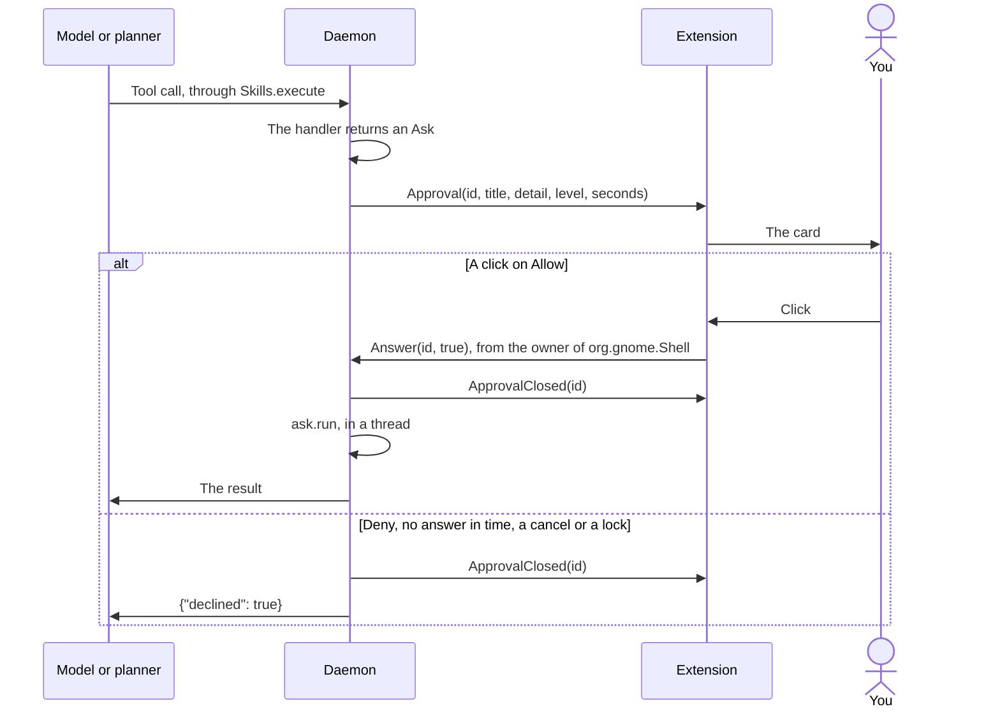

# Tuxistant component contract

The single source of truth for how the parts fit together. Change it here first.

## Layout

| Path | Owner |
|---|---|
| `tuxistant/` | Python daemon, CLI, Settings app. Runs on system `python3` (3.14), deps: dbus_fast, websockets, PyYAML, gi (Gtk 4, Adw 1) |
| `extension/tuxistant@buengenio/` | GNOME Shell 50 extension (blob, hotkey, status icon, right-click menu) |
| `themes/<id>/` | Bundled themes (`theme.json`, `shader.glsl`). User themes: `~/.local/share/tuxistant/themes/<id>/` |
| `helper/` | Fn-key helper + its systemd system unit |
| `packaging/`, `install.sh` | User units, D-Bus activation file, installer |
| `tests/` | stdlib unittest. No test may need a real mic, speaker, or the user's GNOME session. See [TESTING.md](TESTING.md) |
| `tools/` | `try-nested.sh`, `docs_images.py` for the pictures in the docs, and the live evaluations `eval_routing.py`, `eval_flows.py` and `check_voices.py` |
| `website/` | The static site. See [its README](../website/README.md) |

## D-Bus

Session bus. Name `org.tuxistant.Daemon`, path `/org/tuxistant/Daemon`, interface `org.tuxistant.Daemon`.
Structured values are JSON strings. The daemon is D-Bus activatable.

Methods:

| Method | Signature | Meaning |
|---|---|---|
| `Toggle` | `() -> ()` | idle: start a VAD turn. Active: cancel |
| `HoldStart` | `() -> ()` | Start a push-to-talk turn (client-committed) |
| `HoldEnd` | `() -> ()` | Stop mic, commit, request the reply |
| `Cancel` | `() -> ()` | Stop everything, back to idle |
| `DictateStart` | `() -> ()` | Start dictating, from the shell only. See "Dictation" |
| `DictateEnd` | `() -> ()` | Stop listening and type what was said |
| `DictateToggle` | `() -> ()` | `DictateStart`, or `DictateEnd` if already dictating |
| `GetState` | `() -> s` | Current state |
| `GetConfig` | `() -> s` | `Config.public()` as JSON; never contains the API key |
| `SetConfig` | `(s key, s json_value) -> ()` | Validated by `Config.set`; emits `ConfigChanged`. A new `server` clears `api_key`: a key only goes to the server it was given for |
| `ListVoices` | `() -> s` | `voices.catalog()` |
| `PreviewVoice` | `(s voice) -> ()` | Speak a short sample in that voice, without changing config. Replies once it has been spoken; a failure is a D-Bus error |
| `Say` | `(s text) -> ()` | Speak text in the configured voice |
| `ListThemes` | `() -> s` | `{"themes": [...], "problems": [...]}` from `themes.discover()`. Can take seconds: allow 30 |
| `PreviewTheme` | `(s id) -> ()` | Emit `ThemePreview` |
| `ListSkills` | `() -> s` | `Skills.listing()` |
| `ListPhones` | `() -> s` | `phone.devices()`: `[{"id", "name", "type", "connected", "paired"}]`, empty without GSConnect |
| `Hello` | `(i level) -> ()` | From the extension when the daemon comes online: `level` is 1 if it can draw approval cards, 2 if it can also type dictated text. 0 on the way out, which also stops dictation |
| `CanAsk` | `() -> b` | Whether an extension has said level 1. Without one, `Controller.ask` refuses at once and the user hears why |
| `CanType` | `() -> b` | Whether an extension has said level 2. Without one, dictation says why and never opens the microphone |
| `Answer` | `(s id, b allow) -> ()` | The click on an approval card. An unknown id does nothing. `Hello`, `Answer`, `SelectionText`, `Typed` and the three `Dictate` methods are refused from anyone but the current owner of `org.gnome.Shell`, checked before dispatch by `Daemon.guard` |
| `SelectionText` | `(s id, s text) -> ()` | Reply to `SelectionWanted` |
| `Typed` | `(s id, s how) -> ()` | Reply to `TypeText`: `typed`, `pasted`, `copied` or `refused` |
| `GetHistory` | `(i limit) -> s` | `History.recent()` |
| `ClearHistory` | `() -> ()` | Emits `HistoryChanged` |
| `OpenSettings` | `() -> ()` | Launch `tuxistant settings` |

Signals:

| Signal | Signature | Meaning |
|---|---|---|
| `StateChanged` | `s` | `idle`, `connecting`, `listening`, `thinking`, `speaking`, `error` |
| `Presence` | `b` | Whether the blob should be visible. False after Fn release when `hide_on_release` is on, even while the reply is still being processed and spoken |
| `Level` | `d` | 0..1 audio level, 25 to 30 Hz while listening or speaking |
| `Transcript` | `s text, b final` | What the user said |
| `Reply` | `s` | What Tux is saying |
| `Error` | `s` | Human-readable problem to show |
| `ConfigChanged` | `s key` | A setting changed |
| `ThemePreview` | `s id` | Show this theme for about 4 s, cycling through states |
| `HistoryChanged` | none | History was added to or cleared |
| `Approval` | `s id, s title, s detail, s level, i seconds` | Show the approval card. `level` is `click` or `admin` (runs as root). No answer within `seconds` is a no |
| `ApprovalClosed` | `s id` | Take the card down: answered, timed out or cancelled |
| `SelectionWanted` | `s id` | Send the selected text, or else the clipboard text, to `SelectionText` |
| `DictationStarted` | `s id` | Note the focused window: the words are for that one |
| `TypeText` | `s id, s text, b only_copy` | Put the words where the cursor is, then reply with `Typed`. Sent to the shell alone, not broadcast. `only_copy` is true after the time limit |

## Locked screen

GNOME Shell disables the extension at lock, so the daemon follows `ActiveChanged` and `GetActive` of `org.gnome.ScreenSaver` on `org.gnome.Shell.ScreenShield`, `/org/gnome/ScreenSaver`. While the shield is up it cancels any job and ignores `Toggle`, `HoldStart`, `Say` and `PreviewVoice`, in the controller, so that holding Fn is covered too.

## Approvals

`tuxistant/gate.py`. A handler in `HANDLERS` takes `(args, config, session)` and returns a dict, or an `Ask(title, detail, run, level, timeout_s)`. `Skills.execute` is the only way an action runs, for the model and the planner alike:

1. If the conversation has read something private (`session.tainted`) and the action's `network` permission names anything but `home`, it asks first. `home` means the server this install already talks to.
2. The handler runs: in a thread, or on the event loop if it is `async def`. Only async handlers may use `session.confirm`, `busy`, `selection` and `execute`.
3. An `Ask` goes to `session.confirm`, which puts up the card. Yes runs `ask.run` in a thread. Anything else returns `{"declined": true, ...}` to the model.
4. Success with `files_read`, `shell` or `clipboard` sets `session.tainted`.



Title and detail are written by daemon code from what will really happen, never from a manifest or from model text, and `printable()` turns control and bidi characters into visible escapes. A click is required: no voice "yes", as audio playing nearby could say it. `ask.run` must act on what the card showed, not on a fresh look at the world. What was asked and the answer are kept in the action's history record under `asked`.

A handler that wants its result spoken in another language appends a `Speak(text, voice, model)` to `session.after`. The app says it after the model's reply, and the model never sees the text, because Kokoro would read it as English. An empty `voice` shows the text without speaking it. `research.run` uses it too, so that its sources and caveats are said as written and text from the web never reaches a model with tools.

## Dictation

`tuxistant/dictation.py` and `extension/tuxistant@buengenio/typist.js`. Tap Fn, then press it again within 0.4 s and hold it. `dictate-shortcut`, `<Control><Super>d` by default, starts and stops it instead, for long passages and keyboards without Fn.

No model is involved and no tool can start it, so what is said can't become an instruction and nothing here needs a card. The words are not kept: no `Transcript`, no history row, no log.

1. `DictationStarted`. The extension notes the focused window.
2. The microphone fills a buffer, up to 300 s. Release, `DictateEnd` or `DictateToggle` keeps 0.2 s more, so the last word isn't cut off. Another key pressed with Fn, `Cancel`, a lock, or losing the shell or the extension drops the lot. A hold too short or quiet to be speech ends quietly. If the microphone dies, what it heard still goes on.
3. The audio goes to `/v1/audio/transcriptions` as a WAV, with `transcribe_model`. From here the words travel apart from the job, so a new go or a talk hold can start at once. They reach the window in the order they were said, and only `Cancel`, a lock or losing the shell stops them.
4. `clean()` turns line breaks and control characters into spaces, so the text can't press Enter in a terminal or a chat box. The extension does the same again, as it can't know who sent it. A trailing space keeps the next go from running on.
5. `TypeText`. The extension decides in this order:
   - An id it wasn't told about: nothing.
   - A field that says it's a password, at the start or now: nothing is typed or kept, and it says so. `refused`
   - The time limit ran out, no window at the start, the focus has moved, or a shell dialog is up: copied to the clipboard, and it says so. `copied`
   - A text field with an input method, and words that fit in one Wayland message: `Main.inputMethod.commit`. Any language, no key presses, the clipboard untouched. `typed`
   - Anything else, which is XWayland, most Electron apps and long passages: clipboard and primary selection, Shift+Insert, then both put back after 2 s. `pasted`
6. `Typed`. With no reply in 3 s the daemon reports an error.

Why a paste and not keystrokes: where no field has focus, keystrokes would fire single-letter shortcuts, and a paste does nothing. Why Shift+Insert and not Ctrl+V: a layout with no `v`, such as Cyrillic, can't send Ctrl+V. Terminals paste the primary selection with that key, which is why both are set.

The paste rules, all learned the hard way: a single commit over 4096 bytes kills the app, so anything over 3500 is pasted. Saving the clipboard waits 300 ms at most, as its owner may be hung, then the focus is checked again. What goes back is one type of content: text if there was any, else the first type offered. If the clipboard couldn't be saved, or held a password manager's copy, it is cleared rather than left holding the words. Anything copied in those 2 s is left alone.

## Realtime protocol (LocalAI v4.12.1, verified live)

`ws://<server>/v1/realtime?model=<pipeline>`, header `Authorization: Bearer <api_key>`. PCM s16 mono 24 kHz, base64. `server` is `host[:port]`, or `https://host[:port]` for TLS, which uses `wss://`. Both clients ignore proxies and refuse redirects, so the key goes to that host only.

1. Wait for `session.created` before sending anything. Audio sent earlier is lost (cold start takes about 6 s).
2. Send `session.update`: `{"type":"realtime","instructions":...,"tools":[...],"audio":{"output":{"voice":...}}}`. `audio.output.voice` is honoured. Wait for `session.updated`.
3. VAD turn: stream `input_audio_buffer.append`; the server detects the turn.
4. Hold turn: also send `audio.input.turn_detection: null` in session.update. On release send `input_audio_buffer.commit`, then `response.create`. If the commit produces no user item the server sends `response.done` status `failed` (`input_not_committed` in `status_details.error`), sometimes after an `error` event with that code: go quietly back to idle.
5. Events: `input_audio_buffer.speech_started`, `input_audio_buffer.committed`, `conversation.item.input_audio_transcription.completed` (`transcript`), `response.function_call_arguments.done` (`name`, `arguments`, `call_id`), `response.output_audio.delta` (`delta`), `response.output_audio_transcript.done` (`transcript`), `response.done`, `error`. Also accept the beta names `response.audio.delta` and `response.audio_transcript.done`.
6. Tool call: reply with `conversation.item.create` `{"type":"function_call_output","call_id":...,"output":"<json>"}`, then `response.create`. A response that only called a tool has no audio; its `response.done` must not end the turn. De-duplicate by `call_id`.
7. Speech synthesis outside a session: `POST /v1/audio/speech` `{"model": tts_model, "voice": ..., "input": ...}` returns a WAV. Split long text by sentence: long passages can run the 8 GB GPU out of memory.
8. Speech to text outside a session: `POST /v1/audio/transcriptions`, multipart with `model` and `file`, returns `{"text": ...}`. 23 s of speech took 0.9 s with Whisper turbo on the RTX 4060, with punctuation.

## Fn helper

`helper/tuxistant-fn` runs as a sandboxed system service (`DynamicUser`, group `input`, no network). It finds input devices that report `KEY_FN` (0x1d0) by scanning `/sys/class/input/event*/device/capabilities/key`, and reads raw `struct input_event` records with no extra libraries and no `EVIOCGRAB`, so Fn keeps working normally.

It serves `/run/tuxistant-fn/events.sock` (Unix stream, broadcast to all clients), one word per line:

- `down`: Fn pressed
- `up`: Fn released
- `other`: another key was pressed while Fn is held. Never says which key, and is never sent when Fn is not held

Nothing else may ever leave this helper. The daemon owns timing: `down` starts a `fn_hold_ms` timer; `other` or `up` cancels it; if it fires, `HoldStart`; `up` after that means `HoldEnd`. A `down` within 0.4 s of a tap, meaning a press under 0.3 s with no other key, is `DictateStart` straight away, `up` then means `DictateEnd`, and `other` cancels it, because that was a Fn shortcut. A missing socket must not stop the daemon: retry quietly every 5 s. `TUXISTANT_FN_SOCKET` overrides the path, for tests.

## Themes

`theme.json`:

```json
{ "id": "orb", "name": "Orb", "author": "...", "version": "1.0.0",
  "layout": { "kind": "orb", "size": 220, "anchor": "bottom-right", "margin": 32 } }
```

`layout.kind` is `orb` (`size` px wide, optional `height` px, `anchor`, `margin`) or `band` (`height` as a fraction of the monitor, full width, anchored to the bottom edge, click-through, so its right-click menu is the panel icon's). `id` must equal the folder name. Validation is in `tuxistant/themes.py`.

`shader.glsl` defines `vec4 tux_theme(vec2 uv)`: `uv` is 0..1 with (0,0) at the top-left of the actor; returns premultiplied RGBA. The extension prepends these uniforms and wraps the function in a Cogl fragment snippet:

```glsl
uniform float u_time;    // seconds
uniform float u_level;   // smoothed 0..1 audio level
uniform float u_appear;  // 0..1 show/hide animation (the host also multiplies output by it)
uniform float u_listen;  // 0..1 blend: listening
uniform float u_think;   // 0..1 blend: thinking or connecting
uniform float u_speak;   // 0..1 blend: speaking
uniform vec2  u_size;    // actor size in logical pixels
```

Rules: only `#if`-family directives, no backslashes, no textures, no `while` or `do`, loops of the form `for (int i = 0; i < 8; i++) {` that run at most 1024 times per pixel, under 64 KB. Themes are data only and never contain code that runs outside the GPU. A user theme is listed only after `tuxistant/shader_trial.py` has compiled, linked and drawn it in a throwaway process, as a shader can crash or hang the shell it runs in.

## GNOME specifics (verified on Shell 50.1, this machine)

- Keybinding: `Main.wm.addKeybinding(name, settings, Meta.KeyBindingFlags.IGNORE_AUTOREPEAT, Shell.ActionMode.ALL, handler)`; a held key must not toggle on and off. The key is `toggle-shortcut` in the schema `org.gnome.shell.extensions.tuxistant`. Default `<Control><Super>space` is unused here.
- Shader host: subclass `Shell.GLSLEffect`, implement `vfunc_build_pipeline()` with `this.add_glsl_snippet(Cogl.SnippetHook.FRAGMENT, declarations, code, false)`, set values with `this.set_uniform_float(location, 1, [value])`; see `ui/lightbox.js` in the shell's gresource. `Shell.GLSLEffect` caches its pipeline per GType, so each theme needs its own dynamically registered class with a unique GTypeName.
- Wayland: the running shell cannot load a new extension without a logout. Test in a headless shell only.
- GJS doesn't keep a boxed value it hands to a callback, such as the `GLib.Bytes` from `St.Clipboard.get_content`. Copy it inside the callback. Keeping it and using it later crashes the shell, and on Wayland that ends the user's whole session.
- One `Main.inputMethod.commit` must stay under the 4096 bytes of a Wayland message, or the client dies with "Argument list too long". Only the last commit in a tick survives, so a long text can't be split into several in a row.
