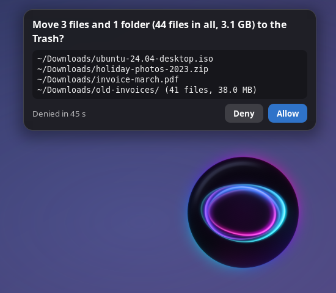

# Skills

A skill is something Tux can do for you, such as telling the time. It declares typed actions and the permissions it needs. The model sees the actions as tools and calls them during a conversation; the daemon runs them and hands the result back to be spoken.

## What exists today

Built-in skills, in `tuxistant/skills_builtin/`:

| Skill | Actions | Permissions | Risk |
|---|---|---|---|
| Time, Disk | `time.now`, `disk.usage` | none | low |
| This computer | `system.info`, `system.running` | `files_read`, and `network: [home]` for what runs on your server | medium |
| Folder sizes | `disk.folders` | `files_read` | medium |
| Weather, News | `weather.forecast`, `news.headlines` | `network` | medium |
| Files | `file.find`, `file.open` | `files_read` | medium |
| Trash | `file.trash` | `files_write` | high |
| Phone | `phone.ring`, `phone.battery` | none | low |
| Phone send | `phone.send` | `files_read` | medium |
| Media | `media.control`, `media.playing` | none | low |
| Apps | `app.open` | none | low |
| Timers and reminders | `timer.set`, `timer.list`, `timer.cancel` | none | low |
| Home Assistant | `home.set` | `home_control` | medium |
| Home Assistant status | `home.status` | `home_read` | medium |
| Calendar | `calendar.events` | `calendar_read` | medium |
| Add to calendar | `calendar.add` | `calendar_write` | medium |
| Mail | `mail.search` | `mail_read` | medium |
| Translate | `translate.text`, `translate.selection` | `network: [home]`, and `clipboard` for the selection | medium |
| General knowledge | `knowledge.answer` | `network` | medium |
| Web search | `web.search` | `network` | medium |
| Research | `research.run` | `network` | medium |
| Shell | `shell.run` | `shell` | high |
| Task | `task.run` | `shell` | high |

A skill with a `home` network permission only talks to the server this install already uses, or for This computer, that server as your ssh_config reaches it (see below).

`system.running` says what lists a program or service by its name, on this computer or on the server in Settings, such as "Is LocalAI running on my server?", and what the server lists as a whole, such as "What's running on my server?". Tux says what docker and systemd list about a name on your server, and what runs on this computer, in their own words: each row that has the name in it with its state as the list gave it, how many rows it looked through, whether a list went on past what it read, and why a list wasn't read. It doesn't judge whether an app works. A state such as "Restarting (1) 5 seconds ago" or "active (exited)" is said as docker or systemd gave it, and no answer says yes or no.

It has no tool of its own, as every tool costs the small model some of its other answers: `system.running` takes an `on`, the other computer the user named, and left out it means this computer. It is free text rather than a choice, as with a choice the model picked "this computer" for "Is LocalAI running on myserver?" and the server's name was lost. It goes to the server for an `on` with the word "server" or "servers" in it, such as "my server", "the home server" or "our servers", or that is the server as Settings has it, also with its port or `http://`, as `nas.lan:8080`, or the server's name or its first label, with "my", "the", "home", "server", "box" or "host" around it, or words such as "ssh", "docker" or "containers", and in any spelling, so "my nas", "my home nas", "my nas box" and "ssh nas" name `nas.lan`, "zephyr nas" names `zephyr-nas.lan` and "my-nas" still names `my-nas.lan`, and for a `name` that is "server" with only words like these around it, such as "my home server", with no `on`. An `'s` after a word is left out, so "the nas's docker" names `nas.lan` too, "my server's" is my server, and "what's running" is the whole list. The model copies `on` word for word, so "my minecraft server" goes there too, and an `on` with more in it than the server, such as that or "my work server", gets an answer that starts "I checked the server in Settings," and its first label, as it may not be the one meant, or "I tried the server in Settings," when the server didn't answer, as with no connection or a key it turned down, though not when ssh isn't installed here, as nothing was tried. An address names the server only as the same address, though in any spelling, as `fd00:0::12` for `[fd00::12]`, in `on` or as the `name`, so `192.0.21.2` is another computer when the server is `192.0.2.12`, though their digits are the same, and a name only with the same numbers, so `web1-1` is not `web-11.lan`. An `on` naming some other computer gets "I can only check this computer and the server in Settings.", or with no server in Settings "There's no server set in Settings, so I don't know which one to check.", and then what this computer lists, as "I can only check this computer and the server in Settings. No service systemd lists here, and no process's command line, has plex in it.", or that first sentence alone for a name of two words, which nothing here is looked up by, so nothing said sounds as if it were about the other one. That says what runs here, so it marks the conversation as any `system.running` does. Words for this computer, such as "my laptop", "here", "localhost", a loopback address or this computer's own name, also with "my" or "box" around it, mean this computer. A `name` that is the server's name, or the first label of it, is looked for on this computer first when there is no `on`, and only when nothing here has it does the server answer, after what this computer lists, so a server called `docker.lan` or `plex` still lets "Is docker running?" look here, "on this computer" stays here, and on `plex.lan` "Is Plex running?" gets an answer that starts "No service systemd lists here, and no process's command line, has plex in it. On your server, docker lists plex, Up 2 days." An address has no first label, and a name no program here could have, such as `fd00::5`, goes to the server straight away. When the server doesn't answer, what this computer lists still comes first, so a sleeping server doesn't hide it.

On this computer, the services are what `systemctl list-units --type=service` lists, the system's and your user's, and the processes are what `pgrep -l -i -f` lists, with the name as a pattern that takes it in any case and with any of `-`, `_`, `.` or a space between its letters, so "localai" finds the `local-ai` process that the image in `server/compose.yaml` runs. `list-units` lists units that are active, failed or have a job waiting, so a service that is stopped with nothing waiting isn't among them. `pgrep -f` matches a process whose command line is empty, as a kernel thread's or a zombie's is, by its own name instead, which is why the processes are said to have the name "in their command line, or in their name where they have none". Tux says up to 4 of each and how many more, each process by its pid and its own name as `pgrep -l` gives them, never its command line, which may hold another program's password or token, and what Tux says is heard, sent to the speech server and kept in History: "On this computer, systemd lists php-fpm.service, active (running), and these processes have php-fpm in their command line, or in their name where they have none: 1234 php-fpm; and 1240 php-fpm." A process found by a later word of its command line is said by its own name all the same, as `man` for "nginx" in `man nginx`. A line from pgrep is said only as a pid and a name of up to 15 characters, as long as Linux keeps a user process's own name, or of up to 63 for a process its `/proc/<pid>/stat` flags as a kernel thread, which has no command line and whose name Linux keeps whole, such as `kworker/R-nvme-wq`. Any other line is counted, not said, as "pgrep listed 1 process in a way I couldn't read", so whatever a pgrep prints, no more than 15 characters after its pid are read out for any process but a kernel thread. With none, it says "No service systemd lists here, and no process's command line, has php-fpm in it." A list it couldn't get is said so, as "pgrep didn't list the processes", "I couldn't read all of systemd's list here." or, when it read neither of systemd's lists, "I couldn't read systemd's lists here.", rather than counted as having none. A process's name is any program's text, so the app says the answer itself, and none of it goes back to the model.

On the server it runs one fixed command that reads, over ssh to the host part of `server`, never the port: `systemctl is-active docker.service`, `docker -H unix:///var/run/docker.sock ps` with a fixed template and `systemctl list-units --type=service`, with no `--state`, so the units are read in every state it lists them in, active and exited, activating, failed and the rest, through `sh`, whatever the remote user's shell, with the `PATH` it gets. `docker ps`, with no `-a`, lists the containers that are running, restarting or paused, so one that has exited or was only created isn't among them. `docker ps` runs only while `systemctl is-active` says `docker.service` is active, and only at docker's own socket, so the command itself starts nothing there. A docker you stopped stays stopped, though its `docker.socket` would start it again, with every container set to restart, if `docker ps` asked it. A docker that isn't the system's `docker.service` isn't asked either, as it may be podman's shim, whose first `podman ps` for your user sets up podman's storage and leaves its pause process running, a rootless docker, whose unit is your user's own `docker.service`, or a NAS's own. Tux then says what `systemctl` said, with the word it gave: "On your server, systemctl says docker.service is inactive, so I didn't ask docker.", or with systemd 253 or later, whose `is-active` exits with 4 for a unit that isn't there, "On your server, systemctl says there's no docker.service unit, so I didn't ask docker." When `systemctl` doesn't say, as with a D-Bus that is down or a timeout, `docker ps` isn't run either, as a socket may be listening: Tux says "systemctl didn't say whether docker.service is active (exit status 1), so I didn't ask docker." or "systemctl took too long to say whether docker.service is active, so I didn't ask docker." With no `systemctl` at all, Tux says "On your server, I couldn't find systemctl, so I didn't ask docker or list the services." Asked, docker may give "docker said permission denied.", "docker gave an error (exit status 1).", "docker took too long to answer.", "I couldn't read docker's answer." or, with no `docker` on the `PATH` `sh` had, "systemctl says docker.service is active, but I couldn't find a docker command.", or for one it found but couldn't run, "systemctl says docker.service is active, but I couldn't run docker." The services may give "systemctl took too long to list the services.", "systemctl didn't list the services (exit status 1)." or "I couldn't find systemctl, so I couldn't list the services." `-H` goes over a `DOCKER_HOST` or docker context of the ssh user's, which may be a rootless docker, podman's socket or another machine, so what is listed is the system docker's alone. Only a docker stopped between the check and `docker ps`, which a slow D-Bus can make up to 8 seconds apart, could still be started by its socket. The login itself opens a session there, as any ssh does, which starts your user services, such as a rootless docker enabled with `systemctl --user`, if nothing else keeps them running, and they stop again soon after it ends. What the server runs for any ssh login with that key, such as an authorized_keys `command=`, a `ForceCommand` or `~/.ssh/rc` there, runs too, before the command or in its place, and the key check in check 31 of the roadmap shows what it prints. With no server in Settings it says so. When the server in Settings is this computer, as when LocalAI runs here, a name is checked here, which is the same machine, and the whole list gets a sentence saying it can only check one name here. An `on` with more in it than the server, such as "my work server", may be another one, so it gets "I can only check this computer and the server in Settings. The server in Settings is this computer." and what this computer lists. A host counts as this computer when it is a loopback address, a localhost name, such as `localhost6` or any name under `.localhost`, or this computer's own name as `hostname` gives it, its first label, or that with `.local`. Any other name for it, such as `thislaptop.lan` from your router, is asked over ssh like another computer, so it needs an ssh server here. The port, user and anything else about the connection come from your `~/.ssh/config`, apart from what the command line sets over it: `BatchMode=yes`, `StrictHostKeyChecking=yes`, `UpdateHostKeys=no` and `CheckHostIP=no`, so nothing is written to `known_hosts`, a 5-second connect timeout, no agent (`-a`, `IdentityAgent=none` and no `SSH_AUTH_SOCK`), no Kerberos ticket handed over (`GSSAPIDelegateCredentials=no`, which an ssh built without GSSAPI says it doesn't support and goes on), no forwarding or `Tunnel`, no `RemoteCommand`, `LocalCommand` or `ControlMaster`, `ForkAfterAuthentication=no`, `SessionType=default` and `LogLevel=ERROR`, which keeps a long banner from hiding why ssh failed. ssh run without `-F`, as it is so that your `~/.ssh/config` counts, makes a `~/.ssh` folder when your home folder has none, so then Tux doesn't start it and says so. `IgnoreUnknown=*` comes first, so an ssh older than 8.7 skips the two options it doesn't know. The first one given wins, so it replaces any `IgnoreUnknown` in your config, and with `*` an option only yours let through, such as macOS's `UseKeychain`, still doesn't stop ssh. What your own ssh_config runs itself, such as a `ProxyCommand` or `Match exec`, still runs, as it does for your own ssh. A `ProxyJump` there is a second ssh that none of these options reach: it goes by your ssh_config alone, so an agent, `ControlMaster` or host-key setting you have there still applies to that hop. It has 10 seconds in all and stdin from `/dev/null`, and gets only `PATH`, `HOME`, `USER` and `LANG` from the daemon's environment, so it needs a key that works without a passphrase or the agent. A security key, an `-sk` key, isn't supported: ssh waits for a touch that nothing asks for, so Tux says the server took too long, and a touch meant for something else would let it in. The server's host key has to be in a `known_hosts` file your ssh_config reads: with `UserKnownHostsFile /dev/null` for it, as some set for machines on their own network, Tux never finds it and says to connect once in a terminal, which can't help then. Once ssh has exited and its output has ended, whatever is left in its process group is killed, so a helper holding its error output doesn't hold the answer. A helper of yours that leaves the group itself is not. Killing ssh doesn't end what it started on the server, so there each of the three reads runs under `timeout 8` where `timeout` works. The host goes as one argument after `--`, and one that could start an option or holds anything but host characters is refused before ssh starts.

The model writes no part of the command: it may name one program or service, a short name, which is matched against the answer on this computer, and never sent. Words around a name, such as "server", "service", "container" or "docker", are left out of it, so "the minecraft server" is minecraft and "the plex service" is plex, and a unit's `.service` is left out too. There is one match rule: the name, in any case and without `-`, `_`, `.` or spaces, is inside a container's name or its image as docker lists it, or inside a unit's name before `.service`, without them too. So "home assistant" finds `home-assistant`, `homeassistant` and a container of the `ghcr.io/home-assistant/home-assistant` image, and "localai" finds `local-ai`. An app whose containers and units don't carry the name isn't found, and one that only shares letters with it is, as any row with the name inside it is said. Each row that matches is said as its list gave it: a container's name and the status docker gave, with its image when only the image has the name in it, and a unit's name with its ACTIVE and SUB as systemd gave them, up to 4 rows of each list and how many more: "On your server, docker lists immich_server, Up 3 hours; and immich_ml, Restarting (1) 5 seconds ago. systemd lists immich.service, active (exited)." With no match, Tux says what it read: "On your server, none of the 31 containers docker lists or the 58 services systemd lists has plex in its name or image." Those are what `docker ps` and `list-units` list, so a plex container that has exited isn't among the 31. A compose wrapper, a sidecar beside an app or a unit that waits to start again after a crash are each said as their list says them, with no word on whether the app works.

The server's own name, "my" or "the" and words such as "docker", "processes" or "apps" with nothing else mean the whole list, and so does the server's first label, or a host with no dot, with words such as "my", "service" or "container" around it, or with an `on` that names the server too: up to 6 containers and 4 services with their states and how many more, as "On your server, docker lists 2 containers: local-ai, Up 3 days; and searxng, Up 2 hours (unhealthy). systemd lists 2 services: nginx.service, active (running); and ssh.service, active (running).", with what has the server's first label in it first, so "the plex service" on `plex.lan` names a `plex` container first. The label alone is a name like any other when it was looked for here first, or with an `on` that says server without naming it, as "Is Plex running on my server?" on `plex.lan`. "docker", "dockerd", "the docker daemon" and "docker engine" mean the whole list too, with what has docker in it first, which starts with what `systemctl` said of `docker.service`, or why it said nothing: "On your server, systemctl says docker.service is active." or, when docker didn't list its containers then, "On your server, systemctl says docker.service is active, but docker said permission denied." "ssh", "sshd" or "openssh" gets "I reached your server over ssh." and the services with ssh in their name, in whatever state systemd lists them, which leaves out one that is stopped with nothing waiting, such as "I reached your server over ssh. On your server, systemd lists ssh.service, activating (auto-restart).", with no claim about which ssh server answered, as Tailscale SSH or Dropbear may have.

What comes back is the server's text, so it is cut at 64 KB and 300 lines a part. A list that went on past that is said to, with "docker's list went on past what I could read.", and a no counts "the first 300 containers docker lists". A row whose name, image, status or state doesn't look like one is counted but not said, with "docker listed 1 container in a way I couldn't read.", and a no then counts "the 1 container I could read of docker's list". A name longer than 64 characters is said up to the last `-`, `_` or `.` in its first 64, or as its first 64 where there is none, followed by "…". The app says the answer itself: none of it goes back to the model. Errors are sentences: no server set, the whole list asked for when the server is this computer, ssh missing, the key turned down, an unknown host key, a host key that has changed, which it says can mean someone is in the way, no connection, too slow, an answer it couldn't read, and each reason above that a list wasn't read.

Full listings are for a Linux server reached over ssh where systemd runs the services, and runs docker as the system's `docker.service`: the Docker CLI talking to dockerd, from docker-ce or docker.io, socket-activated or not. Any other setup, such as podman or its docker shim, a NAS with its own docker, rootless docker, snap's docker, a server without systemd or an unusual `PATH`, may get a sentence saying what Tux couldn't ask there instead, such as "On your server, systemctl says there's no docker.service unit, so I didn't ask docker.", with systemd before 253, which doesn't tell a unit that isn't there from one that is stopped, "On your server, systemctl says docker.service is inactive, so I didn't ask docker.", or "On your server, I couldn't find systemctl, so I didn't ask docker or list the services." Only the system's docker, at `/var/run/docker.sock`, and the system's own services are read there, not a rootless docker or user services of the ssh user's beside them, so "docker lists" and "systemd lists" in what Tux says mean those two. What it can't avoid is the ssh login itself: without lingering, logging in starts your user's systemd manager there and the user services you enabled, such as a rootless docker with its containers, which stop again about 10 seconds after the login ends. With `loginctl enable-linger` for the ssh user there, your user services keep running, so the login doesn't start them. It still opens a session there, as any ssh login does, and runs what the server runs for any login: its PAM session, such as Ubuntu's update-motd scripts, and the start-up files your shell there reads, such as `~/.zshenv`.

On the server it needs no card, as on this computer. The This computer skill now declares `network: [home]` beside its `files_read`, which changes no card and no risk: `home` doesn't count as leaving, and it was medium already. The rule under "What needs a click" is there so nothing private from the conversation leaves without a click, and nothing from the conversation goes into this call: the command is fixed and the name is matched here. Where it connects is your server as your ssh_config reaches it, which a `HostName` or `ProxyJump` there can make another machine, so it is the ssh key, not the address, that it uses. What runs on your server is private, though. `files_read` already marks the conversation after any `system.running` that read something, here or there, and the server's answer marks it too, so a web search after it asks first, as after `system.info`. `tools/eval_cutoffs.py` puts a made-up server in place of ssh, so no evaluation reaches yours, and made-up services and processes in place of `systemctl` and `pgrep` here, so no evaluation prints your own.

Calendar goes through Evolution Data Server, the service GNOME Calendar uses, so Google, CalDAV and Microsoft accounts are added once in GNOME's Online Accounts and Tuxistant holds no password or token for them. Reading needs no card, but it counts as reading something private, so afterwards nothing leaves your own server without a click. Adding always shows a card with the title, the full date, the times and the calendar. The model passes the day and time as you said them, and the dates are worked out in `tuxistant/calendars.py`, because a small model invents dates. An event's title is whatever the person who sent the invitation typed, so it is cut short and its control characters shown as escapes before the model sees it.

Mail answers a question from the search index Thunderbird keeps on this computer, so finding a mail needs no account, no password and no network, and the file is only ever opened read-only. Reading one uses the model on your own server, as everything does. It is off until you turn it on in Settings, and until then the model isn't offered the tool at all. Reading needs no card, but it counts as reading something private. A mail is a stranger's text, so none of it goes back to the voice model: the best matches are read one at a time by a model call with no tools, and the app says the answer itself, with who sent it and when added from the index. A sender is named by address or domain, never by the name beside it, which is whatever they typed. Junk, Trash and drafts are skipped. Sign-in codes and passwords are hidden from a mail before it is searched or read, so one can't be found or said, and a request for one is refused. Among mails holding as many of the question's words, one from an address that first wrote more than a week ago is read ahead of one from an address that didn't, and an answer from a first-time sender ends with a warning. [CONTRACT.md](CONTRACT.md) has the steps.

News declares every source Settings offers, and reads only the one you chose. The list is fixed in `tuxistant/livedata.py`, so a news request can't be pointed at a host that isn't written there, and a redirect to another host is refused. When a card has to ask before the news is fetched, it names the one host that will be reached.

Media pauses, resumes and skips whatever is playing, tells you what it is, and changes the volume, with no card, even after the conversation has read something private. It reaches players through MPRIS, which Spotify, VLC, Firefox, Chromium and most others speak, and the volume through PipeWire's `wpctl`. A player is only ever sent Play, Pause, PlayPause, Next, Previous or Stop with nothing attached, and the volume stops at 100 percent, so the most a confused model can do is pause or skip your music, or resume what was already there. It can't open a file or an address: MPRIS has a call for that, and it is left out on purpose. A title is whatever the web page or the file says, so media replies are read by the app itself and never returned to the model with tools. Titles are cut short and control characters shown as escapes. With several players it means the one that is playing, and asks which you mean if more than one is.

Apps opens an installed app or a page of GNOME Settings, with one tool. The list of apps is Gio's, the one GNOME itself uses, with hidden and NoDisplay entries left out. What you say is matched on this computer, not by the model: against the name shown, the untranslated name, the generic name such as "web browser" or "music player", and words inside the name. Only when none of those fits are the desktop id and the program name tried, and only as an exact match, as every Steam game's shortcut runs `steam` and every Chrome web app runs `google-chrome`. Then come the keywords and a close misheard spelling, the last only when what was said has five letters or more, not counting spaces or a plural "s", as "team" is one letter from "steam", and only when more than half the letters of each word said line up with the name, so "MS Teams" isn't Steam either. "GNOME Settings" and "GNOME Control Center" open Settings. "Browser", "internet" and "mail" mean your default apps, even when those are hidden entries. A Settings page's own name, such as "Bluetooth", wins over every app not named exactly that. Another word for a page, such as "zoom" for Accessibility, loses to an app with that word in its name or as its generic name, desktop id or program, unless you say "settings" or a word like it. Even then, an app named exactly what was said, such as KDE System Settings, wins over a page, and said with a kind word it doesn't have, as "Flatpak KDE System Settings" when only the system one is installed, Tux says so and opens nothing. When several apps match, Tux asks which one, and the same app installed twice, as a Flatpak and from the system, is asked as "Flatpak Firefox or system Firefox", even when the two names differ only in case, spaces or punctuation. A kind word said first or last picks among that kind only when no app is named exactly what was said, so "system monitor" is System Monitor wherever it came from, and "Flatpak The Room" works as the reply suggests. A Settings page is matched against everything said, kind word included, so "system details" is About even beside a system app called Device Details. Only a desktop file from that list is ever started, with `gio launch` in a systemd scope of its own, so the app outlives a daemon restart and isn't under the daemon's memory limit. Nothing the model writes reaches a command line, and no file, address or desktop action is passed. Settings pages come from a fixed table in `tuxistant/apps.py`, and open through GNOME Settings' own desktop file for each page. There is no closing, quitting or switching. An app installed as a package, from the system, Flatpak or Snap, and every Settings page open with no card, even after the conversation has read something private: the model only picks which entry from your own list, opening one sends nothing anywhere, and the worst a confused model can do is open a window you close with one click. A terminal is no exception, as Tux can't type into it. An entry that isn't from an installed package, such as a hand-made shortcut, a game launcher or a browser's "install as app" in your home folder, or a file in `/opt` or `/etc/xdg`, can run any command at all, and often does something as soon as it starts, so it shows a card. The card is made from the file's bytes as read once: the command it runs, a line when it may start over D-Bus instead, runs in a terminal or runs in another folder, and the file it comes from. It says "added in your home folder" only when the file really is there. An entry whose command holds a field code other than `%f`, `%F`, `%u`, `%U` and `%%` is left alone with no card, as `gio launch` fills some of them in with the entry's icon, name or file after the card is shown. An entry whose card would be too long to show in full, as a card's details are cut after 4,000 characters, is left alone with no card too. If the file changes after the card is shown, it is left alone, and a file that can't be read is left alone with no card. App names are other people's text, as a browser's "install as app" names one after the web page, so every reply naming an app is said by the app and never returned to the model. [SECURITY.md](SECURITY.md#opening-apps) has the threat model.

Timers and reminders are kept in `timers.json` beside the history, with the same file mode, and said by the daemon itself when they come due, so they need no card: nothing outside Tuxistant changes. The model passes how long, the day and the time as you said them, and they are worked out in `tuxistant/timers.py`, as for the calendar. A duration makes a timer and a day or a time makes a reminder. A day with no time means 9 in the morning, and "afternoon", "evening" and "night" mean 3, 7 and 9. A bare "at 7" is the next time the clock shows 7, but never before 6 in the morning unless it is to wake you. A label is your own words by way of speech recognition and a model, so it is cut to 60 characters and its control characters shown as escapes wherever it is said or shown. Listing or cancelling hands times and labels from earlier conversations back to the model, so it counts as reading something private, although the manifest asks for no permission: the handler marks the conversation itself. When one comes due there is a notification and Tux says it once, waiting for a turn, a card or dictation to end first and never interrupting. On a locked screen nothing is said until you unlock. Whatever had to wait, for the unlock, a login or the daemon, is said late only within an hour for a timer or a day for a reminder; after that it is missed and only the notification remains. If the words fail before any is heard, as with the speech server down, it is tried again a minute, two minutes and four minutes later, and then missed. Items due after it are not held back by that wait. A lock that cuts the words before any is heard is not a failed try: they are said after the unlock. Once some was heard it counts as said. The `timer_chime` setting, off as installed, adds a short sound with no words, which is then the one thing heard on a locked screen. Only the daemon opens the real file: a test or an evaluation that attaches no store of its own gets "Timers aren't available right now."

Home Assistant is reached through its REST API with a long-lived access token from Settings. Until Settings holds both an address and a token, the model isn't offered the two tools at all, so on a computer with no Home Assistant its list is what it was without them. `SET_UP` in `tuxistant/skills.py` does that, and another skill can use it. The actions stay registered, and one named anyway answers with where to set it up. What you call something is matched against the names and areas Home Assistant has, on this computer, using the whole words in the first 255 characters of each, so a word after the 40 that are said still finds it. A device whose name has no break between words in those 255 characters is matched by the words of its entity id instead. Only typed values reach the server (an entity it listed itself, a service from a fixed table, a number in range, a colour from a fixed list), State values come back as numbers or recognised state words. Entity names also come back: they are cut to 40 characters, control characters shown as escapes, and angle brackets removed. So is a name made from an entity id when there is none, and an unknown kind of thing is cut to 20. Unlocking a lock, opening a cover, activating a scene and running a script show a card naming the entity and the server. A scene has one because it can unlock a door or open a garage and nothing here can see what is in it. So does switching a switch or a helper on, off or over when its name or its id has alarm, siren, lock, unlock, security, arm, armed, disarm or deadbolt in it, or garage, door or gate without light, lamp, bulb, heater or fan: a switch can be the relay on a garage door, and turning an alarm's helper off can disarm it. The name and the id are judged apart, so a switch.porch_light renamed "Garage door" still has a card, and joined spellings such as Doorlock, SmartLock, Frontdoor and Garageopener count, though a clock, a doorbell, a gateway and anything outdoor don't. Locking, closing, lights, other switches, fans, other helpers and temperatures don't. An alarm panel is only read, and a siren is neither read nor changed. So `home.set` declares `home_control`, which makes it medium risk in Settings and nothing more: it isn't `network`, as nothing the model wrote can leave through it. Both handlers mark the conversation private after reading the device list, including change results and errors that reveal names. `home.status` also declares `home_read`, and reading counts as reading something private, as "the front door is unlocked" and "nothing is on" say when a house is empty. They are two manifests because a permission belongs to a skill, not an action. The token goes to the server in Settings and nowhere else: no proxy, no redirect, and never over plain http to an address that isn't on a private network. `GetConfig` never returns it, and a changed address clears it, as a changed server clears the API key.

Code skills that come with Tuxistant, in `tuxistant/skills_code/`:

| Skill | Actions | Permissions | Risk |
|---|---|---|---|
| Lights | `lights.set`, `lights.status` | `network` | medium |

Lights controls Tapo bulbs such as the L530 on your own network. It is a code skill, so it runs in the sandbox below with the network and nothing else. It needs no card, the same as ringing your phone, unless the conversation has already read something private: then the rule under "What needs a click" applies, as it has the network. It finds the bulbs with a broadcast, then remembers them in `lights.json` in its own sandbox folder and asks them directly too, since a bulb saving power misses some broadcasts. It uses the TP-Link email and password from its page in Settings, and until both are there the model isn't offered its two tools, through the same `SET_UP` as Home Assistant: without an account they could only fail, and they would take "the light" from Home Assistant. The password never leaves this computer: KLAP only sends proofs that it is known, and the bulb has to prove it knows it first. Only typed values reach a bulb (on or off, a number, a colour from a fixed list), so it can't carry anything private out. A bulb's name is whatever anyone typed into the Tapo app, so it is cut short and its control characters shown as escapes before the model sees it. Settings lists each skill with its permissions and risk:


A built-in skill is a YAML manifest whose actions have Python handlers in `HANDLERS` in `tuxistant/skills.py`. A code skill brings its own program and runs in a sandbox, like Lights. You can add your own code skills in `~/.local/share/tuxistant/skills/`, and they load while Tux is running. See "Code skills" below. A recipe is simpler: one YAML file in the same folder, with no code, that asks a host it names for something, opens an app or says a sentence. See "Recipe skills" below.

## Reading a skill in Settings

Every skill under Skills in Settings opens to a page of its own, built in or added, so you can read what it is before you trust it, and copy it to make your own. The page shows:

- **What it does and where it comes from:** built into Tuxistant, a code skill that comes with Tuxistant, a code skill you added or a recipe you added, with the file's path for yours.
- **What stands behind the manifest.** A built-in skill is Python inside the daemon, and its page names the module, such as `tuxistant/livedata.py`: the YAML only says what the model is offered, and the code decides what happens. A recipe has no code of its own, and `tuxistant/recipes.py` does what it says. A code skill lists the files of its program, and one you added has "Open folder".
- **Its settings**, where it has any. They live on the skill's page, not on General, which keeps the server and its key, the pipeline, listening, the shortcuts and the instructions. When no skill that shows a setting is loaded, as when Lights can't run without bubblewrap, the Skills page lists it under "Settings of skills that aren't loaded", so a stored password can still be changed or removed.
- **Its permissions** in words, and its risk with the permissions that set it, such as "Because it can use the network".
- **What the model is given.** For each action, the tool name the model sees, its description and each parameter, then the whole tool as JSON. They come from `Skills.tool()`, the same code that builds the list the model is sent, so this is word for word what it reads. An action the model isn't offered now says why: mail search until it is switched on, Home Assistant and Lights until their settings are filled in.
- **The manifest,** whole and read-only, in a fixed-width font, with a Copy button. It is the text that was loaded, so a skill still on its last version that worked shows that version, not the broken file beside it. A recipe has "Open file". A code skill lists its first 100 files and how many more there are.

A skill you add is a stranger's text, so its name, description, actions, files and manifest are shown as plain text, never as markup: `<b>` shows as `<b>`. A line break or tab in a file or folder name shows as `\n` or `\t`, so a name can't fake a second file or another line about where a skill comes from. An older daemon that hasn't been restarted since Settings was updated doesn't have `SkillDetails`. The page then says so and shows the permissions and the actions by name, and the settings still work.

| Skill | Settings on its page |
|---|---|
| Weather | Home town, Use Fahrenheit |
| News | Source |
| Add to calendar | Add events to |
| Mail | Search my mail |
| Timers and reminders | Chime for timers |
| Phone, Send to phone | Default device |
| This computer | Say my Tailscale address |
| Translate, Translate selection | LibreTranslate server |
| General knowledge | Look up facts on Wikipedia, SearXNG server |
| Web search, Research | SearXNG server |
| Lights | TP-Link email and password |
| Home Assistant, Home Assistant status | Address and long-lived access token |
| Multi-step tasks | Use Claude for complex requests, with the agreement it asks for and Withdraw; Anthropic API key; Model |

A setting two skills use is on both their pages. Each page is built when it opens and only one is open at a time, so two rows can never disagree about it.

## Manifest format

A built-in skill is one YAML file. This is the shape of a skill that needs the network:

```yaml
id: org.example.tides
name: Tides
description: Tells you the tide times
version: 1.0.0
permissions:
  network: [api.example.com]
actions:
  tides.today:
    description: Get today's tide times for a place
    params:
      place: { type: string, description: "City name" }
    required: [place]
```

| Field | Meaning |
|---|---|
| `id` | Unique reverse-domain name |
| `name` | Shown in Settings |
| `description` | Shown in Settings |
| `version` | Version of the skill |
| `permissions` | What the skill may do, see below. Use `{}` for nothing |
| `actions` | The actions, by name |

Each action has:

| Field | Meaning |
|---|---|
| `description` | Tells the model when to use it, so write it for the model |
| `params` | JSON Schema properties for the arguments. Optional |
| `required` | Names of the arguments that must be present. Optional |

Action names look like `weather.today`. The model sees them with the dot replaced by an underscore, so two names must not differ only in that way.

A handler takes the arguments, the config and the session, and returns a dict that can be turned into JSON, or an `Ask` when it needs a click first. If it raises, the message goes to the model as `{"error": ...}`, so a failed action becomes something Tux can say rather than a crash. "Approvals" in [CONTRACT.md](CONTRACT.md) has the details.

## Permissions

| Permission | Grants | Risk |
|---|---|---|
| `shell` | Running commands | high |
| `files_write` | Changing files | high |
| `files_read` | Reading files | medium |
| `network` | Reaching the network | medium |
| `clipboard` | Using the clipboard | medium |
| `calendar_read` | Reading your calendars | medium |
| `calendar_write` | Adding to a calendar | medium |
| `mail_read` | Reading your mail | medium |
| `home_read` | Reading the state of your home | medium |
| `home_control` | Controlling devices through Home Assistant | medium |

Set a permission to `true` to ask for it. Names not in this table have no effect on risk.

The permissions set the risk, show up in Settings and drive the rule below. They don't confine a built-in handler, which runs inside the daemon. A code skill is confined: it gets the network only if it asks for it, and it may ask for nothing else.

## What needs a click

`Skills.execute` is the only way an action runs, whether the voice model or the planner asked for it.

- **Anything risky.** A handler returns an `Ask` instead of acting. The card shows what will really happen, written by Tuxistant from the real action, and only a click on it goes ahead. A spoken yes doesn't count, because audio playing nearby could say it. No answer in 45 seconds, a cancel or a locked screen all mean no.
- **An app that isn't from a package.** An app added in your home folder or elsewhere rather than installed as a package shows a card with the command it runs, as that command can be anything. Apps installed as packages and Settings pages open with no click.
- **Private data leaving.** Once a conversation has read files, command output, the selection, your calendar, your mail or the state of your home, any action that reaches past your own server needs a click, whichever skill asks. One skill can't read your files and another send them out.
- **What runs with no click.** Reading, such as `file.find`, and shell commands the parser can prove are read-only. Those run in a sandbox with a read-only filesystem, no network and your secrets hidden. `system.running` on your server needs no click either, but it is not sandboxed: it runs ssh as you, on the network, with your key and whatever your ssh_config runs itself, such as a `ProxyCommand`, `Match exec` or `KnownHostsCommand`. What limits it instead is a fixed command that reads, nothing from the conversation sent, no agent, strict host keys and 10 seconds in all. A `ProxyJump` hop in your ssh_config is a second ssh that goes by that file alone, so an agent or `ControlMaster` you set there still applies to it. A web search or research in a conversation that hasn't read anything private is also this kind of action, and needs no click, and nor does a fact looked up in one, unless its question has words that are often about your home. See "Facts" below.

Every action, every card and the answer to it are in the request history, including what the planner did.

| A normal card | A card for something that runs as root |
|---|---|
|  |  |

## The shell skill

`shell.run` is local and built in, and community skills will never be able to request it.

1. A strict parser reads the command. Anything it doesn't fully understand is not treated as read-only.
2. A command made only of known read-only programs runs in bubblewrap with no click. The parser judges intent and the sandbox is what holds if it is wrong. The sandbox has a read-only filesystem, no network, a seccomp filter and a memory limit, and it hides every dot-entry in the home folder except `.gitconfig`, along with files named like secrets elsewhere. Git runs with a repo's hooks, filters and helpers switched off.
3. Anything else shows the exact command on a card, and approval covers that command once.
4. Deleting previews first and uses the Trash where it can. Anything it can't move to the Trash says it can't be undone.
5. `sudo` alone on a line gets its own warning and runs through `pkexec`. Inside a longer command it is refused.

## Facts

A question of general knowledge is answered from Wikipedia, then web search, and never from the model's memory. If neither clearly says, Tux says it doesn't know. On a hold turn the daemon decides this itself, as the model can't be made to. "Facts" in [CONTRACT.md](CONTRACT.md) has how. A plain question of fact leaves your own server with no click, which is why `knowledge.yaml` declares `network: true`, and why "Look up facts on Wikipedia" in Settings turns it off. Two word filters in `tuxistant/knowledge.py` stand in front of it. A question about the music playing, timers or the home that the narrow one knows by its shape, such as "Is the front door locked?", is refused by the tool itself, so the voice model can't send it by picking the tool. One with a word the wide one holds, such as thermostat, timer or our, that the narrow one lets go, such as "Set the thermostat to 21" or "How old is our galaxy?", shows a card before the tool runs. `Skills.execute` asks for it, and daemon code writes it from the words that would be sent and where they would go. On a hold turn neither kind is sorted, so neither is looked up without the voice model picking the tool. A private question with none of those words, such as "Who's at the door?", can still go out with no click, if the sorter calls it a fact on a hold turn or the voice model picks the tool on any turn it answers.

## Web search and research

Searches go through SearXNG on your own server, set by `search_server`. Left empty, that is the host of the voice server on port 8888. The server is at home but the search isn't: your words go on to the search engines. So both skills declare `network: true`, not `home`, and once a conversation has read something private, a search needs a click like anything else leaving the house.

`web.search` returns at most four results, each a site, a title and a short snippet. `research.run` is ordinary code rather than a model deciding what to do next:

1. It searches, and takes the best result from each of up to five sites.
2. It opens them at once from this computer and keeps the first three that can be read. It never follows a link from a page.
3. The local model summarises each page, in a call that offers no tools.
4. The local model combines the summaries into two or three sentences, again with no tools.
5. Daemon code adds the sources, taken from the page addresses, and says so if a page failed, if there is only one source or if time ran out.
6. The app reads that out itself, as it does a translation. The voice model is told only that it's done, and isn't asked to speak after it. Given the text, it reworded it and dropped the sources and caveats almost every time, so a thin answer sounded certain. Given nothing and asked to speak, it sometimes made up an answer of its own just before the real one: a date, in 2 of 8 tries at "When did I apply to renew my passport?".

The whole thing stops at 45 seconds and answers with what it has. It always uses the local model, even with Cloud turned on. As the voice model never sees the answer, it can't take questions about it afterwards.

**Web text is untrusted.** All of it is cleaned and capped. Cleaning removes hidden characters and every angle bracket, as `<|im_start|>` would be a control token to the chat template and `<tool_call>` a real call to the server's parser. Search results reach the voice model under the key `untrusted_web_text`. Research never reaches it at all: only the summarising calls read pages, and they have no tools. So a hostile page can make Tux say something false out loud, such as a wrong phone number, but it can't act, and whatever the voice model does meets the same gates as always.

**Opening a page is guarded, as anyone on the web can choose the address.** `tuxistant/webfetch.py` takes http and https only, with no user name or password in the address. It looks up the name and refuses it unless every address it gets is on the open internet, which rules out loopback, private, link-local, multicast and reserved addresses, including ones wrapped in IPv6 and unusual spellings of numbers. It also refuses this computer's own addresses, public ones too, such as a global IPv6 address from your internet provider, and the networks of its containers and virtual machines, whatever range they were given, judged as a recipe's request is (see "Where a request may go" under Recipes), as a port Docker publishes answers there. A host has to be an address or a plain name of letters, digits and hyphens once IDNA has encoded it, as the resolver will, and port 0 is refused. It refuses the servers this install talks to by that name, so in any spelling the resolver reads as it, such as fullwidth letters, and by address. Their names may also hold an underscore, as Settings allows; a server whose host holds anything Settings wouldn't save, such as a backslash, stops every page with a sentence saying so; their addresses are looked up each in a thread of its own, and what a lookup answers is kept for a minute and used while the next lookup runs. A failed lookup isn't kept. Research starts those lookups while it searches, and once it has the results waits for them, looking again at a name no lookup has answered yet, never looked up or failed every time, before any page starts its clock. If that lookup hasn't ended within research's time, no page is read. Each page and redirect is checked after its host's lookup, just before it is opened, against the servers the settings name then and every address they have answered with, and one named since is looked up and waited for within the page's time. It connects to the address it checked rather than looking the name up again, and does all of this again for each of at most three redirects. A fetch stops after 8 seconds and 1 MB, a page cut short by the clock or by a server that hangs up before the length it gave isn't read, and it reads only text and HTML, refuses compressed replies, and sends no cookies, no key and no referrer. It doesn't use a proxy.

## Multi-step requests

`task.run` handles requests that need several steps. It runs one step, reads the result and picks the next, with at most 8 steps, and every action goes through the same gates.

It uses the model on your own server unless you turn on Cloud in Settings, on the Multi-step tasks page. It is off by default and needs your Anthropic API key. With it on, Claude sees the request, the names and descriptions of the actions Tux can take, and what each step gives back, such as file names, command output and calendar events. What is inside a file, what Home Assistant answers and the list of timers and reminders go only if you click to allow each one, and so does the request itself once the conversation has read something private.

Turning it on opens an agreement that says all this, names the provider and the model, and links Anthropic's privacy policy. Turn On can't be pressed until "I understand and agree" is ticked; Cancel is the default and Escape cancels. Settings records the agreement in the config with the date, the provider, the model and the version of what is sent, and the page then says "You agreed on" that date, with a Withdraw button that turns Cloud off and forgets the agreement. Switching it off and on again doesn't ask again while the agreement still covers what is sent.

The daemon uses the cloud only when the switch is on, a key is set and that agreement covers this version of what is sent, this provider and this model, and it checks right before every request it sends, a retry included. So without a kept agreement, the switch turned on over D-Bus or in a config file does nothing. With one, the switch alone turns Cloud on again, from Settings or over D-Bus, as switching off keeps it; only Withdraw forgets it. A config from before there was an agreement stays at home until you agree, a new model asks again, and so does every install when a release changes what is sent. See "Cloud agreement" in [CONTRACT.md](CONTRACT.md#cloud-agreement).

## Computed risk

`risk_of()` in `tuxistant/skills.py` works out the risk from the permissions:

- **high** if the skill asks for `shell` or `files_write`
- **medium** if it asks for `files_read`, `network`, `clipboard`, `calendar_read`, `calendar_write`, `mail_read`, `home_read` or `home_control`
- **low** otherwise

The risk is never read from the manifest. A `risk:` line is overwritten when the skill loads, so an author cannot label a dangerous skill as safe.

## Code skills

A code skill is a folder with a `skill.yaml` and a program. Tux runs the program as its own process in a sandbox and talks to it over MCP, one JSON message per line on stdin and stdout. Your own go in `~/.local/share/tuxistant/skills/`, one folder each:

```text
~/.local/share/tuxistant/skills/moon/
  skill.yaml
  main.py
```

```yaml
id: org.example.moon
name: Moon
description: Tells you the phase of the moon
version: 1.0.0
run: [python3, main.py]
permissions: { network: true }
timeout_s: 15
actions:
  moon.phase:
    description: Say what phase the moon is in tonight
    params:
      place: { type: string, description: "City name" }
```

The fields are the ones above, plus these:

| Field | Meaning |
|---|---|
| `run` | The command, as a list. It starts with `python3`, `node` or a file in the folder. Paths with `..` or starting with `/` are refused |
| `permissions` | Only `network`, set to `true`. A list of hosts counts as the whole network, as the sandbox can't tell hosts apart |
| `config` | Settings the skill is given. Only `tapo_email` and `tapo_password` exist, and only the Lights that come with Tuxistant may have them. A skill you add that lists one is refused. Never an API key |
| `timeout_s` | Seconds a call may take, from 1 to 60. 15 if left out |

`main.py` uses `skillkit`, which the sandbox provides:

```python
from skillkit import Skill

skill = Skill("org.example.moon")


@skill.action("moon.phase")
def phase(args: dict, config: dict) -> dict:
    if not args.get("place"):
        raise ValueError("Say which city.")     # Tux says this out loud
    return {"phase": "full"}


skill.run()
```

A handler returns a dict. If it raises, its message is spoken, so write a plain sentence. Print to stderr if you need to: stdout carries the protocol.

**What it can't do.** A skill you add can't ask for `shell`, `files_read`, `files_write` or `clipboard`. It can't use an id starting `org.tuxistant.`, or an action name another skill already has, so it can't stand in for a built-in action, and no two of its own actions may have the same tool name, such as `a.one_x` and `a_one.x`. Nor can an action of it start like a built-in or bundled one, as the model sees tool names, with `_` for each `.`, and would take `file_delete` beside `file_find` for Tux's own. So the first word of its tool name, up to the first `.` or `_`, may not be the first word of one of theirs, with or without an `s` on the end: `file.delete`, `files.delete`, `file_trash.now`, `apps.open` and `shell_run.now` are all refused. Those first words are `app`, `calendar`, `disk`, `file`, `home`, `knowledge`, `light`, `mail`, `media`, `new`, `news`, `phone`, `research`, `shell`, `system`, `task`, `time`, `timer`, `translate`, `weather` and `web`. Its `skill.yaml` may not use YAML anchors or aliases, `&` and `*`, as a few hundred bytes of them grow to gigabytes, and it is at most 64 KB and 16 levels deep. Each of these refuses the skill with a reason, and the others still load.

**Six actions in all.** Every tool the small model is offered costs it some of its other answers, so the skills you add, code skills and recipes together, bring at most six actions. Those that were loaded already are counted first, then those of them that now have more actions than when they loaded, then new ones in the order the folder sorts by name, so a skill you drop in, or the actions you add to one, are what is refused, never a skill that was working. Tux keeps the file and folder names of those that were loaded or keep their place, with how many actions each had, its id, its action names and a fingerprint of its recipe or `skill.yaml`, in `~/.local/share/tuxistant/skills-loaded.json`, so this holds after a restart or the next login too. Without that file, as at the first start after updating from 0.4.0, which kept none, every skill is new and they are counted in the order the folder sorts by name, so one that was working can be refused. A new skill that would go past six is refused whole, with a reason, until you take another out, and a later one that still fits loads. One skill with seven or more actions is refused even on its own, and the reason says what to take out to use it. A skill that was loaded keeps its place whatever it is refused for: actions that go past six, an id or action another skill already has, one that starts like a built-in one, or a file that no longer loads, even one broken while Tuxistant was off. It also keeps the id and action names of the version that last loaded, whatever an edit to it says, until you take it out, so a new skill, or an edit to another of yours, that would take one is refused instead, whichever sorts first and after a restart too, as the fingerprint tells Tux which file you edited. An id or action an edit gives up is free as soon as that edit loads, in the same reload, so skills can swap actions in one go, in pairs or in rings. While that edit is refused, the name stays with the version in use, or with the place. When two of yours add the same new action at once, the one counted first gets it. Until Tuxistant restarts, the version a refused skill that was loaded had before stays in use, with the reason, as long as that version is still allowed. After a restart, one still refused has none of it in use, but keeps its place at the size it had, so no other skill can take that room or those names, and it loads again once you undo the change. When two grew, each keeps the version it had, or after a restart its place, and one's new actions come in only if the other's still fits beside them. One whose file or folder is still there but is no longer a recipe or a skill folder says so, and keeps its place. Taking a skill's file or folder out frees its place and its names, and renaming one counts as taking it out and adding a new one. That includes taking a skill out to allow what it newly asks for: while it is out, a skill waiting for room can take its place, and then it is the one refused when you put it back. While the skills folder can't be read, none of yours loads, and each keeps its place for when it can. Built-in skills, the code skills that come with Tuxistant, such as Lights, and code skills that can't run because bubblewrap isn't working don't count, and keep no place.

Each action's description, and every text in its `params`, is at most 200 characters with nothing hidden in it, such as control or direction-changing characters. The model reads them all on every turn. A `<` or `>` in them, or in the skill's name, description or version, refuses the skill with a reason.

**The sandbox.** Bubblewrap, with shellgate's seccomp filter and memory limit. The skill sees `/usr`, a few files from `/etc`, a checked copy of its folder read-only at `/skill`, a folder of its own at `/state` for anything it keeps, and `/tmp`. On disk, `/state` is `~/.local/state/tuxistant/skills/<id>`, and `./uninstall.sh --purge` removes it. It sees no home folder, no session bus, no display and no runtime folder, and it has no network unless it asked. Each call still goes through `Skills.execute`, so once a conversation has read something private, a skill with the network needs a click.

**What the network permission reaches.** The skill shares this computer's network, so it can reach the internet and your local network, where Lights finds its bulbs. The card says so: "reach the internet and your local network". Services meant only for this computer listen there too, such as adb on 127.0.0.1 (which reaches your phone), CUPS and the display's sockets. Landlock keeps the skill away from them: it can't connect to an abstract socket from outside its sandbox, it can open TCP connections only to ports 53, 80 and 443, and it can't listen for TCP. This needs Linux 6.12 or newer; on an older kernel a skill with the network doesn't start. What still gets through: UDP to any port, and TCP to ports 53, 80 and 443, reach this computer's own services too, not only other computers.

**What it answers.** A result goes to the model and the history, so it is cleaned on the way: hidden characters show as escapes, angle brackets become spaces, an `error` is cut to 300 characters, and an answer longer than 3,900 characters, or nested more than 8 deep, becomes an error.

**What it was allowed stays what it is allowed.** The first version of a skill you add gets the permissions it asks for, and Tux keeps a note of them in `~/.local/share/tuxistant/skill-grants.json`. A later version that asks for more, such as the network, is not used: the last version that worked carries on, or the skill stays off, and the problem says why. To allow it, take the skill's folder out of the skills folder, wait for Tux to notice, and put the new one back. What the skill saved in `/state` is then cleared, so data an older version kept can't leave through a permission it never had. Skills that come with Tuxistant change with Tuxistant, so this doesn't apply to them. Tux watches that file and reads it again whenever it changes, so an edit you make to it counts at once, and isn't written over. If it is there but can't be read, because it is damaged, larger than 1 MB, not a plain file, a link that leads nowhere, or not a list of skills and what each was allowed, such as another app's settings behind a link, Tux leaves it as it is and allows no skill you added the network or a setting, even one it allowed before, not even the version in use, until you fix it or take it out. Taking it out allows every skill of yours what it asks for now, edits that were refused included. Through a link, Tux only ever writes the file the link led to when it read it, and only if that is beside the link; a link into another folder counts as a file that can't be read. Renaming a skill, or taking out the original of two files with the same id, keeps what it was allowed, even when the renamed file, or a copy that broke after the original went, won't read for a while: a skill doesn't count as taken out while a file in your skills folder won't read, has no id Tux knows as it is now, and began so no earlier than the skill's file went, as a rename into it would, and the reason names that file. While Tux runs, a draft or an empty folder that was already there holds nothing back; after a restart it does, until it reads or is taken out, as Tux can't tell when it began to fail. Moving a skill's folder onto an empty one counts as a new file, so it still holds the skill back. If Tux can't save that file, because the disk is full or the folder can't be written, the skills it already allowed carry on, a skill it hasn't allowed before is refused with a reason that says so, and it tries again at the next reload. A second file with the same id as one of yours can't change what the first was allowed. A note in it that doesn't read as one allows nothing. While your skills folder can't be read, no skill counts as taken out. Notes of skills you took out are kept for the 1000 taken out last; an older one's note is dropped and what it saved is cleared, so it comes back as a new skill. A skill with code of its own that has no note at all, as after you take the file out, is new too, so what it saved is cleared. That never happens to a skill that loads or keeps its place, or to one of Tuxistant's own.

**Not limited yet.** A skill can start as many processes as your account may, and use a whole CPU core while it runs. Its process stops 5 minutes after its last call, or 15 for the skills that come with Tuxistant.

**Live reload.** Tux watches the skill folders. Add, change or remove a skill and the next request uses the new version, with no restart. A changed file restarts only that skill's process: calls already running finish first, and a request that started before the change is told to ask again. If the new version is broken, the last one that worked stays in use. That version runs from a copy Tux made when it was checked, in `~/.local/share/tuxistant/skill-code/`, so a restart after an idle stop or a crash runs the checked code, not what is in the folder now. Editor swap files, byte code and hidden folders such as `.git` are not part of a skill's code: changing them restarts nothing, and they aren't copied. `tuxistant skills reload` loads them again now and prints any problems, and `tuxistant doctor` lists them too.

**What still needs a restart.** Built-in skills are Python inside the daemon. Their YAML reloads live, but a change to their code, or a new built-in action, needs `systemctl --user restart tuxistant`. A change to `skillkit.py` reaches a skill the next time its process starts. Only a skill's top folder is watched, so a change deeper down, such as `lib/x.py`, is picked up at the next change to its top folder or a `tuxistant skills reload`.

## Recipe skills

A recipe is one YAML file, `<anything>.yaml`, put straight into `~/.local/share/tuxistant/skills/`, beside any code skill folders. A file there ending in `.yml` or `.json` is listed as a problem rather than loaded. It has no code and no folder: the file is all there is to read before you add it. Tux does what it says with code of its own, in `tuxistant/recipes.py`, and a recipe can do only four things:

- **Ask a host it names**, with `get` or `post`, and say something from the answer.
- **Open** one installed app or one GNOME Settings page, named in the file.
- **Do a desktop action** from Tux's own short list, such as Night Light or locking the screen, named in the file. See "Desktop actions" below.
- **Say** a sentence written in the file.

It has no shell, no files, no clipboard, no D-Bus and no headers, so it can't run anything, carry a key or reach the desktop's own services other than through a desktop action Tux wrote. Six examples are in [docs/examples/recipes/](examples/recipes/). They have eleven actions between them, more than the six skills you add may bring, so they can't all be added at once. To make your own from one, copy it somewhere else, change its host and words there, and put it into the skills folder once its hosts are final, as a host changed in place is refused (see "Risk and what it was allowed" below). Recipes load, change and go while Tux is running, like code skills, and Settings lists them as "A recipe you added."

```yaml
id: org.example.tides
name: Tides
description: Says when the next high tide is
version: "1.0.0"
permissions:
  network: [api.tides.example]
actions:
  tides.next:
    description: Say when the next high tide is at a seaside town
    params:
      town: { type: text, max: 40, description: "The town, like Brighton" }
    required: [town]
    get: https://api.tides.example/v1/next?town={town}
    pick:
      time: [high, 0, time]
    say: "The next high tide in {town} is at {time}."
```

| Field | Rule |
|---|---|
| `id` | Reverse-domain, in small letters. `org.tuxistant.` and the ids of built-in skills are refused |
| `name`, `description`, `version` | Shown in Settings. At most 100, 1000 and 40 characters, with nothing hidden and no `<` or `>`. Put the version in quotes, as YAML reads `1.0` as a number |
| `permissions` | `{}`, or `network:` with a list of 1 to 4 hosts. `network: true`, `shell`, `files_read`, `files_write`, `clipboard`, `config` and anything else are refused |
| `actions` | 1 to 4 actions |

Any other field, such as `run`, `config`, `timeout_s` or `risk`, refuses the recipe with a reason.

Each action has:

| Field | Rule |
|---|---|
| `description` | Required. What the model picks the action by, so name what people say and what it isn't for. At most 200 characters on one line, with no `<` or `>`. 120 or fewer is better |
| `params` | Up to 4, by name, each with a type, see below |
| `required` | Names of params that must be given. A param with a `default` can't be one |
| `get` or `post` | An address on a host the permissions name |
| `json` or `text` | A body, with `post` only, and one or the other |
| `pick` | Up to 4 values to take from the answer, each a list of up to 6 keys and positions. `[]` is the whole answer, when it is plain text or a single JSON value |
| `say` | With `get` or `post`, said after a good answer. On its own, what the action does. Not with `open`, which already says "Opening ...", or `desktop`, which says what it did |
| `open` | `{app: <desktop id>}`, with or without `.desktop`, of an app in the app grid, or `{settings: <page>}`. A page is named as Settings shows it, in any case: Bluetooth, Displays, Sound, Wi-Fi, Network, Appearance, Notifications, Power, Keyboard, Mouse and Touchpad, Printers, Online Accounts, Privacy and Security, Sharing, Multitasking, Search, Apps, Accessibility, Colour, Graphics Tablet, Mobile Network, Wellbeing, System, About, Date and Time, Region and Language, Users or Ubuntu Desktop. So does a word Tux knows the page by when you ask for it, such as `wallpaper` or `volume`, or its desktop file's name, such as `universal-access`. It takes no params |
| `desktop` | `{action: <entry>, ...}`: one entry of Tux's desktop actions and its fields, such as `{action: night_light, turn: on}`. See "Desktop actions" below |

Each action has exactly one of `get`, `post`, `open` and `desktop`, or `say` alone. Every host in the permissions has to be used by an action, and every host an action uses has to be in the permissions, so Settings shows exactly what a recipe reaches. A host is a name or an address written as four numbers. `localhost`, loopback, link-local, multicast and the like are refused when the file loads, and the rest is checked again before each request.

**Params.** The daemon writes the schema the model sees from these, and an author can't add to it.

| Type | Rule | What the model sends that won't do |
|---|---|---|
| `text` | `max` from 1 to 200, 60 if left out, and a `description`. Hidden characters, line breaks and `<` `>` become spaces, and it is cut at a word under `max` | "I need the town for that." |
| `number` | Whole numbers, with `min` and `max` both required. `"5"`, `5.0` and `"1,000"` are taken, and a number out of range is moved into it | "Say a number from 0 to 255." |
| `choice` | `of:` a list of 1 to 20 short words. Matched without caring about case or a full stop. Put a number among them in quotes, `"2"` | "Say one of: bitcoin or ethereum." |

A param left out uses its `default`, which has to fit its type. An optional param with no default that a template uses refuses the recipe: list it in `required` or give it a default. Arguments the model makes up are ignored. YAML reads an unquoted `on`, `off`, `yes` or `no` as true or false, so a choice or a `json` key like that refuses the recipe with a reason: write `"on"`.

**Templates.** In an address, a `json` string, a `text` body and a `say` line, `{name}` is a param's value, and in `say` a pick's too. That is the only syntax: no expressions or conditions, and a value holding `{town}` stays as it is. A `{` or `}` that isn't a placeholder refuses the recipe. In an address, a placeholder may only come after the first `/` of the path, in a path segment or a query value, never in the scheme, the host, the port, a query name or after a `#`. A value in the path is percent-encoded with nothing left as it is, so `/`, `?`, `#`, `&` and `%` can't move the request, and `.` or `..` as a whole segment is refused. In a `json` body, a string that is exactly `"{level}"` becomes the value itself, so a number stays a number, and keys are as written. Put a placeholder that starts a value in quotes: unquoted, YAML reads `{level}` as a mapping, and the recipe is refused with that advice. A body is at most 2,000 characters, and an address 500 before its values go in.

**What needs a card.**

| The request | Card |
|---|---|
| `say` | Never |
| `open`, a packaged app or a Settings page | Never, as for "Open Firefox" |
| `open`, an entry from your home folder or elsewhere | The apps card, with the command it runs |
| `open`, an entry not in the app grid (NoDisplay), such as a screen reader or a helper | Refused: Tux says so and opens nothing, as "Open ..." can't reach it either |
| `desktop` | The entry's own rule, in the table under "Desktop actions": `lock_screen` always, `do_not_disturb` and `night_light` when they turn on, the others never |
| `get` to a host on the internet, with only `choice` and `number` values in it | None in a fresh conversation |
| `get` with a `text` value in it | Always |
| `post` | Always |
| Anything to a device on your local network | Always, with the address dialled |
| Anything with a host, after the conversation read something private | The usual card for reaching out first, then the recipe's own card if its row above asks for one. Not for a copy of a request answered in the last 4 seconds, or arguments Tux refuses, as neither sends anything |

The card names the host, says whether it is on the internet or your local network with the addresses it found, and shows the method, the whole address and the exact body that will be sent. Tux writes it from the request, and only the recipe's id comes from the file. Allow sends that request to those addresses and nothing else. A card too long to show whole is never cut: Tux says "That request is too long to show on a card, so I left it alone."

**Desktop actions.** A recipe reaches the desktop only through this table, in `tuxistant/desktop.py`. Each entry has its own code, which holds the D-Bus call or the setting it changes, its own sentence and its own card rule, all written there. A recipe names the entry and fills its fields, and never a bus, a path, an interface, a method, a schema or a key: a D-Bus method name doesn't say what a call will do, so no card could be honest about one.

```yaml excerpt
actions:
  evening.nightlight:
    description: Turn Night Light on or off
    params:
      turn: { type: choice, of: ["on", "off"], description: "On or off" }
    required: [turn]
    desktop: { action: night_light, turn: "{turn}" }
  evening.away:
    description: Lock the screen because I'm leaving the computer
    desktop: { action: lock_screen }
```

| Entry | Fields | What it does | Tux says | Card |
|---|---|---|---|---|
| `notify` | `text` | Shows a notification. Its title is "From the recipe" and the recipe's id, written by Tux, and its text is the recipe's, at most 200 characters | "Done." | Never: nothing changes, and the title says where it came from |
| `do_not_disturb` | `turn` | Turns Do Not Disturb on or off, as the switch in the notification list does | "Do Not Disturb is on." | When it turns on: nothing on screen changes, and reminders and calls stop popping up until someone turns it off. "Turn on Do Not Disturb?", saying so |
| `night_light` | `turn` | Turns Night Light on or off, as the switch in the top bar does. It tints the screen during its schedule, set in Settings, Displays | "Night Light is on." | When it turns on: outside its schedule nothing on screen changes, and the screen turns warm hours later. "Turn on Night Light?", saying it tints during its schedule, which may not start until later today |
| `dark_style` | `turn` | Turns dark style on, or back to the default style | "Dark style is on." | Never: it is seen at once and undone in one click |
| `lock_screen` | none | Locks the screen | "Locking the screen." | Always: it takes the screen away from whoever is using it. "Lock the screen?", saying it takes your password to get back |

- **`turn`** is `on` or `off`, unquoted (YAML reads them as true and false, which is what Tux wants here), `"on"`, `"off"`, `yes` or `no`, or a choice param in quotes, `"{turn}"`, whose every choice is one of on, off, yes, no, true and false. The card follows the value the model chose, so `do_not_disturb` or `night_light` with `"{turn}"` shows a card only for on. Write `turn: on`, not `on: true`: YAML reads `on:` as a field called true, and the recipe is refused with that advice.
- **`text`** is a template like a `say` line, at most 200 characters with no `<` or `>`. Only `choice` and `number` params can go in it, never a `text` one: what is on screen under Tux's name is what the author wrote, with values from a fixed list or a range.
- An entry Tux doesn't have, a field the entry doesn't take, a missing field or a `say` line beside it refuses the recipe with a reason that lists the entries.
- When the desktop says no, such as a desktop with no Night Light, Tux says so ("I couldn't change Night Light on this desktop.") and nothing is kept, so asking again tries again. The same call again within 5 seconds does nothing more and Tux says what it said, as for a request. Any call to the same entry in between, from any action or recipe, drops that answer, so on, off and on again are three calls. A turn that is cancelled leaves its call running, so two calls to one entry can overlap and either may land last: neither keeps an answer, and Tux never says a state it didn't just set.
- A desktop action changes something on this computer only, so it never meets the card for reaching out after private data and adds nothing to the recipe's risk, like `open`. Settings and the registry can list the entries a recipe uses from its manifest's `desktop` list.
- In evaluations and `tuxistant doctor` a desktop action does nothing, like the rest of a recipe. Taking a screenshot isn't an entry: GNOME lets only its own tools take one without asking, and the portal saves it where it chooses.

**Where a request may go.** Tux looks the host up once and connects to the addresses it checked. All of them have to be on the open internet, or all of them on your local network (private ranges, `fc00::/7`, and `100.64.0.0/10` as Tailscale uses). It refuses loopback, link-local, this computer's own addresses, the networks of its containers and virtual machines (a bridge with no physical network card in it, such as Docker's or libvirt's, a veth on its own, or a tap on its own with virtio headers, as QEMU's has, which a VPN that turned them on would be taken for; an address is judged by the kernel's most specific route to it), Tailscale's `100.100.100.100` and `fd7a:115c:a1e0::53`, the servers this install talks to, Home Assistant included, and a name that answers with a mix of both. An address in `64:ff9b::/96`, which a NAT64 gateway delivers to the IPv4 address in its last 32 bits, is judged as that IPv4 address too, so this computer's public IPv4 and a server's address can't be reached that way. A VPN, such as Tailscale, ZeroTier or an OpenVPN tap, and a tunnel such as a VXLAN, count as the network beyond them. The servers this install talks to are looked up alongside the host, inside its 8 seconds, so a slow one doesn't add to the host's time, and the host is judged once both have answered. One that no lookup has answered yet, never looked up or failed every time, is waited for, as a failed lookup isn't kept: if its lookup hasn't ended by then, the host "doesn't answer" and nothing is sent. A lookup still running from before the call that then fails is followed by a fresh one. The request is judged again just before it is sent, after any card, by the servers the settings name then and every address they have answered with since, so one named or answering while a card waits is refused. After a card, one that still has no answer is looked up again and waited for. Their names are always refused, and what a name's lookup last answered is used while its next lookup runs. The host is looked up before its card is shown, as the card names the addresses. Plain `http` is only for your local network: to the internet it has to be `https`, and the certificate is checked. No redirect is followed, nothing goes through a proxy, and the only headers are `Host`, with the recipe's host and its port when that isn't the scheme's own, `User-Agent: Tuxistant`, `Accept`, `Accept-Encoding: identity` and, with a body, its type and length. Nothing from the recipe or the model ever goes in a header, so there is no way to send a key.

**What the model sees.** Nothing a recipe reads. The answer is a stranger's text, so Tux takes the picks from it, cleans them as it cleans web pages, cuts each to 80 characters, puts them into the recipe's `say` line, cut to 300 characters, and says that itself. The model is told only that the app is answering, or gets an error Tux wrote about its arguments. So it can't answer a follow-up about what was said, as with research. What Tux says when it goes wrong:

| What happened | What Tux says |
|---|---|
| A good answer, every pick found | The `say` line, or "Done." without one |
| No answer, too slow, an answer cut short, or a redirect | "api.tides.example didn't answer." |
| An error from the host | "api.tides.example said no to that." |
| An answer that isn't JSON or plain text, won't parse, is compressed, is over 64 KB, or lacks a pick | "api.tides.example sent an answer I couldn't read." |
| A host it won't send to | "That recipe's host, api.tides.example, isn't somewhere I'll send to." |
| Plain `http` to the internet | "api.tides.example is on the internet, and that recipe would send to it without encryption, so I didn't." |

An answer is only read when the action picks something from it. The same request a second time within 5 seconds, which the small model often sends, sends nothing: Tux says what it said for the first one again, unless that is already waiting to be said in the same reply.

**Risk and what it was allowed.** Risk comes from the permissions as for any skill: medium with hosts, low without. A recipe never marks the conversation as having read something private. What it was first allowed is kept by its id and its hosts. A new version that names a host it didn't have is refused, and the last version that worked carries on, until you take the file out of the folder, wait a moment, and put it back. That holds for an example you copied in too, so change its hosts in a copy outside the folder first. A broken edit keeps the last version that worked too, and Settings lists the problem under "Skills with problems".

## Planned

None of this exists yet.

- **Secrets for recipes.** A token kept in Settings or the keyring, sent only over https to the host the recipe names. Until then a recipe has no headers at all.
- **Recipes that call built-in actions,** such as "movie time", through `Skills.execute`, from a list without the shell, tasks, files or mail, with one card for all the steps.
- **Recipe switch in Settings.** Turning a recipe off, and "don't ask again" for one, instead of a card every time for a device at home.
- **Network by host.** A code skill that names hosts gets the whole network today. Holding it to those hosts needs a proxy in front of the sandbox.
- **Process and CPU limits.** A cgroup for each skill, with a limit on its tasks and its CPU time.
- **Approving on a card.** A skill that asks for more than it had should show a card, rather than need taking out and putting back.
- **Sharing.** Code skills stay local to the machine. They are not for sharing. Recipes are the ones meant for sharing, as what one does can be read from its file and checked by the same loader, but there is no registry yet.
