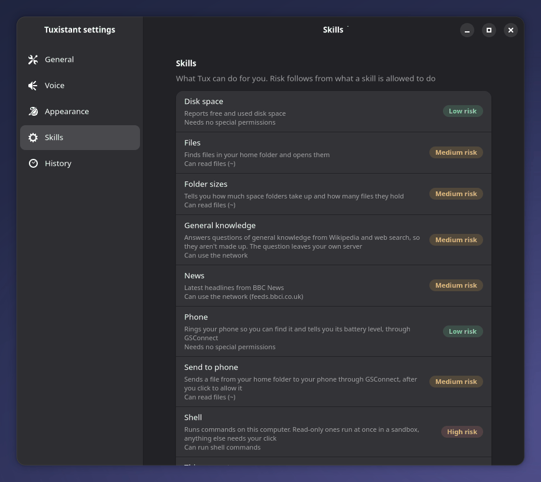
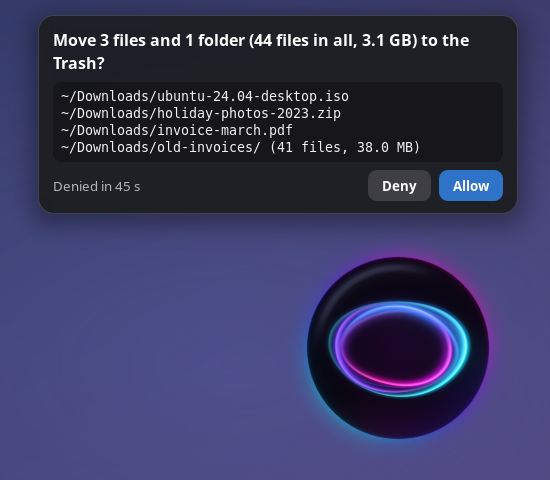
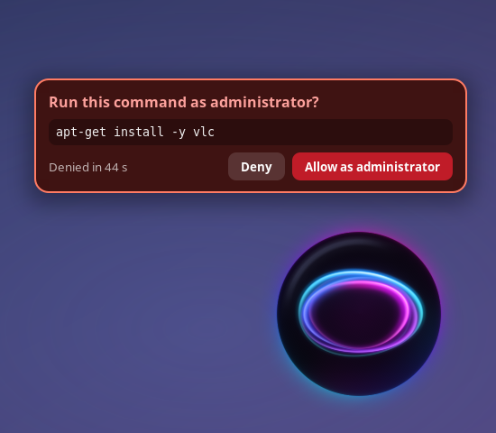

# Skills

A skill is something Tux can do for you, such as telling the time. It declares typed actions and the permissions it needs. The model sees the actions as tools and calls them during a conversation; the daemon runs them and hands the result back to be spoken.

## What exists today

Built-in skills, in `tuxistant/skills_builtin/`:

| Skill | Actions | Permissions | Risk |
|---|---|---|---|
| Time, Disk | `time.now`, `disk.usage` | none | low |
| This computer | `system.info`, `system.running` | `files_read` | medium |
| Folder sizes | `disk.folders` | `files_read` | medium |
| Weather, News | `weather.forecast`, `news.headlines` | `network` | medium |
| Files | `file.find`, `file.open` | `files_read` | medium |
| Trash | `file.trash` | `files_write` | high |
| Phone | `phone.ring`, `phone.battery` | none | low |
| Phone send | `phone.send` | `files_read` | medium |
| Media | `media.control`, `media.playing` | none | low |
| Apps | `app.open` | none | low |
| Timers and reminders | `timer.set`, `timer.list`, `timer.cancel` | none | low |
| Home Assistant | `home.set` | `home_control` | medium |
| Home Assistant status | `home.status` | `home_read` | medium |
| Calendar | `calendar.events` | `calendar_read` | medium |
| Add to calendar | `calendar.add` | `calendar_write` | medium |
| Mail | `mail.search` | `mail_read` | medium |
| Translate | `translate.text`, `translate.selection` | `network: [home]`, and `clipboard` for the selection | medium |
| General knowledge | `knowledge.answer` | `network` | medium |
| Web search | `web.search` | `network` | medium |
| Research | `research.run` | `network` | medium |
| Shell | `shell.run` | `shell` | high |
| Task | `task.run` | `shell` | high |

A skill with a `home` network permission only talks to the server this install already uses.

Calendar goes through Evolution Data Server, the service GNOME Calendar uses, so Google, CalDAV and Microsoft accounts are added once in GNOME's Online Accounts and Tuxistant holds no password or token for them. Reading needs no card, but it counts as reading something private, so afterwards nothing leaves your own server without a click. Adding always shows a card with the title, the full date, the times and the calendar. The model passes the day and time as you said them, and the dates are worked out in `tuxistant/calendars.py`, because a small model invents dates. An event's title is whatever the person who sent the invitation typed, so it is cut short and its control characters shown as escapes before the model sees it.

Mail answers a question from the search index Thunderbird keeps on this computer, so finding a mail needs no account, no password and no network, and the file is only ever opened read-only. Reading one uses the model on your own server, as everything does. It is off until you turn it on in Settings, and until then the model isn't offered the tool at all. Reading needs no card, but it counts as reading something private. A mail is a stranger's text, so none of it goes back to the voice model: the best matches are read one at a time by a model call with no tools, and the app says the answer itself, with who sent it and when added from the index. A sender is named by address or domain, never by the name beside it, which is whatever they typed. Junk, Trash and drafts are skipped. Sign-in codes and passwords are hidden from a mail before it is searched or read, so one can't be found or said, and a request for one is refused. Among mails holding as many of the question's words, one from an address that first wrote more than a week ago is read ahead of one from an address that didn't, and an answer from a first-time sender ends with a warning. [CONTRACT.md](CONTRACT.md) has the steps.

News declares every source Settings offers, and reads only the one you chose. The list is fixed in `tuxistant/livedata.py`, so a news request can't be pointed at a host that isn't written there, and a redirect to another host is refused. When a card has to ask before the news is fetched, it names the one host that will be reached.

Media pauses, resumes and skips whatever is playing, tells you what it is, and changes the volume, with no card, even after the conversation has read something private. It reaches players through MPRIS, which Spotify, VLC, Firefox, Chromium and most others speak, and the volume through PipeWire's `wpctl`. A player is only ever sent Play, Pause, PlayPause, Next, Previous or Stop with nothing attached, and the volume stops at 100 percent, so the most a confused model can do is pause or skip your music, or resume what was already there. It can't open a file or an address: MPRIS has a call for that, and it is left out on purpose. A title is whatever the web page or the file says, so media replies are read by the app itself and never returned to the model with tools. Titles are cut short and control characters shown as escapes. With several players it means the one that is playing, and asks which you mean if more than one is.

Apps opens an installed app or a page of GNOME Settings, with one tool. The list of apps is Gio's, the one GNOME itself uses, with hidden and NoDisplay entries left out. What you say is matched on this computer, not by the model: against the name shown, the untranslated name, the generic name such as "web browser" or "music player", and words inside the name. Only when none of those fits are the desktop id and the program name tried, and only as an exact match, as every Steam game's shortcut runs `steam` and every Chrome web app runs `google-chrome`. Then come the keywords and a close misheard spelling, the last only when what was said has five letters or more, not counting spaces or a plural "s", as "team" is one letter from "steam", and only when more than half the letters of each word said line up with the name, so "MS Teams" isn't Steam either. "GNOME Settings" and "GNOME Control Center" open Settings. "Browser", "internet" and "mail" mean your default apps, even when those are hidden entries. A Settings page's own name, such as "Bluetooth", wins over every app not named exactly that. Another word for a page, such as "zoom" for Accessibility, loses to an app with that word in its name or as its generic name, desktop id or program, unless you say "settings" or a word like it. When several apps match, Tux asks which one, and the same app installed twice, as a Flatpak and from the system, is asked as "Flatpak Firefox or system Firefox", even when the two names differ only in case, spaces or punctuation. A kind word said first or last picks among that kind only when no app is named exactly what was said, so "system monitor" is System Monitor wherever it came from, and "Flatpak The Room" works as the reply suggests. A Settings page is matched against everything said, kind word included, so "system details" is About even beside a system app called Device Details. Only a desktop file from that list is ever started, with `gio launch` in a systemd scope of its own, so the app outlives a daemon restart and isn't under the daemon's memory limit. Nothing the model writes reaches a command line, and no file, address or desktop action is passed. Settings pages come from a fixed table in `tuxistant/apps.py`, and open through GNOME Settings' own desktop file for each page. There is no closing, quitting or switching. An app installed as a package, from the system, Flatpak or Snap, and every Settings page open with no card, even after the conversation has read something private: the model only picks which entry from your own list, opening one sends nothing anywhere, and the worst a confused model can do is open a window you close with one click. A terminal is no exception, as Tux can't type into it. An entry that isn't from an installed package, such as a hand-made shortcut, a game launcher or a browser's "install as app" in your home folder, or a file in `/opt` or `/etc/xdg`, can run any command at all, and often does something as soon as it starts, so it shows a card. The card is made from the file's bytes as read once: the command it runs, a line when it may start over D-Bus instead, runs in a terminal or runs in another folder, and the file it comes from. It says "added in your home folder" only when the file really is there. An entry whose command holds a field code other than `%f`, `%F`, `%u`, `%U` and `%%` is left alone with no card, as `gio launch` fills some of them in with the entry's icon, name or file after the card is shown. If the file changes after the card is shown, it is left alone, and a file that can't be read is left alone with no card. App names are other people's text, as a browser's "install as app" names one after the web page, so every reply naming an app is said by the app and never returned to the model. [SECURITY.md](SECURITY.md#opening-apps) has the threat model.

Timers and reminders are kept in `timers.json` beside the history, with the same file mode, and said by the daemon itself when they come due, so they need no card: nothing outside Tuxistant changes. The model passes how long, the day and the time as you said them, and they are worked out in `tuxistant/timers.py`, as for the calendar. A duration makes a timer and a day or a time makes a reminder. A day with no time means 9 in the morning, and "afternoon", "evening" and "night" mean 3, 7 and 9. A bare "at 7" is the next time the clock shows 7, but never before 6 in the morning unless it is to wake you. A label is your own words by way of speech recognition and a model, so it is cut to 60 characters and its control characters shown as escapes wherever it is said or shown. Listing or cancelling hands times and labels from earlier conversations back to the model, so it counts as reading something private, although the manifest asks for no permission: the handler marks the conversation itself. When one comes due there is a notification and Tux says it once, waiting for a turn, a card or dictation to end first and never interrupting. On a locked screen nothing is said until you unlock. Whatever had to wait, for the unlock, a login or the daemon, is said late only within an hour for a timer or a day for a reminder; after that it is missed and only the notification remains. If the words fail before any is heard, as with the speech server down, it is tried again a minute, two minutes and four minutes later, and then missed. Items due after it are not held back by that wait. A lock that cuts the words before any is heard is not a failed try: they are said after the unlock. Once some was heard it counts as said. The `timer_chime` setting, off as installed, adds a short sound with no words, which is then the one thing heard on a locked screen. Only the daemon opens the real file: a test or an evaluation that attaches no store of its own gets "Timers aren't available right now."

Home Assistant is reached through its REST API with a long-lived access token from Settings. Until Settings holds both an address and a token, the model isn't offered the two tools at all, so on a computer with no Home Assistant its list is what it was without them. `SET_UP` in `tuxistant/skills.py` does that, and another skill can use it. The actions stay registered, and one named anyway answers with where to set it up. What you call something is matched against the names and areas Home Assistant has, on this computer, using the whole words in the first 255 characters of each, so a word after the 40 that are said still finds it. A device whose name has no break between words in those 255 characters is matched by the words of its entity id instead. Only typed values reach the server (an entity it listed itself, a service from a fixed table, a number in range, a colour from a fixed list), State values come back as numbers or recognised state words. Entity names also come back: they are cut to 40 characters, control characters shown as escapes, and angle brackets removed. So is a name made from an entity id when there is none, and an unknown kind of thing is cut to 20. Unlocking a lock, opening a cover, activating a scene and running a script show a card naming the entity and the server. A scene has one because it can unlock a door or open a garage and nothing here can see what is in it. So does switching a switch or a helper on, off or over when its name or its id has alarm, siren, lock, unlock, security, arm, armed, disarm or deadbolt in it, or garage, door or gate without light, lamp, bulb, heater or fan: a switch can be the relay on a garage door, and turning an alarm's helper off can disarm it. The name and the id are judged apart, so a switch.porch_light renamed "Garage door" still has a card, and joined spellings such as Doorlock, SmartLock, Frontdoor and Garageopener count, though a clock, a doorbell, a gateway and anything outdoor don't. Locking, closing, lights, other switches, fans, other helpers and temperatures don't. An alarm panel is only read, and a siren is neither read nor changed. So `home.set` declares `home_control`, which makes it medium risk in Settings and nothing more: it isn't `network`, as nothing the model wrote can leave through it. Both handlers mark the conversation private after reading the device list, including change results and errors that reveal names. `home.status` also declares `home_read`, and reading counts as reading something private, as "the front door is unlocked" and "nothing is on" say when a house is empty. They are two manifests because a permission belongs to a skill, not an action. The token goes to the server in Settings and nowhere else: no proxy, no redirect, and never over plain http to an address that isn't on a private network. `GetConfig` never returns it, and a changed address clears it, as a changed server clears the API key.

Code skills that come with Tuxistant, in `tuxistant/skills_code/`:

| Skill | Actions | Permissions | Risk |
|---|---|---|---|
| Lights | `lights.set`, `lights.status` | `network` | medium |

Lights controls Tapo bulbs such as the L530 on your own network. It is a code skill, so it runs in the sandbox below with the network and nothing else. It needs no card, the same as ringing your phone, unless the conversation has already read something private: then the rule under "What needs a click" applies, as it has the network. It finds the bulbs with a broadcast, then remembers them in `lights.json` in its own sandbox folder and asks them directly too, since a bulb saving power misses some broadcasts. It uses the TP-Link email and password from Settings, and until both are there the model isn't offered its two tools, through the same `SET_UP` as Home Assistant: without an account they could only fail, and they would take "the light" from Home Assistant. The password never leaves this computer: KLAP only sends proofs that it is known, and the bulb has to prove it knows it first. Only typed values reach a bulb (on or off, a number, a colour from a fixed list), so it can't carry anything private out. A bulb's name is whatever anyone typed into the Tapo app, so it is cut short and its control characters shown as escapes before the model sees it. Settings lists each skill with its permissions and risk:



A built-in skill is a YAML manifest whose actions have Python handlers in `HANDLERS` in `tuxistant/skills.py`. A code skill brings its own program and runs in a sandbox, like Lights. You can add your own code skills in `~/.local/share/tuxistant/skills/`, and they load while Tux is running. See "Code skills" below.

## Manifest format

A built-in skill is one YAML file. This is the shape of a skill that needs the network:

```yaml
id: org.example.tides
name: Tides
description: Tells you the tide times
version: 1.0.0
permissions:
  network: [api.example.com]
actions:
  tides.today:
    description: Get today's tide times for a place
    params:
      place: { type: string, description: "City name" }
    required: [place]
```

| Field | Meaning |
|---|---|
| `id` | Unique reverse-domain name |
| `name` | Shown in Settings |
| `description` | Shown in Settings |
| `version` | Version of the skill |
| `permissions` | What the skill may do, see below. Use `{}` for nothing |
| `actions` | The actions, by name |

Each action has:

| Field | Meaning |
|---|---|
| `description` | Tells the model when to use it, so write it for the model |
| `params` | JSON Schema properties for the arguments. Optional |
| `required` | Names of the arguments that must be present. Optional |

Action names look like `weather.today`. The model sees them with the dot replaced by an underscore, so two names must not differ only in that way.

A handler takes the arguments, the config and the session, and returns a dict that can be turned into JSON, or an `Ask` when it needs a click first. If it raises, the message goes to the model as `{"error": ...}`, so a failed action becomes something Tux can say rather than a crash. "Approvals" in [CONTRACT.md](CONTRACT.md) has the details.

## Permissions

| Permission | Grants | Risk |
|---|---|---|
| `shell` | Running commands | high |
| `files_write` | Changing files | high |
| `files_read` | Reading files | medium |
| `network` | Reaching the network | medium |
| `clipboard` | Using the clipboard | medium |
| `calendar_read` | Reading your calendars | medium |
| `calendar_write` | Adding to a calendar | medium |
| `mail_read` | Reading your mail | medium |
| `home_read` | Reading the state of your home | medium |
| `home_control` | Controlling devices through Home Assistant | medium |

Set a permission to `true` to ask for it. Names not in this table have no effect on risk.

The permissions set the risk, show up in Settings and drive the rule below. They don't confine a built-in handler, which runs inside the daemon. A code skill is confined: it gets the network only if it asks for it, and it may ask for nothing else.

## What needs a click

`Skills.execute` is the only way an action runs, whether the voice model or the planner asked for it.

- **Anything risky.** A handler returns an `Ask` instead of acting. The card shows what will really happen, written by Tuxistant from the real action, and only a click on it goes ahead. A spoken yes doesn't count, because audio playing nearby could say it. No answer in 45 seconds, a cancel or a locked screen all mean no.
- **An app that isn't from a package.** An app added in your home folder or elsewhere rather than installed as a package shows a card with the command it runs, as that command can be anything. Apps installed as packages and Settings pages open with no click.
- **Private data leaving.** Once a conversation has read files, command output, the selection, your calendar, your mail or the state of your home, any action that reaches past your own server needs a click, whichever skill asks. One skill can't read your files and another send them out.
- **What runs with no click.** Reading, such as `file.find`, and shell commands the parser can prove are read-only. Those run in a sandbox with a read-only filesystem, no network and your secrets hidden. A web search, research or a fact looked up in a conversation that hasn't read anything private is also this kind of action, and needs no click, unless the question has words that are often about your home. See "Facts" below.

Every action, every card and the answer to it are in the request history, including what the planner did.

| A normal card | A card for something that runs as root |
|---|---|
|  |  |

## The shell skill

`shell.run` is local and built in, and community skills will never be able to request it.

1. A strict parser reads the command. Anything it doesn't fully understand is not treated as read-only.
2. A command made only of known read-only programs runs in bubblewrap with no click. The parser judges intent and the sandbox is what holds if it is wrong. The sandbox has a read-only filesystem, no network, a seccomp filter and a memory limit, and it hides every dot-entry in the home folder except `.gitconfig`, along with files named like secrets elsewhere. Git runs with a repo's hooks, filters and helpers switched off.
3. Anything else shows the exact command on a card, and approval covers that command once.
4. Deleting previews first and uses the Trash where it can. Anything it can't move to the Trash says it can't be undone.
5. `sudo` alone on a line gets its own warning and runs through `pkexec`. Inside a longer command it is refused.

## Facts

A question of general knowledge is answered from Wikipedia, then web search, and never from the model's memory. If neither clearly says, Tux says it doesn't know. On a hold turn the daemon decides this itself, as the model can't be made to. "Facts" in [CONTRACT.md](CONTRACT.md) has how. A plain question of fact leaves your own server with no click, which is why `knowledge.yaml` declares `network: true`, and why "Look up facts on Wikipedia" in Settings turns it off. Two word filters in `tuxistant/knowledge.py` stand in front of it. A question about the music playing, timers or the home that the narrow one knows by its shape, such as "Is the front door locked?", is refused by the tool itself, so the voice model can't send it by picking the tool. One with a word the wide one holds, such as thermostat, timer or our, that the narrow one lets go, such as "Set the thermostat to 21" or "How old is our galaxy?", shows a card before the tool runs. `Skills.execute` asks for it, and daemon code writes it from the words that would be sent and where they would go. On a hold turn neither kind is sorted, so neither is looked up without the voice model picking the tool. A private question with none of those words, such as "Who's at the door?", can still go out with no click, if the sorter calls it a fact on a hold turn or the voice model picks the tool on any turn it answers.

## Web search and research

Searches go through SearXNG on your own server, set by `search_server`. Left empty, that is the host of the voice server on port 8888. The server is at home but the search isn't: your words go on to the search engines. So both skills declare `network: true`, not `home`, and once a conversation has read something private, a search needs a click like anything else leaving the house.

`web.search` returns at most four results, each a site, a title and a short snippet. `research.run` is ordinary code rather than a model deciding what to do next:

1. It searches, and takes the best result from each of up to five sites.
2. It opens them at once from this computer and keeps the first three that can be read. It never follows a link from a page.
3. The local model summarises each page, in a call that offers no tools.
4. The local model combines the summaries into two or three sentences, again with no tools.
5. Daemon code adds the sources, taken from the page addresses, and says so if a page failed, if there is only one source or if time ran out.
6. The app reads that out itself, as it does a translation. The voice model is told only that it's done, and isn't asked to speak after it. Given the text, it reworded it and dropped the sources and caveats almost every time, so a thin answer sounded certain. Given nothing and asked to speak, it sometimes made up an answer of its own just before the real one: a date, in 2 of 8 tries at "When did I apply to renew my passport?".

The whole thing stops at 45 seconds and answers with what it has. It always uses the local model, even with Cloud turned on. As the voice model never sees the answer, it can't take questions about it afterwards.

**Web text is untrusted.** All of it is cleaned and capped. Cleaning removes hidden characters and every angle bracket, as `<|im_start|>` would be a control token to the chat template and `<tool_call>` a real call to the server's parser. Search results reach the voice model under the key `untrusted_web_text`. Research never reaches it at all: only the summarising calls read pages, and they have no tools. So a hostile page can make Tux say something false out loud, such as a wrong phone number, but it can't act, and whatever the voice model does meets the same gates as always.

**Opening a page is guarded, as anyone on the web can choose the address.** `tuxistant/webfetch.py` takes http and https only, with no user name or password in the address. It looks up the name and refuses it unless every address it gets is on the open internet, which rules out loopback, private, link-local, multicast and reserved addresses, including ones wrapped in IPv6 and unusual spellings of numbers. It refuses the servers this install talks to, by name and by address. It connects to the address it checked rather than looking the name up again, and does all of this again for each of at most three redirects. A fetch stops after 8 seconds and 1 MB, reads only text and HTML, refuses compressed replies, and sends no cookies, no key and no referrer. It doesn't use a proxy.

## Multi-step requests

`task.run` handles requests that need several steps. It runs one step, reads the result and picks the next, with at most 8 steps, and every action goes through the same gates.

It uses the model on your own server unless you turn on Cloud in Settings, which is off by default and needs your Anthropic API key. With it on, Claude sees the request plus file names and command output from that task. File contents go only if you click to allow each one.

## Computed risk

`risk_of()` in `tuxistant/skills.py` works out the risk from the permissions:

- **high** if the skill asks for `shell` or `files_write`
- **medium** if it asks for `files_read`, `network`, `clipboard`, `calendar_read`, `calendar_write`, `mail_read`, `home_read` or `home_control`
- **low** otherwise

The risk is never read from the manifest. A `risk:` line is overwritten when the skill loads, so an author cannot label a dangerous skill as safe.

## Code skills

A code skill is a folder with a `skill.yaml` and a program. Tux runs the program as its own process in a sandbox and talks to it over MCP, one JSON message per line on stdin and stdout. Your own go in `~/.local/share/tuxistant/skills/`, one folder each:

```text
~/.local/share/tuxistant/skills/moon/
  skill.yaml
  main.py
```

```yaml
id: org.example.moon
name: Moon
description: Tells you the phase of the moon
version: 1.0.0
run: [python3, main.py]
permissions: { network: true }
timeout_s: 15
actions:
  moon.phase:
    description: Say what phase the moon is in tonight
    params:
      place: { type: string, description: "City name" }
```

The fields are the ones above, plus these:

| Field | Meaning |
|---|---|
| `run` | The command, as a list. It starts with `python3`, `node` or a file in the folder. Paths with `..` or starting with `/` are refused |
| `permissions` | Only `network`, set to `true`. A list of hosts counts as the whole network, as the sandbox can't tell hosts apart |
| `config` | Settings the skill is given. Only `tapo_email` and `tapo_password` exist, and only the Lights that come with Tuxistant may have them. A skill you add that lists one is refused. Never an API key |
| `timeout_s` | Seconds a call may take, from 1 to 60. 15 if left out |

`main.py` uses `skillkit`, which the sandbox provides:

```python
from skillkit import Skill

skill = Skill("org.example.moon")


@skill.action("moon.phase")
def phase(args: dict, config: dict) -> dict:
    if not args.get("place"):
        raise ValueError("Say which city.")     # Tux says this out loud
    return {"phase": "full"}


skill.run()
```

A handler returns a dict. If it raises, its message is spoken, so write a plain sentence. Print to stderr if you need to: stdout carries the protocol.

**What it can't do.** A skill you add can't ask for `shell`, `files_read`, `files_write` or `clipboard`. It can't use an id starting `org.tuxistant.`, or an action name another skill already has, so it can't stand in for a built-in action. Each of these refuses the skill with a reason, and the others still load.

Each action's description, and every text in its `params`, is at most 200 characters with nothing hidden in it, such as control or direction-changing characters. The model reads them all on every turn. A `<` or `>` in them, or in the skill's name, description or version, refuses the skill with a reason.

**The sandbox.** Bubblewrap, with shellgate's seccomp filter and memory limit. The skill sees `/usr`, a few files from `/etc`, a checked copy of its folder read-only at `/skill`, a folder of its own at `/state` for anything it keeps, and `/tmp`. On disk, `/state` is `~/.local/state/tuxistant/skills/<id>`, and `./uninstall.sh --purge` removes it. It sees no home folder, no session bus, no display and no runtime folder, and it has no network unless it asked. Each call still goes through `Skills.execute`, so once a conversation has read something private, a skill with the network needs a click.

**What the network permission reaches.** The skill shares this computer's network, so it can reach the internet and your local network, where Lights finds its bulbs. The card says so: "reach the internet and your local network". Services meant only for this computer listen there too, such as adb on 127.0.0.1 (which reaches your phone), CUPS and the display's sockets. Landlock keeps the skill away from them: it can't connect to an abstract socket from outside its sandbox, it can open TCP connections only to ports 53, 80 and 443, and it can't listen for TCP. This needs Linux 6.12 or newer; on an older kernel a skill with the network doesn't start. What still gets through: UDP to any port, and TCP to ports 53, 80 and 443, reach this computer's own services too, not only other computers.

**What it answers.** A result goes to the model and the history, so it is cleaned on the way: hidden characters show as escapes, angle brackets become spaces, an `error` is cut to 300 characters, and an answer longer than 3,900 characters, or nested more than 8 deep, becomes an error.

**What it was allowed stays what it is allowed.** The first version of a skill you add gets the permissions it asks for, and Tux keeps a note of them in `~/.local/share/tuxistant/skill-grants.json`. A later version that asks for more, such as the network, is not used: the last version that worked carries on, or the skill stays off, and the problem says why. To allow it, take the skill's folder out of the skills folder, wait for Tux to notice, and put the new one back. What the skill saved in `/state` is then cleared, so data an older version kept can't leave through a permission it never had. Skills that come with Tuxistant change with Tuxistant, so this doesn't apply to them.

**Not limited yet.** A skill can start as many processes as your account may, and use a whole CPU core while it runs. Its process stops 5 minutes after its last call, or 15 for the skills that come with Tuxistant.

**Live reload.** Tux watches the skill folders. Add, change or remove a skill and the next request uses the new version, with no restart. A changed file restarts only that skill's process: calls already running finish first, and a request that started before the change is told to ask again. If the new version is broken, the last one that worked stays in use. That version runs from a copy Tux made when it was checked, in `~/.local/share/tuxistant/skill-code/`, so a restart after an idle stop or a crash runs the checked code, not what is in the folder now. Editor swap files, byte code and hidden folders such as `.git` are not part of a skill's code: changing them restarts nothing, and they aren't copied. `tuxistant skills reload` loads them again now and prints any problems, and `tuxistant doctor` lists them too.

**What still needs a restart.** Built-in skills are Python inside the daemon. Their YAML reloads live, but a change to their code, or a new built-in action, needs `systemctl --user restart tuxistant`. A change to `skillkit.py` reaches a skill the next time its process starts. Only a skill's top folder is watched, so a change deeper down, such as `lib/x.py`, is picked up at the next change to its top folder or a `tuxistant skills reload`.

## Planned

None of this exists yet.

- **Recipe skills.** Declarative steps with no code of their own. These are the ones meant to be shared, because what they do can be read from the manifest.
- **Network by host.** A code skill that names hosts gets the whole network today. Holding it to those hosts needs a proxy in front of the sandbox.
- **Process and CPU limits.** A cgroup for each skill, with a limit on its tasks and its CPU time.
- **Approving on a card.** A skill that asks for more than it had should show a card, rather than need taking out and putting back.
- **Sharing.** Code skills stay local to the machine. They are not for sharing.
